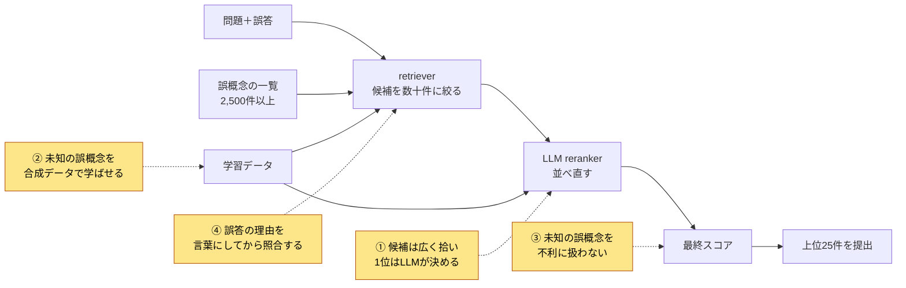
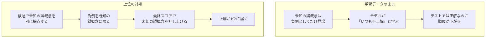

# Eedi - Mining Misconceptions in Mathematics 上位解法まとめ — 学習データにない誤概念を、1位に置けるか

## はじめに

[Eedi - Mining Misconceptions in Mathematics](https://www.kaggle.com/competitions/eedi-mining-misconceptions-in-mathematics) は、算数・数学の4択問題で生徒が選んだ誤答から、その誤答を生んだ「誤概念（misconception）」を2,500件以上の候補の中から当てるコンペでした。2024年12月12日23:59（UTC）に終了しました。

上位チームのモデル構成はさまざまでしたが、勝負を分けた点は共通していました。結論を先に書きます。

> **テストで問われる誤概念の多くは、学習データに正解として一度も出てこないものだった。上位チームは、候補を広く拾ってLLMに順位を決めさせる骨格の上で、その誤概念の合成問題を作って学習に加え、学習でも最終スコアでも「出てこないから不正解」と扱わないようにした。**

本記事はこれを4つの勝負所に分けて、代表的なチームの例で説明します。

対象は最終順位1〜12位です。Kaggle CLIで取得できたDiscussionから、12チームすべての本人によるSolution投稿（計14本）を読みました。投稿が見つからなかった順位はありません。

## コンペ概要

### タスク

- **入力**: 4択問題1問（問題文、正答、Construct名、Subject名）と、そのうち1つの誤答。Constructは問われる最も細かい技能、Subjectはより広い単元です。
- **出力**: その誤答を説明する誤概念のIDを、可能性の高い順に最大25個。候補は誤概念の一覧表（`misconception_mapping.csv`）から選びます。
- **評価**: MAP@25（Mean Average Precision @ 25）。

この指標とデータには、直感に反する性質が3つあります。

1. **25個出せても、実質的に効くのは上位数個だけ。** 正解の誤概念は1つだけなので、MAP@25は「正解を置いた順位の逆数」の平均になります。1位なら1点、2位なら0.5点、5位なら0.2点です。正解を1位に上げることが、ほぼすべてです。
2. **テストの多数派は、学習データに一度も出てこない誤概念。** 一覧表のうち900件以上は、学習データに一度も登場しません。3位は、各誤答に1個だけ予測する提出を、既知の誤概念だけ・未知の誤概念だけに限って出し、LB（リーダーボード）のスコアを比べました。既知だけでは0.154、未知だけでは0.444で、未知の方がはるかに大きな得点源でした（[3位](https://www.kaggle.com/competitions/eedi-mining-misconceptions-in-mathematics/discussion/551498)）。
3. **問題単位で分けた検証は、楽観的になりすぎる。** QuestionId（問題単位）で分けると、検証用のfold（交差検証で手元評価に回す分割）に未知の誤概念が少ししか入りません。6位の例では、既知80%・未知20%のfoldで既知のスコアが0.65、未知が0.3なら、全体は 0.65×0.8 + 0.3×0.2 = 0.58 です。未知が多数派のテストとは比率が逆なので、未知への弱さが平均に埋もれます（[6位](https://www.kaggle.com/competitions/eedi-mining-misconceptions-in-mathematics/discussion/551565)）。

### 提供データ

| データ | 内容 |
| --- | --- |
| `train.csv` | 4択問題と、各誤答に付けられた誤概念ID。1位は学習データを約1.8k件と記述 |
| `misconception_mapping.csv` | 誤概念IDと短い英文の説明。2,500件以上 |
| 隠しテスト | 約1,000問。各問題の3つの誤答それぞれに25個まで予測する |
| 実行環境 | インターネットなしのNotebookで9時間以内。公開済みの外部データと学習済みモデルは使用可 |

### このコンペが難しい理由

- 誤概念の説明文は短く、よく似たものが多い（「左から計算する」と「括弧がない限り左から計算する」は別の誤概念）。
- 問題文と誤概念の文面は似ておらず、誤答に至る推論をたどらないと結び付かない。
- 70B級のLLMを9時間・オフラインで動かすには、量子化と推論の高速化が必要。

### 用語

| 用語 | 意味 |
| --- | --- |
| retriever | 問題と誤概念をそれぞれベクトルにし、近い誤概念を高速に探すモデル |
| reranker | retrieverが絞った候補をLLMに読ませ、正解らしい順に並べ直すモデル |
| recall@K | 上位K件の中に正解が入っている割合 |
| 正例・負例 | 学習時に「正解」として見せる組と、「不正解」として見せる組 |
| 既知・未知の誤概念 | 学習データに正解として登場するもの・しないもの |
| CoT | Chain of Thought。答えに至る推論の過程を文章にしたもの |
| LoRA | 大きなモデルの一部だけに小さな追加の重みを学習させる、軽量な微調整の方法 |
| Public / Private LB | テストの一部で期間中に見える順位表と、残りで最終順位を決める順位表 |
| CV | 学習データを分割して手元で測る検証スコア |
| 量子化・蒸留 | 重みを4bitなどに縮めて大きなモデルを載せること・強いモデルの出力を小さいモデルに学ばせること |

## 上位解法の全体像

全チームが「retrieverで候補を数十件に絞る → LLMのrerankerで並べ直す → 上位25件を提出する」という骨格を使いました。差がついたのは、下図で色をつけた4か所です。

## 1. 候補は広く拾い、1位はLLMに決めさせる

**問題**: 2,500件以上の誤概念をすべてLLMに読ませる時間はありません。一方、軽いretrieverの順位をそのまま出すと、似た誤概念を区別しきれません。

**上位の対処**: 役割を分けました。retrieverは「正解を候補に入れること」だけを目標にし、順位はrerankerが決めます。

- **1位**は、retrieverをMAP@25ではなくrecall@32で選びました。2つの指標はしばしば逆に動いたため、MAP@25が最も高いモデルではなく、recallが高いQwen2.5-14Bを採用しています（[1位](https://www.kaggle.com/competitions/eedi-mining-misconceptions-in-mathematics/discussion/551688)）。
- **5位**のretrieverは単体でLB 0.39と弱いものでした。それでも上位104件をQwen2.5-32Bに読ませたので、正解を取りこぼしにくかったと著者は説明しています（[5位](https://www.kaggle.com/competitions/eedi-mining-misconceptions-in-mathematics/discussion/551391)）。
- rerankerの効果は大きく、**9位**ではPrivateが0.491から0.571に上がりました（[9位](https://www.kaggle.com/competitions/eedi-mining-misconceptions-in-mathematics/discussion/551420)）。

rerankerの形は、大きく2通りに分かれました。

| 方式 | LLMにさせること | 代表例 |
| --- | --- | --- |
| pointwise | 候補を1件ずつ見せ、「この誤概念で誤答を説明できるか」をYes/Noで答えさせる。Yesの強さで並べる | 1位の14B・32B、8位、9位 |
| listwise | 候補にA, B, C…と記号を付けてまとめて見せ、正解の記号1文字を答えさせる。記号ごとの確率で並べる | 1位の72B、2位、3位、5位、7位 |

1位は両方を組み合わせました。14B（retrieverが残した32〜64件を8件に）→32B（5件に）→72Bのlistwise（最終順位）と、上位ほど重いモデルに任せます。32Bを足してPrivateが+0.010、72Bでさらに+0.013でした（[1位](https://www.kaggle.com/competitions/eedi-mining-misconceptions-in-mathematics/discussion/551688)）。

**なぜ効くか**: MAP@25は上位数件でほぼ決まるので、計算資源を上位に集中するほど得点に直結します。retrieverの役目は候補に正解を残すことなので、recallで評価するのが筋です。

## 2. 未知の誤概念を、合成データで「見たことのあるもの」にする

**問題**: 学習データに出てこない誤概念は、retrieverもrerankerも正例として見たことがありません。テストではそれらが多数派なので、学習データだけで学ぶと、正解を候補に入れることすら難しくなります。

**上位の対処**: LLMに、誤概念ごとに新しい4択問題を書かせました。12チームすべてが、自前の合成データか公開の外部データを学習に使っています。

- **8位**では、合成データを足すだけで、単体retrieverのPublic LBが0.3台から0.49に上がりました。同チームの改善の中で最大です（[8位](https://www.kaggle.com/competitions/eedi-mining-misconceptions-in-mathematics/discussion/551412)）。
- **1位**では、合成問題（後述の疑似ラベル付き）を14B rerankerの学習に加え、Privateが0.531から0.575に上がりました。1位が報告した改善の中で最大です（[1位](https://www.kaggle.com/competitions/eedi-mining-misconceptions-in-mathematics/discussion/551688)）。

### 作り方：似た誤概念と本物の問題を一緒に見せる

1位は最初、誤概念を1件だけ渡す単純なプロンプトで問題を作り、求める性質のほとんどを満たせませんでした。生成するLLMが、紛らわしい隣の誤概念を知らないからです。

そこで、よく取り違えられる誤概念を束ねたグループと、その実例の問題4〜5問を一緒にClaude 3.5 Sonnetへ渡しました。

さらにGPT-4oに「誤概念から誤答への筋道が通っているか」を0〜10点で採点させ、低品質な問題を捨てています（[1位](https://www.kaggle.com/competitions/eedi-mining-misconceptions-in-mathematics/discussion/551688)）。

- **5位**は、生成時の例題に「似た誤概念の問題」を選ぶと、ランダムに選ぶより+0.011〜0.014良くなったと答えています（[5位](https://www.kaggle.com/competitions/eedi-mining-misconceptions-in-mathematics/discussion/551391)）。
- **2位**は、gpt-4o-miniで品質を採点して良い問題だけを残すことを「鍵」と書いています（[2位](https://www.kaggle.com/competitions/eedi-mining-misconceptions-in-mathematics/discussion/551651)）。

### 使い方：rerankerには、ラベルの雑音に注意して入れる

合成データのラベルには、審査後も雑音が残ります。1位は、実データだけで学習した72Bモデル2つでラベルを付け直して（疑似ラベル）から、小さいrerankerに学ばせました。6位は合成データをretrieverにだけ使い、rerankerに入れると効きませんでした（[6位](https://www.kaggle.com/competitions/eedi-mining-misconceptions-in-mathematics/discussion/551565)）。

## 3. 未知の誤概念を「いつも不正解」として教えない

この節が本記事の中心です。

**問題**: 学習時の負例（不正解として見せる誤概念）を一覧表全体から選ぶと、未知の誤概念は「正例として一度も出てこず、負例としてだけ出てくる」存在になります。モデルは「これらはいつも外れ」と覚え、テストで多数派の正解を自ら押し下げてしまうと考えられます。

### 検証で、未知の誤概念を見えるようにする

まず、未知の誤概念に弱いことを検証で見えるようにしました。

- **1位**は、QuestionId（問題単位）で分けると楽観的すぎ、SubjectId（単元単位）では悲観的すぎることを確かめました。ConstructId（技能単位）で分けると、検証とLBの差が小さくなりました（[1位](https://www.kaggle.com/competitions/eedi-mining-misconceptions-in-mathematics/discussion/551688)）。
- **6位**は、既知と未知の誤概念に同じ重みを付けて採点しました。**4位**は、未知の誤概念だけのスコアも別に見ています（[4位](https://www.kaggle.com/competitions/eedi-mining-misconceptions-in-mathematics/discussion/551559)）。

### 負例から、未知の誤概念を外す

3チームが独立に、同じ工夫にたどり着いています。

- **4位**は、rerankerの負例を「学習データで正例として出てくる誤概念」に限りました。単体のrerankerで、PublicとPrivateがどちらも約0.025上がりました（[4位](https://www.kaggle.com/competitions/eedi-mining-misconceptions-in-mathematics/discussion/551559)）。
- **7位**は、retrieverの負例から未知の誤概念を外しました。CVは変わりませんでしたが、LBは大きく改善しました（[7位 Masaya](https://www.kaggle.com/competitions/eedi-mining-misconceptions-in-mathematics/discussion/551430)）。
- **6位**は、rerankerの学習から「test misconceptions」（学習データに正解として出てこない、テスト側の誤概念と読み取れます）をすべて除外したことが、Public 0.6到達後でおそらく最大の改善（約0.61→0.63）だったと書いています（[6位](https://www.kaggle.com/competitions/eedi-mining-misconceptions-in-mathematics/discussion/551565)）。

7位でCVが動かずLBだけが上がったように、この効果は学習データの範囲では見えません。

### 最後に、テストの比率に合わせてスコアを補正する

- **3位**は、性質2で紹介したLBの調査から、テストの既知・未知の比率を約1:3と推定しました。そこで未知の誤概念のスコアに定数を掛け、1位予測の75%が未知になるまで調整しました。Privateは0.564から0.600に上がりました（[3位](https://www.kaggle.com/competitions/eedi-mining-misconceptions-in-mathematics/discussion/551498)）。
- **4位**は、既知の誤概念のスコアを0.40倍しました（[4位](https://www.kaggle.com/competitions/eedi-mining-misconceptions-in-mathematics/discussion/551559)）。
- **7位**も、未知の誤概念の順位を押し上げる後処理を入れました（[7位](https://www.kaggle.com/competitions/eedi-mining-misconceptions-in-mathematics/discussion/551388)）。

**なぜ効くか**: 学習データとテストで誤概念の出現比率が大きく違うため、モデルに残る「既知寄り」の癖を最後の掛け算で打ち消せます。6位によれば、主催者はPublicとPrivateで既知・未知の比率をそろえており、Publicで決めた補正がPrivateでも通用しやすい条件でした（[6位](https://www.kaggle.com/competitions/eedi-mining-misconceptions-in-mathematics/discussion/551565)）。

## 4. 誤答の理由を言葉にしてから照合する

**問題**: 公式の例では、誤答「13」が「優先順位を無視して左から計算する」という誤概念に対応します。この2つを結ぶには、生徒の計算をたどる必要があります。1位も、LLMは数学を解くのは得意でも、「どう間違えたか」を逆向きにたどる推論は苦手だと指摘しています。

**上位の対処**: LLMに「なぜこの誤答になったか」を短く書かせ（CoT）、問題と一緒にretrieverやrerankerへ入力しました。

- **1位**は、Claude 3.5 Sonnetに誤答の理由を書かせ、そのデータでQwenを学習させました（蒸留）。推論時はQwenが理由を書きます。14B rerankerのPrivateは0.596から0.615に上がりました。学習データの半分だけに理由を付け、理由があってもなくても判断できるようにしています（[1位](https://www.kaggle.com/competitions/eedi-mining-misconceptions-in-mathematics/discussion/551688)）。
- **5位**は、Qwen2.5-32Bが推定した理由を入れると、retrieverのCVが+0.04、rerankerのCVが約+0.01改善しました（[5位](https://www.kaggle.com/competitions/eedi-mining-misconceptions-in-mathematics/discussion/551391)）。

**2位**は逆に、すべての誤概念にLLMで説明文を付け、retrieverが約2〜4%改善しました。一覧は事前に処理できるので、提出時のコストは増えません。問題側に理由を付けると、14B・32Bのretrieverでは推論時間が2倍になりました（[2位](https://www.kaggle.com/competitions/eedi-mining-misconceptions-in-mathematics/discussion/551651)）。

**なぜ効くか**: 「誤答 → 理由 → 誤概念」と2段に分けると、後半の照合は文面の近さで判断しやすくなると考えられます。難しい逆向きの推論を、強いLLMが事前に肩代わりしている形です。

### 補足：そのほかに効いた工夫

| 工夫 | なぜ効くか | 代表例 |
| --- | --- | --- |
| 候補の並び順を入れ替えて平均する | LLMは、提示された候補の順序をそのまま保ちがち | 6位: 上位2件の順序を入れ替えて2回推論し、平均して並べ直した（[6位](https://www.kaggle.com/competitions/eedi-mining-misconceptions-in-mathematics/discussion/551565)） |
| 70B級のrerankerを量子化して載せる | 大きいモデルほど、似た誤概念を区別できる | 2位: Publicでは見劣りしたが、検証を信じてQwen2.5-72Bを採用。Privateは0.593（14Bでは0.568）（[2位](https://www.kaggle.com/competitions/eedi-mining-misconceptions-in-mathematics/discussion/551651)） |
| rerankerの入力に、候補の誤概念の実例を入れる | 説明文だけより、実際の問題を見た方が判断しやすい | 1位: 1〜2件の例題を入れ、14BのPrivateが+0.036（[1位](https://www.kaggle.com/competitions/eedi-mining-misconceptions-in-mathematics/discussion/551688)） |
| 正例1件あたりの負例を増やす | 似た誤概念との違いを多く学べる | 11位: 別GPUの負例も共有してPublic 0.567→0.574（[11位](https://www.kaggle.com/competitions/eedi-mining-misconceptions-in-mathematics/discussion/551424)） |
| fold別のLoRAを1つに統合する | 推論時間を増やさずに、複数foldの学習結果をまとめられる | 8位: 重みを部分的に元へ戻すWise-FTで統合し、Public 0.57→0.59（[8位](https://www.kaggle.com/competitions/eedi-mining-misconceptions-in-mathematics/discussion/551412)） |

## 上位解法から見えた、特に重要な発見

### 1. 難しさの本体は、分類の細かさより分布のずれ

似た誤概念の区別以上に、「学習で正解として見たことのない誤概念が、テストでは多数派」というずれが効きました。勝負所2・3は、どちらもこのずれへの対処です。

### 2. 学習データに「ない」ことも、モデルへの教えになる

負例の選び方しだいで、モデルは「このラベルは出ない」と学んでしまいます。勝負所3は、モデルを強くするのではなく、学習データの偏りを持ち込まない工夫でした。

### 3. 検索と並べ替えを分けると、それぞれの目標がはっきりする

retrieverは取りこぼさないこと、rerankerは1位を当てることに専念できます。retriever単体が弱くても上位に入れたのは、この分業のおかげです。

### 4. 強いLLMの知識は、データと文章の形で持ち込める

テスト時に使えない強いLLMの力を、上位は合成問題や推論の文章として学習時に取り込み、手元のQwenに引き継ぎました。

## うまくいかなかったアプローチ

- **hard negative mining（間違えやすい負例を集めて学習する）**: 1位ではrecall@32が上がらず、5位でも効かなかった。ただし8位は有効と報告している（[1位](https://www.kaggle.com/competitions/eedi-mining-misconceptions-in-mathematics/discussion/551688)）。
- **推論特化のQwQ-32B-Previewに置き換える**: 1位では悪化し、7位でも効かなかった（[7位](https://www.kaggle.com/competitions/eedi-mining-misconceptions-in-mathematics/discussion/551388)）。
- **rerankerをさらに大きくする**: 6位ではQwen 72Bでも32Bと同じ結果だった（[6位](https://www.kaggle.com/competitions/eedi-mining-misconceptions-in-mathematics/discussion/551565)）。
- **誤概念あたりの合成問題を増やす**: 5位ではCVが悪化して提出しなかったが、著者は後にLBでは良くなった可能性があると振り返っている（[5位](https://www.kaggle.com/competitions/eedi-mining-misconceptions-in-mathematics/discussion/551391)）。
- **72Bの知識を小さいモデルへ蒸留する**: 10位では手元の検証で改善が見えず提出しなかった。検証データが少なく判断を誤った可能性もあると著者は書いている（[10位](https://www.kaggle.com/competitions/eedi-mining-misconceptions-in-mathematics/discussion/551722)）。
- **rerankerの出力を、さらにGBDTで並べ直す**: 12位のLightGBM/CatBoostは効かなかった（[12位](https://www.kaggle.com/competitions/eedi-mining-misconceptions-in-mathematics/discussion/551429)）。

多くは、小さく偏った学習データの上の検証だけでは、未知の誤概念への効き目を正しく測れなかった例です。

## まとめ

上位解法の流れを6行にまとめると、次のとおりです。

1. 検証用のfoldに未知の誤概念を入れ、既知と未知を分けて採点する。
2. 未知の誤概念ごとに、似た誤概念と実例を見せてLLMに問題を作らせ、採点して良いものだけ残す。
3. LLMに誤答の理由を書かせ、問題と一緒に入力する。
4. retrieverはrecallで選び、候補を数十〜百件まで広げる。
5. 量子化した32B〜72Bのrerankerで並べ直す。負例には既知の誤概念だけを使う。
6. テストの既知・未知の比率に合わせて、最終スコアを補正する。

> **学習データに出てこないラベルが評価の主役になるときは、そのラベルを合成データで「見たことのあるもの」にし、負例の中で「負けたことしかないもの」にしない。**

この考え方は、新しい疾患コードの付与、新商品の推薦、新規カテゴリへの文書分類など、ラベルの一覧は決まっていても学習例のないラベルが多いタスクに使えます。ラベルごとに説明文があり、テストでの新規ラベルの割合をある程度見積もれることが、応用の条件です。

## 参照した上位Solution

各チームの要点を一言でまとめています。詳しく知りたいチームは、リンク先の投稿を参照してください。

| 順位 | チーム | 一言で言うと | 投稿 |
| --- | --- | --- | --- |
| 1位 | MTH 101 | 合成データ・理由の蒸留と、14B→32B→72Bの段階的rerank | [1st Place Solution Summary](https://www.kaggle.com/competitions/eedi-mining-misconceptions-in-mathematics/discussion/551402)、[1st Place Detailed Solution](https://www.kaggle.com/competitions/eedi-mining-misconceptions-in-mathematics/discussion/551688) |
| 2位 | CQYR | 誤概念の説明文と、72B・70Bによる区間ごとのlistwise rerank | [2nd place solution](https://www.kaggle.com/competitions/eedi-mining-misconceptions-in-mathematics/discussion/551651) |
| 3位 | Waseda Pochi | LBで未知の比率を推定し、未知の誤概念のスコアを増幅 | [3rd Place Solution (with Magic Boost)](https://www.kaggle.com/competitions/eedi-mining-misconceptions-in-mathematics/discussion/551498) |
| 4位 | takoi & charmq & kami | 未知の誤概念に合わせた合成・検索枠・負例・後処理 | [4th Place Solution](https://www.kaggle.com/competitions/eedi-mining-misconceptions-in-mathematics/discussion/551559) |
| 5位 | Ebi & ktr | 52文字の選択肢で104候補をまとめて並べ直す | [5th Place Solution](https://www.kaggle.com/competitions/eedi-mining-misconceptions-in-mathematics/discussion/551391) |
| 6位 | Nikita Babich | 既知・未知を同じ重みで見る検証と、並び順の癖への対策 | [6th Place Solution](https://www.kaggle.com/competitions/eedi-mining-misconceptions-in-mathematics/discussion/551565) |
| 7位 | terekaerumasahmet | 性質の違う3つの32B rerankerによる投票 | [Private 7th Place Solution Summary](https://www.kaggle.com/competitions/eedi-mining-misconceptions-in-mathematics/discussion/551388)、[Masaya Part](https://www.kaggle.com/competitions/eedi-mining-misconceptions-in-mathematics/discussion/551430) |
| 8位 | Yannan Chen | 合成データと単一の32B rerankerで、約6時間の軽い構成 | [8th Place Solution](https://www.kaggle.com/competitions/eedi-mining-misconceptions-in-mathematics/discussion/551412) |
| 9位 | Study Hard | retrieverで選別した合成データと、32BのYes/No reranker | [Private 9th Place Solution](https://www.kaggle.com/competitions/eedi-mining-misconceptions-in-mathematics/discussion/551420) |
| 10位 | sayoulala | 7kの外部データで事前学習したretrieverと、fold別LoRAの統合 | [10st Place Solution Summary](https://www.kaggle.com/competitions/eedi-mining-misconceptions-in-mathematics/discussion/551722) |
| 11位 | H&Y&L | 外部データ2種→学習データの順に段階的に学習 | [Private 11th Place Solution Summary](https://www.kaggle.com/competitions/eedi-mining-misconceptions-in-mathematics/discussion/551424) |
| 12位 | chizhu | 推論つきで作った合成データと、ランダムな25択のrerank | [12th Place Solution](https://www.kaggle.com/competitions/eedi-mining-misconceptions-in-mathematics/discussion/551429) |

未解決の順位はありません。
