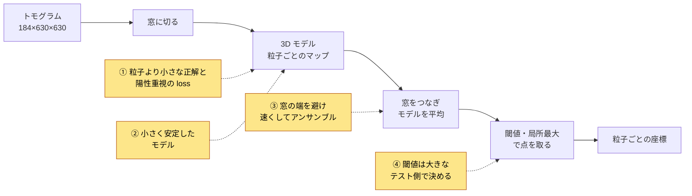
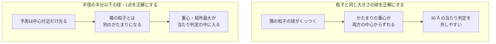

# CZII - CryoET Object Identification 上位解法まとめ — 粒子より小さな正解で中心を教え、閾値は大きなテストで決める

## はじめに

[CZII - CryoET Object Identification](https://www.kaggle.com/competitions/czii-cryo-et-object-identification) は、細胞の3D画像からタンパク質複合体（以下、粒子）の中心座標を見つけるコンペでした。2025年2月5日23:59（UTC）に終了しました。

上位のモデルは、3D U-Net、2D backboneを使う2.5D U-Net、点検出モデルとばらばらでしたが、決め手は共通していました。結論を先に書きます。

> **この指標では、粒子の中心から半径の半分以内に1点を置けば当たりで、見逃しは誤検出よりはるかに重く罰されます。上位チームは、粒子より小さな球を正解ラベルにし、粒子のボクセルを重く扱うlossで「中心を見逃さない」ことだけを教えました。そのうえで、小さく安定したモデルを使い、推論では窓の端の不安定な予測を減らし、高速化で浮いた時間をアンサンブルに回しました。閾値は、7本の学習データでのCVではなく、大きなテスト側のスコアで決めました。**

本記事では、これを4つの勝負所に分けて、代表的なチームの例で説明します。

対象は最終順位1〜11位で、Kaggle CLIで取得できたDiscussionから11チーム・12本のSolution投稿を読みました（1位は2本）。全順位で本人によるSolution投稿が見つかりました。

## コンペ概要

### タスク

- **入力**: クライオ電子線トモグラフィー（cryoET）で撮った細胞の3D画像（トモグラム）。1本は184×630×630ボクセルで、1ボクセルは10 Å（オングストローム）です。
- **出力**: 5種類の粒子それぞれについて、中心の3D座標 `x, y, z` のリスト。
- **評価**: β=4のF-beta（F4）。予測点が正解の中心から「粒子半径×0.5」以内にあれば当たりです。難しい2種類（thyroglobulin、β-galactosidase）は重み2、残り3種類は重み1で、全トモグラムをまとめて集計します。

この指標には、直感に反する性質が3つあります。

1. **見逃しは、誤検出よりはるかに重い。** F4は、再現率（recall、正解のうち見つけた割合）を適合率（precision、予測のうち正しかった割合）よりβ²=16倍重視する式です。計算例を示すと、適合率0.5・再現率0.9ならF4は約0.86ですが、適合率0.9・再現率0.5だと約0.51まで落ちます。迷ったら出す方が得です。
2. **当たり判定は、粒子の大きさよりずっと小さい。** apo-ferritinは半径60 Åなので、当たりになるのは中心から30 Å、つまりボクセル3個分以内です。粒子の輪郭を正確に塗れても、中心がずれれば点になりません。
3. **採点しない粒子も、学習には役立つ。** beta-amylaseは重み0ですが、似た形のβ-galactosidaseと見分けるため、学習ではクラスとして残す方が役立ちました（[1位・セグメンテーション担当](https://www.kaggle.com/competitions/czii-cryo-et-object-identification/discussion/561510)）。

### 提供データ

| データ | 内容 |
| --- | --- |
| 学習用トモグラム | 7本。各粒子の中心座標が付いている |
| 再構成方法の違い | 学習データには denoised、wbp、ctfdeconvolved、isonetcorrected の4種類がある。テストは denoised のみ |
| 対象の粒子 | 採点される5種類と、採点されないbeta-amylase |
| 隠しテスト | 約500本。一部がコンペ中に見えるPublic LB、残りが最終順位を決めるPrivate LBの採点に使われる。インターネットなしのNotebookで12時間以内に推論する |
| 外部データ | 主催者が公開したシミュレーションのトモグラムなど、公開データの利用が認められている |

### このコンペが難しい理由

- 学習用のトモグラムが7本しかなく、foldを切ると検証は1〜2本になる。
- 粒子は小さく、画像はノイズが強い。隣の粒子と予測がくっつきやすい。
- 500本を12時間で処理するには、1本あたり約1分30秒しか使えない。
- F4は閾値に敏感で、7本のCVでは最適な閾値が安定しない。

### 用語

| 用語 | 意味 |
| --- | --- |
| U-Net | 画像を縮めて特徴を取り、元の解像度に戻して画素ごとに予測するネットワーク |
| 2.5D U-Net | 2D画像用のbackboneで各スライスを処理し、深さ方向をまとめる U-Net |
| ヒートマップ | 粒子の中心付近ほど値が高くなる3Dの予測マップ |
| 連結成分（CC3D） | 閾値を超えたボクセルのかたまり。重心を粒子の位置とする |
| logit | sigmoidやsoftmaxにかける前のモデル出力 |
| 陽性 | 正解ラベルで粒子に属するボクセル。それ以外は背景（陰性） |
| fold / CV | 学習データを分けて検証する単位と、その交差検証のスコア。ここではトモグラム1〜2本が1 foldの検証になる |
| TensorRT | NVIDIA GPU向けにモデルを最適化して推論を速くするツール |
| model soup | 同じ初期値から学習した複数モデルの重みを平均して、1つのモデルにする手法 |
| TTA | 推論時に画像を反転・回転して予測し、平均する手法 |
| OOF | 各foldの検証用データに対する予測をまとめたもの |

## 上位解法の全体像

ほぼすべてのチームが、「トモグラムを小さな窓に切る → 3Dモデルで粒子ごとのマップを出す → 窓をつなぎ、モデルを平均する → 閾値を超えたかたまりや局所最大から点を取る」という骨格を使いました。差がついたのは、下図で色をつけた4か所です。

## 1. 正解を粒子より小さくし、見逃しを重く罰する

この節が本記事の中心です。

**問題**: 粒子と同じ大きさの球を正解として塗ると、モデルは輪郭を描くことにも力を使います。隣り合う粒子の予測はくっつきやすく（10位・11位も、くっついたかたまりへの対処を工夫しています）、1つのかたまりの重心は両方の中心からずれて、30 Åの当たり判定を外しやすくなります。さらに、陽性のボクセルは全体のごく一部なので、普通のlossでは「全部背景」と答えるのが楽になります。

**上位の対処**: 正解を当たり判定の大きさまで縮め、陽性のボクセルを重く扱いました。

- **9位**は、正解の球の半径を小さい粒子で1/2、大きい粒子で1/3にしました。これだけでPublic LBが0.02〜0.04跳ね上がりました。上位で報告された単一の変更の中でも最大級の改善です。根拠として「当たり判定が半径×0.5なので、0.5以下に縮めるのは理にかなう」と書いています（[9位](https://www.kaggle.com/competitions/czii-cryo-et-object-identification/discussion/561431)）。
- **1位**のセグメンテーション側は、正解を中心の1ボクセルだけにしました。陽性の重みを256、背景を1にした重みつきクロスエントロピーで学習し、「lossの設計が最も重要だった」と述べています（[1位・セグメンテーション担当](https://www.kaggle.com/competitions/czii-cryo-et-object-identification/discussion/561510)）。
- **7位**も、陽性に大きな重みをつけたBCEでモデルがわざと多めに予測するようにし、閾値をlogit空間で 0 未満（確率0.5未満）まで下げました（[7位](https://www.kaggle.com/competitions/czii-cryo-et-object-identification/discussion/561447)）。

半径を0.5倍前後に縮める方法は、2位・3位・6位でも使われていました（[2位](https://www.kaggle.com/competitions/czii-cryo-et-object-identification/discussion/561568)、[3位](https://www.kaggle.com/competitions/czii-cryo-et-object-identification/discussion/561417)）。5位も、log2(半径)×0.8という小さな球を正解にしています（[5位](https://www.kaggle.com/competitions/czii-cryo-et-object-identification/discussion/561580)）。

**縮めすぎ・二値化しすぎは逆効果**: 9位では、大きい粒子を0.25倍まで縮めると悪化しました。6位は、DiceやTverskyのlossでは予測が0か1に張り付き、モデルを平均して閾値をかける流れと合わないと指摘しました。そこで、確信度を残すFocalTversky++に変えて、単体のCVとLBがともに約0.02上がり、アンサンブルの改善幅も大きくなりました（[6位](https://www.kaggle.com/competitions/czii-cryo-et-object-identification/discussion/561518)）。

**なぜ効くか**: 当たり判定の外側を正解にしても、得点は増えません。正解を判定の大きさに合わせれば、モデルの容量はすべて「中心はどこか」に使われます。陽性を重くすると予測は多めになりますが、F4では誤検出の損が小さいので、全体では得になります。

## 2. 7本の学習データには、小さく安定したモデルで臨む

**問題**: 学習用のトモグラムは7本しかありません。大きなモデルはすぐに過学習します。学習が不安定だと、foldやseedごとにスコアがぶれ、どの変更が効いたのかも分かりません。

**上位の対処**: パラメータ数を抑え、学習を安定させる設定を探しました。

- **2位**は、パラメータ数87万〜1,420万の軽量モデルだけでアンサンブルしました。正規化をInstanceNorm3d、活性化をPReLUに変えると、BatchNorm3d+ReLUより学習が安定しました。Transformer系の重いモデルは改善しませんでした（[2位](https://www.kaggle.com/competitions/czii-cryo-et-object-identification/discussion/561568)）。
- **5位**は、DeepFinderを元にチャンネル数を28〜36に減らした1.44 MBのモデルを使い、学習データ7本すべてで4つのseedを学習しました。大きなモデルはすぐに過学習し、成績も悪かったそうです（[5位](https://www.kaggle.com/competitions/czii-cryo-et-object-identification/discussion/561580)）。

**正規化の選び方は、チームによって逆だった**: 11位は、逆にすべてBatchNormにしました。InstanceNormは窓の中の統計で正規化するので、窓の隅にノイズの塊があると、同じ場所の予測が窓の位置によって変わるからです（[11位](https://www.kaggle.com/competitions/czii-cryo-et-object-identification/discussion/561837)）。どちらも「学習と推論を安定させる」という同じ目的のための選択です。

### 合成データは、効くチームと効かないチームに割れた

主催者などが公開したシミュレーションのトモグラムで事前学習する方法は、上位で評価が二分しました。

- **効いた例**: 8位では、合成データでの事前学習でLBが約0.01上がりました（[8位](https://www.kaggle.com/competitions/czii-cryo-et-object-identification/discussion/561515)）。6位では、学習データだけでは弱かった3D U-NetとSegResNetが、事前学習後に2.5D U-Netと同じ水準に届きました。10位も9モデル中8つを合成データで事前学習しています（[10位](https://www.kaggle.com/competitions/czii-cryo-et-object-identification/discussion/561844)）。
- **効かなかった例**: 1位は外部データも合成データも使わず、試した結果「効かなかった」としています。2位・3位・9位も効かなかったと報告しました。

上位3チームはどれも合成データなしでこの順位に入っており、このコンペでは必須の施策ではありませんでした。

## 3. 推論窓の端を避け、速くした分をアンサンブルに回す

**問題**: トモグラムは窓に切って推論します。窓の端のボクセルは周りの情報が少なく、予測が不安定です。また、500本を12時間で処理するので、モデルの数やTTAの量は推論速度で決まります。

### 端を減らす

- **8位**は、128³で学習したモデルを (160, 384, 384) の大きな窓で推論しました。128³で推論した場合と比べて、Privateは0.76604から0.77612に上がりました。畳み込みだけのモデルは入力サイズを選ばず、窓が大きいほど端のボクセルの割合が減ります（[8位](https://www.kaggle.com/competitions/czii-cryo-et-object-identification/discussion/561515)）。
- **6位**は窓の外側8%の予測を捨て、7位は端ほど重みが下がる関数で窓をつなぎました。

### 速くした分を、モデルの数に回す

- **1位**は、モデルをONNXにまとめてTensorRTに変換し、torch.jit比で200%の高速化を得ました。さらに2枚のT4 GPUでテストを半分ずつ処理しました。出力の解像度を半分（stride 2）にするだけでも約50%速くなり、精度の差はLBで0.002でした（[1位・点検出担当](https://www.kaggle.com/competitions/czii-cryo-et-object-identification/discussion/561440)）。
- **7位**は、点の取り出しを連結成分から局所最大（max pooling）に変えて、約0.002の損と引き換えに大幅に速くし、その分TTAとモデルを増やしました。4位と6位も、1位と同様にTensorRTと2枚のT4を使っています（[4位](https://www.kaggle.com/competitions/czii-cryo-et-object-identification/discussion/561401)）。

### 平均するのは、点ではなくマップ

アンサンブルは、各モデルの点のリストではなく、点を取り出す前のマップで平均するのが共通でした。7位と8位は、確率ではなくlogitで平均する方が良かったと報告しています。

1位は、性質の違う2系統を混ぜるために、もう一歩踏み込みました。セグメンテーションと点検出では出力の分布がまったく違うので、そのままでは平均できません。そこで、粒子ごとに全ボクセルの値を大きさの順に並べ、片方のマップの値を、もう片方のマップで同じ順位にある値に置き換えました。順位は保ったまま値のスケールだけをそろえてから、平均したわけです。単独でもTop-5に入れる力がありましたが、この合流で1位になりました（[1位・セグメンテーション担当](https://www.kaggle.com/competitions/czii-cryo-et-object-identification/discussion/561510)）。

## 4. 閾値は、7本のCVではなく大きなテスト側で決める

**問題**: F4は粒子ごとの閾値に敏感です。しかし、7本のトモグラムで作るCVはノイズが大きく、閾値も手法の良し悪しも安定しません。1位の点検出担当は、ローカルのfoldのF4とLBの間に大きな差があったと書いています。

**上位の対処**: CVは「おかしくないかの確認」と「チェックポイントの選択」に使い、手法の採否や閾値は、約500本のテストのうちPublic部分の結果で決めました。

- **4位**は、CVとLBが相関しないため、改善しそうな手法はそのまま提出し、LBで採否を決めました（[4位](https://www.kaggle.com/competitions/czii-cryo-et-object-identification/discussion/561401)）。
- **7位**は、提出の工夫で粒子ごとのTP・FP・FNの数をPublic LBから逆算しました（probing）。求めた粒子数が論文の平均値と一致したので、PrivateもPublicと同じ分布だと判断し、CVよりLBを信じる方針に切り替えました（[7位](https://www.kaggle.com/competitions/czii-cryo-et-object-identification/discussion/561447)）。
- **1位**の点検出担当は、Q&Aで「閾値に敏感すぎるので、Publicのトモグラム数を考えると、LBでの検証が唯一現実的だった」と答えています（[1位・点検出担当](https://www.kaggle.com/competitions/czii-cryo-et-object-identification/discussion/561440)）。

**逆をやるとどうなるか**: 11位は、多くの提出をしたものの、LBでの調整には使わず、CVで構造やハイパーパラメータを試しました。著者は「学習データが少なすぎてCVからは有用な結論をほぼ引き出せなかった。本当に足りなかったのは、Publicテストでモデルをきちんと最適化することだった」と振り返っています（[11位](https://www.kaggle.com/competitions/czii-cryo-et-object-identification/discussion/561837)）。

**なぜ効くか**: このコンペでは、Publicのテストが学習データよりずっと大きく、7位のprobingの結果からは、PublicとPrivateの粒子の分布もそろっていたと考えられます。3位のベスト提出はPublicとPrivateがともに0.783で、Publicを信じても裏切られにくい条件でした（[3位](https://www.kaggle.com/competitions/czii-cryo-et-object-identification/discussion/561417)）。ただし、Publicに合わせて選んだ2位の最終提出より、選ばなかった組み合わせの方がPrivateは高い例もあり、完全に一致したわけではありません。

### 補足：そのほかに効いた工夫

4つの勝負所ほどではありませんが、上位で効果が報告された工夫です。

| 工夫 | なぜ効くか | 代表例 |
| --- | --- | --- |
| くっついたかたまりを、粒子1個分の形で分割する | 1つのかたまりに複数の粒子が入ると、重心が両方から外れる | 10位: 粒子1個の分布をKLダイバージェンスで当てはめて分割し、LB +約0.015（[10位](https://www.kaggle.com/competitions/czii-cryo-et-object-identification/discussion/561844)） |
| 難しい2種類だけ、2D分類器で誤検出を落とす | かたまりの大きさだけでは区別できない偽物を、投影像の形で見分ける | 11位: 著者の推定で +0.01〜0.02（[11位](https://www.kaggle.com/competitions/czii-cryo-et-object-identification/discussion/561837)） |
| ガウスの山ではなく、中心へのずれを直接予測する | 山の形を描くことに容量を使わず、座標のずれにも強い | 1位: 単一foldの点検出モデルで LB 0.752（ガウスのベースラインは約0.740）（[1位・点検出担当](https://www.kaggle.com/competitions/czii-cryo-et-object-identification/discussion/561440)） |
| 学習データの別の再構成方法をaugmentationに使う | テストにない種類でも、同じ粒子の見え方の幅を増やせる | 3位: 4種類の再構成を混ぜて学習（[3位](https://www.kaggle.com/competitions/czii-cryo-et-object-identification/discussion/561417)） |
| 同じ初期値から学習したfoldの重みを平均する（model soup） | 推論コストを1モデル分に保ったまま、foldの知識をまとめられる | 8位: 1構成のsoupで Public 0.762（[8位](https://www.kaggle.com/competitions/czii-cryo-et-object-identification/discussion/561515)） |

## 上位解法から見えた、特に重要な発見

### 1. 指標の当たり判定が、正解の作り方を決めた

モデル構造の違いよりも、「何を正解として塗るか」の方が大きな差を生みました。当たり判定の外側を学習させても、得点にはなりません（1節）。指標を読み、正解ラベルを指標の形に合わせることが、最も安い改善でした。

### 2. 学習データが少ないときは、容量より安定性

7本のトモグラムでは、大きなモデルや強いaugmentationの効果は、運次第で変わりました。上位が共通して選んだのは、小さなモデルと安定した学習で、ぶれの少ない部品を作ってからアンサンブルで底上げする方法でした（2節）。

### 3. 12時間の制限では、速さが精度になる

同じモデルでも、速く推論できればTTAとアンサンブルを増やせます。TensorRT、出力の低解像度化、軽い点の取り出しは、どれも精度をわずかに犠牲にして、より多くのモデルを積むための選択でした（3節）。

### 4. どのデータで判断するかも、勝負の一部

小さなCVで判断すると、良い変更も悪い変更もノイズに埋もれます。このコンペでは、PublicとPrivateの分布がそろっていたため、大きなテストで閾値を決める方が信頼できました。これは常に正しいわけではなく、テスト側の大きさと分布を確かめてから取るべき戦略です（4節）。

## うまくいかなかったアプローチ

- **2段目の分類器で候補を絞り直す**: 4位ではCVは良くなったがLBは改善しなかった。2位と6位でも効かなかった。効かせた11位は、2D分類器の得点を単独では使わず、かたまりの大きさによる選別と組み合わせていた（[4位](https://www.kaggle.com/competitions/czii-cryo-et-object-identification/discussion/561401)）。
- **重い・深いモデルにする**: 2位のTransformer系、5位の大きなモデルは過学習して成績が下がり、8位でも大きく深いU-Netは効かなかった。データが7本なら容量は弱点になる（[8位](https://www.kaggle.com/competitions/czii-cryo-et-object-identification/discussion/561515)）。
- **Mixup・Copy-Pasteを入れる**: 1位の点検出モデルではCVが上がりLBが下がり、8位でも効かなかった。一方、1位のセグメンテーション側では不可欠で、3位ではLBだけが上がった。効果はモデル次第（[1位・点検出担当](https://www.kaggle.com/competitions/czii-cryo-et-object-identification/discussion/561440)）。
- **denoised以外の再構成方法で学習する**: 6位では効かなかった。一方、3位はaugmentationとして採用し、8位は学習データに加えて良い結果を得ており、使い方次第（[6位](https://www.kaggle.com/competitions/czii-cryo-et-object-identification/discussion/561518)）。
- **中心へのずれを予測するheadを足す**: 7位では位置精度の改善を狙ったが効かず、最終提出は単純なセグメンテーションheadだけになった（[7位](https://www.kaggle.com/competitions/czii-cryo-et-object-identification/discussion/561447)）。
- **性質の違うモデルを、そのまま混ぜる**: 8位では、YOLOとU-Netの混合はLB 0.73付近までは効いたが、最終解には使えなかった。1位でも、2系統の出力は分布が違いすぎて、そのままでは平均できなかった（[8位](https://www.kaggle.com/competitions/czii-cryo-et-object-identification/discussion/561515)）。

どれも、7本の学習データとCVのノイズの中で「良く見えた」変更が、大きなテストでは再現しなかった例です。

## まとめ

上位解法の流れを6行にまとめると、次のとおりです。

1. 指標の当たり判定（半径×0.5）とF4の性質を読み、見逃しを最も重い失敗と位置づける。
2. 正解を当たり判定の大きさまで縮め、陽性を重く扱うlossで学習する。
3. 7本の学習データに合わせて、小さく安定したモデルを複数作る。
4. 学習より大きな窓で推論し、窓の端の予測を避ける。
5. TensorRTなどで推論を速くし、空いた時間をアンサンブルとTTAに回して、マップの段階で平均する。
6. 粒子ごとの閾値と手法の採否を、大きなテスト側の結果で決める。

> **評価指標が「どこまでを当たりとするか」を、そのまま正解ラベルとlossの形にする。そのうえで、判断は最も大きく信頼できるデータで下す。**

この考え方は、細胞検出、天体のソース検出、医用画像の病変の中心検出など、「中心から一定距離以内なら当たり」と判定する点検出タスクに使えます。ただし、Public LBを判断に使うのは、テスト側が学習データより十分大きく、分布もそろっていると確かめられた場合に限ります。

## 参照した上位Solution

各チームの要点を一言でまとめています。詳しく知りたいチームは、リンク先の投稿を参照してください。

| 順位 | チーム | 一言で言うと | 投稿 |
| --- | --- | --- | --- |
| 1位 | Daddies | 1点正解のセグメンテーションと点検出を、分布をそろえて合成 | [Object Detection Part](https://www.kaggle.com/competitions/czii-cryo-et-object-identification/discussion/561440)、[Segmentation and Ensembling Part](https://www.kaggle.com/competitions/czii-cryo-et-object-identification/discussion/561510) |
| 2位 | LuoZiqian&Lion | InstanceNorm＋PReLUで安定させた軽量モデル群 | [2nd Place Solution](https://www.kaggle.com/competitions/czii-cryo-et-object-identification/discussion/561568) |
| 3位 | ONCE UPON A MOON | 半径1/2の正解と強いaugmentationの3D U-Net | [3rd Place Solution](https://www.kaggle.com/competitions/czii-cryo-et-object-identification/discussion/561417) |
| 4位 | yu4u & tattaka | 陽性と陰性を釣り合わせたMSEで学習する2.5D U-Net | [4th Place Solution](https://www.kaggle.com/competitions/czii-cryo-et-object-identification/discussion/561401) |
| 5位 | Youssef Ouertani | 1.44 MBの小型3Dモデルを4 seedで平均 | [5th Place Solution](https://www.kaggle.com/competitions/czii-cryo-et-object-identification/discussion/561580) |
| 6位 | tomoon33 | FocalTversky++で確信度を保った10モデルの平均 | [6th Place Solution](https://www.kaggle.com/competitions/czii-cryo-et-object-identification/discussion/561518) |
| 7位 | kobakos | 陽性を強く重みづけしたヒートマップとLBのprobing | [7th place solution](https://www.kaggle.com/competitions/czii-cryo-et-object-identification/discussion/561447) |
| 8位 | I Cryo Everyteim | 合成データで事前学習し、大きな窓で推論するmodel soup | [8th Place Solution](https://www.kaggle.com/competitions/czii-cryo-et-object-identification/discussion/561515) |
| 9位 | Avengers | 正解の半径を1/2〜1/3に縮めた3D ConvNeXt U-Net | [9th place solution](https://www.kaggle.com/competitions/czii-cryo-et-object-identification/discussion/561431) |
| 10位 | Josef Slavicek | くっついたかたまりをKLダイバージェンスで分割 | [10th place solution](https://www.kaggle.com/competitions/czii-cryo-et-object-identification/discussion/561844) |
| 11位 | MNISTery | BatchNormと、難しい2種類向けの2D分類器 | [11th place solution](https://www.kaggle.com/competitions/czii-cryo-et-object-identification/discussion/561837) |

1〜11位のすべてのチームについて、本人によるSolution投稿が見つかりました。
