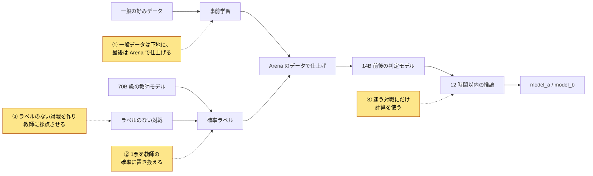
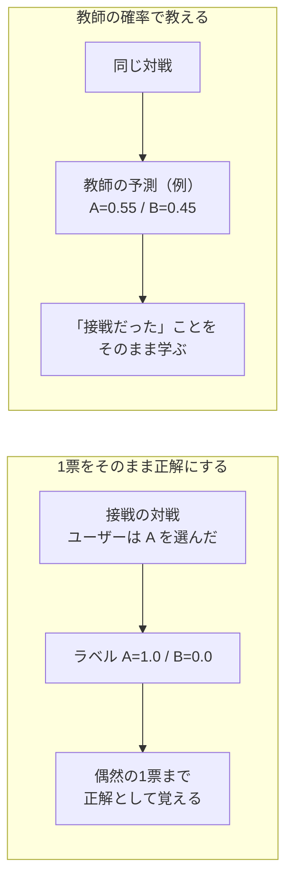

# WSDM Cup - Multilingual Chatbot Arena 上位解法まとめ — 1人の1票を確率に置き換え、迷う対戦にだけ計算を使う

## はじめに

[WSDM Cup - Multilingual Chatbot Arena](https://www.kaggle.com/competitions/wsdm-cup-multilingual-chatbot-arena) は、2つのLLM（大規模言語モデル）の回答のうち、ユーザーがどちらを選ぶかを当てるコンペでした。英語中心だった前回の[LMSYS](https://www.kaggle.com/competitions/lmsys-chatbot-arena)の続編で、今回は多言語の会話が対象です。提出の締切は2025年2月3日で、締切後に集めた新しい対戦で採点し直し、2025年3月10日に終了しました。

上位のモデルはQwen2.5-14BやGemma2-9Bにほぼ収束しており、差がついたのはモデル選びではありませんでした。結論を先に書きます。

> **正解ラベルは1人のユーザーの1票で、接戦の対戦でも「片方が100%正しい」と書かれている。上位チームはこの硬いラベルを、大きな教師モデルが付けた確率に置き換え、ラベルのない対戦を自分たちで作って教師に採点させた。そして12時間の推論予算を、確率が0.5に近い「迷う対戦」に集中させた。**

本記事はこれを4つの勝負所に分けて、代表的なチームの例で説明します。

対象は最終順位1〜12位で、Kaggle CLIで取得できたDiscussionから8チーム・10本のSolution投稿を読みました。8〜11位のチームについては、調べたKaggle CLI経由のDiscussionの中に本人によるSolution投稿が見つかりませんでした。

## コンペ概要

### タスク

- **入力**: ユーザーの質問（prompt）と、2つのLLMの回答（`response_a`, `response_b`）。
- **出力**: ユーザーが選んだ側（`model_a` か `model_b`）。
- **評価**: 正解率（accuracy）。

この指標には、直感に反する性質が3つあります。

1. **満点にはまったく近づけない。** 正解は、その場にいた1人のユーザーの好みです。同じ2つの回答を見ても、人によって選ぶ側は変わります。優勝チームでも、最終順位を決めるPrivateの正解率は0.716で、1位と12位の差は0.005しかありませんでした。
2. **確率の出来は採点されず、0.5付近の対戦だけが得点を動かす。** 0.9を0.8と予測しても結果は同じです。順位を左右するのは、モデルが五分五分と見ている対戦の当たり外れです。
3. **Publicで同点でも、Privateでは大差がつく。** Publicは約1万行の過去の対戦、Privateは締切後に集めた最大2.5万行の新しい対戦です。2位の2つの提出はどちらもPublic 0.709でしたが、Privateは0.708と0.716に分かれました（[2位](https://www.kaggle.com/competitions/wsdm-cup-multilingual-chatbot-arena/discussion/567948)）。

### 提供データ

| データ | 内容 |
| --- | --- |
| 学習データ | prompt、2つの回答、勝者。学習データにだけ、回答したモデル名と言語の列がある。1位の記載では約4.8万件 |
| テスト（Public） | 学習フェーズの過去データ、約1万行 |
| テスト（Private） | 締切後に集めた新しい対戦、最大2.5万行 |
| 実行環境 | インターネットなしのNotebook。学習フェーズは4.75時間、本番は12時間以内に推論する |
| 外部データ | 公開されているデータと学習済みモデルは使用可。前回LMSYSの約5.5万件もその1つ |

### このコンペが難しい理由

- ラベルのノイズが大きく、1件ずつの正解を覚えるほど過学習しやすい。
- LLMは、先に出てきた回答や長い回答を好むなど、内容以外の手がかりに引っ張られる（位置バイアス）。
- 質問と回答2つで入力が長く、14B級を12時間で回すには工夫がいる。

### 用語

| 用語 | 意味 |
| --- | --- |
| 教師モデル / 生徒モデル | 大きなモデル（教師）の予測を、小さなモデル（生徒）に真似させることを蒸留と呼ぶ |
| 確率ラベル | 「A=1, B=0」ではなく「A=0.6, B=0.4」のような確率で書いたラベル（soft label） |
| 擬似ラベル | ラベルのないデータに、学習済みモデルが付けたラベル |
| CV / fold / OOF | CVは交差検証。データをfoldに分けて学習と検証を繰り返す。OOFは、そのモデルが学習に使っていないfoldに対して出した予測 |
| 分類ヘッド | モデルの末尾に付ける、クラス分類用の層 |
| TTA | テスト時に入力を変えて複数回予測し、平均すること。本コンペでは回答AとBを入れ替えるのが基本 |
| LoRA / QLoRA | 一部の小さな行列だけを学習する省メモリの微調整。QLoRAは4-bitに量子化したモデルに対して行う |
| vLLM | LLMの高速推論ライブラリ |

## 上位解法の全体像

ほぼすべてのチームが、「外部データで下地を作る → Arenaのデータで仕上げる → 14B前後のモデル1〜2個で推論する」という骨格を使いました。差がついたのは、下図で色をつけた4か所です。

## 1. 一般の好みデータは下地に使い、最後はArenaの票で仕上げる

**問題**: 公開されている好みデータ（UltraFeedbackやDPO用のデータセットなど）は量が多いものの、「良い回答」の基準がArenaのユーザーとは違います。Arenaのユーザーは正しさだけでなく、長さ、文体、言語、読みやすさでも選ぶからです（[5位](https://www.kaggle.com/competitions/wsdm-cup-multilingual-chatbot-arena/discussion/567856)）。

**上位の対処**: 外部の好みデータで「2つの回答を比べる」練習を先にさせ、最後にArenaのデータだけで仕上げる2段階にしました。

- **4位**は、事前学習ではUltraFeedbackなどを使い、語彙全体に対する損失で「A」か「B」かを学ばせました。仕上げではArenaのデータで、AとBの2択だけの損失に切り替えています。著者は、この段階分けで上限が上がる代わりに学習ステップが多く要ると書いており、2エポック目の終盤にCVが平均約0.002伸びました（[4位](https://www.kaggle.com/competitions/wsdm-cup-multilingual-chatbot-arena/discussion/568522)）。
- **2位**は、前回LMSYSで学習済みのモデルから始め、擬似ラベルのデータで学習し直してから、最後にこのコンペの全データで仕上げました。仕上げも、英語中心のエポックの後に多言語中心のエポックを置いています（[2位](https://www.kaggle.com/competitions/wsdm-cup-multilingual-chatbot-arena/discussion/567948)）。
- **12位**も、一般的な好みデータ約20万件で事前学習した後、Arenaのデータで微調整しました（[12位](https://www.kaggle.com/competitions/wsdm-cup-multilingual-chatbot-arena/discussion/567614)）。

**逆をやるとどうなるか**: 6位では、DPO用データセットに元から付いているラベルは、事後学習には効きませんでした。一方、擬似ラベルを付ける素材としては役に立ちました（[6位](https://www.kaggle.com/competitions/wsdm-cup-multilingual-chatbot-arena/discussion/567600)）。外部データの「対戦の形」は使えても、「誰が勝ったか」はArenaの基準で付け直す必要があった、と読み取れます。これが次の2つの節につながります。

## 2. 人間の1票を、大きなモデルの確率に置き換える

この節が本記事の中心です。

**問題**: 1件の対戦には、1人のユーザーの1票しかありません。2つの回答がほぼ同じ出来でも、ラベルは「Aが100%正しい」になります。この硬いラベルをそのまま学習すると、モデルは偶然の票まで正解として覚え込みます。

**上位の対処**: 70B級の教師モデルをArenaのデータで学習し、その確率を生徒モデルの正解にしました（蒸留）。教師はArenaのデータをfoldに分けて学習し、各教師が学習に使っていない対戦にだけ確率を付けます（OOF）。

- **3位**は、Qwen2.5-14Bに72Bの教師を蒸留しました。fold 0のCVは、蒸留なしの0.7051から、蒸留の設定（温度と損失の重み）を調整して0.7135に上がりました。教師を増やすと、さらに0.7169まで伸びています（[3位](https://www.kaggle.com/competitions/wsdm-cup-multilingual-chatbot-arena/discussion/567584)）。
- **1位**は、Qwen2.5-72Bを5つのfoldで学習し、5つの教師でOOFの確率を作りました。その際、教師にだけ、各回答の前にモデル名を入れています。テストにはモデル名がないため、モデル名を使えない生徒が、モデル名を知る教師の判断を間接的に学ぶことになります。さらに、教師と人間の判断が最も食い違った対戦を手で見直し、ラベルの誤りを直しました（[1位](https://www.kaggle.com/competitions/wsdm-cup-multilingual-chatbot-arena/discussion/569902)）。

**なぜ効くか**: 3位の著者は、72Bの教師を使わず、14Bのモデル自身の確率で蒸留する「自己蒸留」でも同じCVに届いたと書いています。そのうえで、効いているのは教師の大きさより、確率ラベルによってラベルのノイズが洗われることかもしれない、と述べています（[3位](https://www.kaggle.com/competitions/wsdm-cup-multilingual-chatbot-arena/discussion/567584)）。他チームの結果も、この見方と矛盾しません。

- **4位**では、3つの教師に4つ目を足しても差は0.0005以内でした（[4位](https://www.kaggle.com/competitions/wsdm-cup-multilingual-chatbot-arena/discussion/568522)）。
- **6位**では、蒸留はGemma2-9Bには効きましたが、Qwen2.5-14Bには目立った効果がありませんでした（[6位](https://www.kaggle.com/competitions/wsdm-cup-multilingual-chatbot-arena/discussion/567600)）。
- **5位**は大きな教師を使わずに入賞しました。ただし、正解を [0, 1] から [0.05, 0.95] にぼかし、自分のモデルが付けた確率ラベルも使っています（[5位](https://www.kaggle.com/competitions/wsdm-cup-multilingual-chatbot-arena/discussion/567856)）。

つまり、上位に共通していたのは「70Bを使うこと」ではなく、「1と0の硬いラベルで学習しないこと」でした。教師の大きさや数は、硬いラベルをやめたうえでの追加の改善だったと考えられます。

## 3. ラベルのない対戦を作り、教師に採点させる

**問題**: Arenaのラベル付きデータは、このコンペと前回のLMSYSを合わせても約10万件です。英語以外の対戦は少なく、Privateには締切後に登場した新しい質問やモデルも含まれます。

**上位の対処**: 公開されている会話ログから質問だけを取り出し、多数のオープンなLLMに回答させて対戦を作りました。勝敗は、Arenaのデータで学習した採点役のモデル（多くは第2節の教師）に、確率で付けさせます。

- **6位**は、外部の対戦や生成した回答の約56万件に擬似ラベルを付けました。コンペのデータを学習に使わず、これだけでPublic 0.693を超えたそうです（[6位](https://www.kaggle.com/competitions/wsdm-cup-multilingual-chatbot-arena/discussion/567600)）。
- **7位**は、WildChat-1Mとlmsys-chat-1mの質問から10万件の対戦を作りました。質問はクラスタリングし、Arenaが公開している質問の分布（Arena Explorer）に近づけて抜き出しています。ラベルは、微調整したQwen2.5-72BとLlama-3.1-Nemotron-70Bが付けました（[7位](https://www.kaggle.com/competitions/wsdm-cup-multilingual-chatbot-arena/discussion/567589)）。

### 作り方：量より「Arenaに似ていて、勝敗がつく対戦」

効いた作り方には、2つの共通点がありました。

1つ目は、**本番の分布に寄せること**です。1位は、簡単すぎる質問を除き、英語以外を50%にして、質問の分野の比率もこのコンペに合わせた5万件を作りました（[1位](https://www.kaggle.com/competitions/wsdm-cup-multilingual-chatbot-arena/discussion/569902)）。2位も、作るたびに英語以外の比率を上げています。

2つ目は、**採点役のモデルにも勝敗がつけられない対戦を捨てること**です。2位は、モデル間の実力差が小さい公開データ（nbroad v3）を、擬似ラベルのノイズになるとして使いませんでした。さらに、採点役のモデルが出した確率の差が0.03以下の対戦も除いています。この拡張を含む複数の変更で、Privateは0.708から0.716に上がりました（[2位](https://www.kaggle.com/competitions/wsdm-cup-multilingual-chatbot-arena/discussion/567948)）。

5位も、オープンモデルの対戦に自分のモデルで確率ラベルを付けて加え、Publicが0.7039から0.7068に上がりました（[5位](https://www.kaggle.com/competitions/wsdm-cup-multilingual-chatbot-arena/discussion/567856)）。

**なぜ効くか**: 人間の票は限られていますが、教師の確率はいくらでも作れます。Privateは未来の対戦なので、質問と回答のモデルの幅を広げるほど、未知の対戦に強くなると考えられます。

## 4. 12時間を、迷う対戦にだけ使う

**問題**: 本番のテストは最大2.5万行あり、14B級のモデルを何度も全件に回す余裕はありません。3位では、2つ目のモデルは全件を処理しきれず、学習フェーズで処理できたのは約60%でした（[3位](https://www.kaggle.com/competitions/wsdm-cup-multilingual-chatbot-arena/discussion/567584)）。回答AとBを入れ替えて2回推論するTTAは位置バイアスを打ち消しますが、全件に行うと時間が2倍かかります。

**上位の対処**: まず速いモデルで全件を予測し、確率が0.5に近い対戦にだけ、入れ替えたTTAや大きなモデルを追加しました。0.9を0.8と予測しても結果が変わらないのと同じで、自信のある対戦に計算を足しても得点は増えません。

- **7位**は、Gemma-2-9Bで全件を予測し、迷う度合い `1 − |p − 0.5|` を計算しました。最も迷う15%にはQwen2.5-32BまたはMistral-Small-24Bを、次の35%にはQwen2.5-14Bを重ね、残りはGemmaの予測をそのまま使いました（[7位](https://www.kaggle.com/competitions/wsdm-cup-multilingual-chatbot-arena/discussion/567589)）。
- **1位**は、統合したモデルで全件を予測した後、最も不確かな33%だけを、回答を入れ替えて別のモデルで予測し直しました（[1位](https://www.kaggle.com/competitions/wsdm-cup-multilingual-chatbot-arena/discussion/569902)）。
- **12位**は、確率が0.5に近い40%にだけ入れ替えのTTAを行い、全件TTAより効率と精度の両方で良かったと報告しています（[12位](https://www.kaggle.com/competitions/wsdm-cup-multilingual-chatbot-arena/discussion/567614)）。

**逆をやるとどうなるか**: 1位は、2回目の推論に72Bのモデルを使う案も試しました。推論が重いため、TTAをかけられたのは全体の5%だけで、Publicは大きく悪化しました（[1位](https://www.kaggle.com/competitions/wsdm-cup-multilingual-chatbot-arena/discussion/569902)）。72Bを5%にだけ使うより、14B級を、より多くの迷う対戦に使う方が得だったと読み取れます。

**予算を数える**: 3位は、T4×2で1分あたり約7万トークンという処理速度を測り、残り時間で処理できる量を計算しながら推論しました。トークン数の順に並べて先頭25%にTTAをかけ、残りの時間でPhi4を走らせています（[3位](https://www.kaggle.com/competitions/wsdm-cup-multilingual-chatbot-arena/discussion/567584)）。

ただし、入れ替えのTTAがいつも効くわけではありません。6位では分類ヘッド型のモデルにTTAの効果がなく、代わりにQwenが迷った対戦だけGemmaを使いました（[6位](https://www.kaggle.com/competitions/wsdm-cup-multilingual-chatbot-arena/discussion/567600)）。共通点は「迷う対戦にだけ2つ目の意見を足す」ことで、手段はチームごとに違いました。

### 補足：そのほかに効いた工夫

4つの勝負所ほどではありませんが、複数のチームが取り入れた工夫です。

| 工夫 | なぜ効くか | 代表例 |
| --- | --- | --- |
| 長い文章は真ん中を切る | 回答の判断材料は冒頭と結論に多い | 5位: 中央を切る方式はPublic 0.6938、左側を切る方式（LoRA学習）は0.6907（[5位](https://www.kaggle.com/competitions/wsdm-cup-multilingual-chatbot-arena/discussion/567856)） |
| 学習時にもAとBを入れ替える | 位置バイアスを学習の段階で消す | 5位: 外部データ込みの学習に入れ替えを加え、Public 0.6964 → 0.7038（[5位](https://www.kaggle.com/competitions/wsdm-cup-multilingual-chatbot-arena/discussion/567856)） |
| 分類ヘッドではなく「A」「B」の次トークン確率で判定 | vLLMでそのまま速く推論できる | 4位: vLLMで出力をAとBのトークンに限定して確率を取得（[4位](https://www.kaggle.com/competitions/wsdm-cup-multilingual-chatbot-arena/discussion/568522)） |
| 量子化はPublicではなくCVで選ぶ | Publicの小差は本番で逆転する | 4位: 8-bit GPTQは4-bit AWQよりPublicで低かったが、Privateは0.005高かった（[4位](https://www.kaggle.com/competitions/wsdm-cup-multilingual-chatbot-arena/discussion/568522)） |
| 五分五分の対戦だけ単純なルールで決める | モデルが決めきれない対戦では、弱い手がかりでも当たる | 5位: 数字を多く含む回答を選ぶルールが、接戦の対戦で正解率0.58（[5位](https://www.kaggle.com/competitions/wsdm-cup-multilingual-chatbot-arena/discussion/567724)） |

## 上位解法から見えた、特に重要な発見

### 1. 天井を決めていたのは、モデルではなくラベル

正解が1人の1票なので、どれだけ強いモデルでも当てられない対戦が多く残ります。だからこそ、モデルを大きくするより、ラベルを確率にしてノイズを薄める方が効きました（第2節）。

### 2. データは量より「Arenaの基準で付け直したか」

外部データは、元のラベルのままではArenaの票と合わず、下地作りか採点し直す素材として使われました（第1節・第3節）。

### 3. 正解率は境界の近くでしか動かない

固定の推論予算の中では、得点を動かせる五分五分の対戦にだけ計算を足す方が、全件に重い処理をかけるより合理的でした（第4節）。

### 4. Publicは古いデータで、本番は未来のデータ

Publicは過去の対戦、Privateは締切後の新しい対戦でした。Publicで同点の提出や、Publicで劣っていた量子化が本番で逆転しました。Publicの小差だけで選ぶと、本番では外れえます。

## うまくいかなかったアプローチ

- **推論時に考える過程の文章（CoT, Chain-of-Thought）を生成させる**: 3位ではCVとPublicが0.001〜0.002伸びたが、生成が長くなって時間切れが頻発した。精度の伸びより推論の予算を優先する（[3位](https://www.kaggle.com/competitions/wsdm-cup-multilingual-chatbot-arena/discussion/567584)）。
- **教師の学習にCoTを使う**: 1位では、GPT-4oの批評文2万件で教師を補強したが、その確率ラベルで学習した生徒は繰り返し悪化した。教師に理由を書かせても、確率ラベルは良くならなかった（[1位](https://www.kaggle.com/competitions/wsdm-cup-multilingual-chatbot-arena/discussion/569902)）。
- **推論特化の蒸留モデル（DeepSeek-R1-Distill）を使う**: 5位ではCVが0.001伸びたが、Publicは0.003下がった。著者は、1トークンだけ出力する使い方では推論の能力が生きないためと考えている（[5位](https://www.kaggle.com/competitions/wsdm-cup-multilingual-chatbot-arena/discussion/567856)）。
- **間違えやすい対戦を学習から除く**: 4位では、6つの70Bモデルの判断と最も食い違う5〜10%を除いても、差はなかった。ノイズは除くより、確率で薄める方が扱いやすい（[4位](https://www.kaggle.com/competitions/wsdm-cup-multilingual-chatbot-arena/discussion/568522)）。
- **報酬モデルで擬似ラベルを付ける**: 2位では、公開されたSkyworkの報酬モデルによる擬似ラベルは効かなかった。Arenaの票で学習したモデルの方が基準が合うと考えられる（[2位](https://www.kaggle.com/competitions/wsdm-cup-multilingual-chatbot-arena/discussion/567948)）。

どれも、「1票のノイズ」「Arena固有の基準」「12時間の予算」のどれかとぶつかった例です。

## まとめ

上位解法の流れを6行にまとめると、次のとおりです。

1. 公開の好みデータで、2つの回答を比べる練習を先にさせる。
2. 70B級の教師をfoldごとに学習し、OOFで確率ラベルを作る。
3. 公開の会話ログから質問を選び、多数のLLMに回答させて対戦を作る。
4. 教師に採点させ、勝敗のつかない対戦は捨てる。
5. 14B前後の生徒を、確率ラベルとArenaのデータで仕上げる。
6. 全件を一度予測し、0.5に近い対戦にだけTTAや大きなモデルを足す。

> **ラベルが1人の1票なら、それを真実として覚えさせてはいけない。より強いモデルの確率に置き換えて「どれだけ接戦だったか」を教え、限られた推論予算は、答えが変わりうる境界の近くにだけ使う。**

この考え方は、検索の関連度判定や、1人の評価者が付けた好み・品質ラベルを当てるタスクにも使えます。ラベルが1件1人のばらつく判断で、評価がしきい値で切る正解率である、という条件がそろうときに特に有効です。

## 参照した上位Solution

各チームの要点を一言でまとめています。詳しく知りたいチームは、リンク先の投稿を参照してください。

| 順位 | チーム | 一言で言うと | 投稿 |
| --- | --- | --- | --- |
| 1位 | whitefebruary | 72B教師5つの蒸留と、分布を合わせた合成対戦 | [1st Place Solution](https://www.kaggle.com/competitions/wsdm-cup-multilingual-chatbot-arena/discussion/569902) |
| 2位 | zhudong1949 | 多数のLLMで作った対戦に擬似ラベルを付け、段階的に拡張 | [The 2nd Place Solution](https://www.kaggle.com/competitions/wsdm-cup-multilingual-chatbot-arena/discussion/567948) |
| 3位 | PLaMo 1000000B | A/Bトークンで判定し、蒸留と推論予算の管理を徹底 | [3rd place solution](https://www.kaggle.com/competitions/wsdm-cup-multilingual-chatbot-arena/discussion/567584) |
| 4位 | HKUST-GZ DSA KiMi Lab | 段階ごとに損失を変え、3つの教師で蒸留 | [4th Place Solution](https://www.kaggle.com/competitions/wsdm-cup-multilingual-chatbot-arena/discussion/568522) |
| 5位 | Just doing | 大きな教師なし。真ん中切り、入れ替え、確率ラベル | [5th place solution overview](https://www.kaggle.com/competitions/wsdm-cup-multilingual-chatbot-arena/discussion/567617)、[5th Place Solution for the WSDM Cup](https://www.kaggle.com/competitions/wsdm-cup-multilingual-chatbot-arena/discussion/567724)、[5th Place Detailed Solution](https://www.kaggle.com/competitions/wsdm-cup-multilingual-chatbot-arena/discussion/567856) |
| 6位 | Oh Your Mercy Never Fails | 約56万件の擬似ラベルが中心 | [6th Place Solution](https://www.kaggle.com/competitions/wsdm-cup-multilingual-chatbot-arena/discussion/567600) |
| 7位 | Team Turing | 迷う対戦ほど大きなモデルに回す3段の推論 | [7th Place Solution](https://www.kaggle.com/competitions/wsdm-cup-multilingual-chatbot-arena/discussion/567589) |
| 12位 | monsaraida | 2段階学習と、迷う40%だけのTTA | [12th Place Solution](https://www.kaggle.com/competitions/wsdm-cup-multilingual-chatbot-arena/discussion/567614) |

8位（sayoulala）、9位（quenn）、10位（tascj）、11位（Evalthon）は、調べたKaggle CLI経由のDiscussionの中に本人によるSolution投稿が見つかりませんでした。
