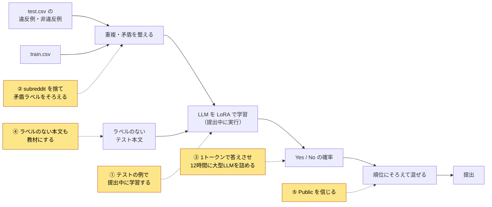
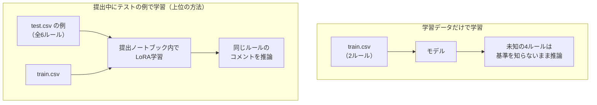

# Jigsaw - Agile Community Rules Classification 上位解法まとめ — 未知ルールの答えはテストの中にあった

## はじめに

[Jigsaw - Agile Community Rules Classification](https://www.kaggle.com/competitions/jigsaw-agile-community-rules) は、Redditのコメントが「あるルール」に違反しているかを当てるコンペでした。2025年10月23日23:59（UTC）に終了しました。

上位のモデルはQwen系のLLM、DeBERTa、埋め込みモデルとさまざまでしたが、勝負を決めた判断は共通していました。結論を先に書きます。

> **学習データには2つのルールしかなく、テストのルールの多くは未知でした。しかしテストの各行には、そのルールの違反例と非違反例が2つずつ付いていました。上位チームはこれを提出ノートブックの中で学習データに変え、ノイズの元を取り除いたうえで、12時間の制限内にできるだけ大きなLLMをできるだけ多く学習させました。**

本記事はこれを5つの勝負所に分けて、代表的なチームの例で説明します。

対象は最終順位1〜14位で、Kaggle CLIで取得できたDiscussionから12チーム・12本のSolution投稿を読みました。10位と14位のチームについては、調べたKaggle CLI経由のDiscussionの中に本人によるSolution投稿が見つかりませんでした。

## コンペ概要

### タスク

- **入力**: コメント本文（`body`）、判定対象のルール文（`rule`）、投稿先のsubreddit、そのルールの違反例2つと非違反例2つ。
- **出力**: そのコメントがルールに違反している確率。
- **評価**: ルールごとにAUCを計算して平均する指標です。公式の名前はcolumn-averaged AUCで、上位チームはこの意味で扱いました（[6位のQ&A](https://www.kaggle.com/competitions/jigsaw-agile-community-rules/discussion/613150)、[7位](https://www.kaggle.com/competitions/jigsaw-agile-community-rules/discussion/613215)）。

このコンペには、直感に反する性質が3つあります。

1. **ルールをまたいだ確率の大小は、点数に関係しない。** 見られるのは、同じルールの中で違反コメントを非違反コメントより上に並べられたかだけです。7位は「ルールごとに予測を順位に変えても点数は変わらない」と書いています。
2. **未知のルールでも、答えの手がかりはテストに付いている。** 学習データのルールは2つだけで、1位によればテストの6ルールのうち4つは学習データにありません。ただし、テストの各行にはそのルールの違反例・非違反例が付いており、これ自体がラベル付きデータです。
3. **手元の検証よりPublic LBの方が信頼できる。** 主催者によるとPublic/Privateの分割はランダムで、Publicはテスト全体の30%です。手元の学習データは2ルールしかないので、未知ルールでの性能を測れません。

### 提供データ

| データ | 内容 |
| --- | --- |
| train.csv | 2ルール分のコメントと正解（`rule_violation`）。違反例・非違反例の列も付く |
| test.csv | 約5.5万行（[8位](https://www.kaggle.com/competitions/jigsaw-agile-community-rules/discussion/613195)）。学習データにないルールを含む |
| 違反例・非違反例 | `positive_example_{1,2}`、`negative_example_{1,2}`。各行のルールについての例 |
| subreddit | 投稿先の掲示板名。主催者は、判定（ラベル付け）には関与していないと説明した |
| 実行環境 | Notebookで提出。GPU 12時間以内、インターネットなし。上位はT4（16GB）×2で動かした |

### このコンペが難しい理由

- 学習データのルールが2つしかなく、普通の教師あり学習では未知ルールに対応できない。
- 同じコメントと同じルールの組に、違う正解が付いていることがある。
- 12時間・T4×2という制約で、大きなLLMの学習と約5.5万行の推論を両方こなす必要がある。
- 同じNotebookでも、実行のたびにエラーや時間切れが起きることがあった。

### 用語

| 用語 | 意味 |
| --- | --- |
| AUC | 正例を負例より上に並べられる確率。予測値の絶対値ではなく順序だけで決まる |
| LoRA / QLoRA | LLMの重みを固定し、小さな追加行列だけを学習する方法。QLoRAは元の重みを4bitに圧縮して省メモリにしたもの |
| TTT（test-time training） | 提出ノートブックの実行中に、テストに含まれる情報でモデルを学習すること。train-on-testとも呼ばれた |
| Unsloth | LoRAの学習を省メモリ・高速にするライブラリ。14BモデルをT4 1枚に載せられる |
| 疑似ラベル | モデルの予測を、ラベルのないデータの仮の正解として使い、再び学習すること |
| logit | LLMが次のトークンごとに出すスコア。YesとNoのlogitの差から違反確率を作れる |
| Public / Private LB | テストの30%で提出中に見える順位表と、残り70%で最終順位を決める順位表 |

## 上位解法の全体像

ほぼすべてのチームが、「テストの例と学習データを集める → 整える → LLMなどを学習する → 違反確率を出す → 混ぜる」という骨格を、提出ノートブックの中で動かしました。差がついたのは、下図で色をつけた5か所です。

## 1. テストに付いた例で、提出中に学習する

この節が本記事の中心です。

**問題**: 学習データにあるのは2ルールだけです。残り4つの未知ルールについて、何が違反かをモデルは一度も教わっていません。学習データだけで学習したモデルを未知ルールに当てても、判定基準がずれます。

**上位の対処**: テストの各行に付いている違反例・非違反例を集めると、未知ルールを含む全ルールのラベル付きデータになります。上位チームは、これで提出ノートブックの実行中にモデルを学習しました（TTT）。テストの中身は提出時にしか見えないので、学習もその場で行う必要があります。

- **1位**は、テストの例を2回ずつ繰り返して学習データと混ぜ、全体を1 epoch学習しました。これは、学習データを1周、テストの例を2周学習するのと同じです（[1位](https://www.kaggle.com/competitions/jigsaw-agile-community-rules/discussion/613305)）。6モデルのアンサンブルはPrivate 0.9293でした。
- **13位**の回答では、train.csvだけで学習したQwen2.5-14B-Instructのスコアは0.886でした（指標の種類は書かれていません）。テストの例で学習したQwen3-8bはPublic 0.922です（[13位](https://www.kaggle.com/competitions/jigsaw-agile-community-rules/discussion/613265)）。モデルが違うので厳密な比較ではありませんが、差の大きさは目安になります。

**逆をやるとどうなるか**: テストの例で学習しない大型モデルは、小さいモデルに負けました。

- **5位**では、公式の学習データだけで学習したQwen-32Bが、TTTしたLLaMA-3.1 8B（Private 0.92618）より低いPrivate 0.89671にとどまりました（[5位](https://www.kaggle.com/competitions/jigsaw-agile-community-rules/discussion/613421)）。
- **7位**も、学習データで学習したQwen3-32Bを公開ルールだけに使ってみましたが、他のモデルのアンサンブルより大幅に悪かったと報告しています（[7位](https://www.kaggle.com/competitions/jigsaw-agile-community-rules/discussion/613215)）。

**なぜ効くか**: 違反かどうかの基準は、ルールの文面だけでは決まりません。たとえば「宣伝禁止」のようなルールなら、どこまでを宣伝と見なすかは判定した人の感覚で決まります。テストの例はその感覚を直接示しているので、モデルの大きさより効きます。

## 2. subredditを捨て、矛盾するラベルをそろえる

**問題**: データには2種類のノイズがありました。1つはsubredditです。同じルール・同じ内容でも、subredditによって判定が変わって見え、モデルが近道として覚えてしまいます。もう1つは矛盾ラベルで、同じコメントと同じルールの組に、違反と非違反の両方が付いていることがありました。

**上位の対処**: 読んだ12チームの半数以上が、subredditを入力から外しました。さらに、重複をまとめ、矛盾するラベルを多数決でそろえました。

- **7位**は、主催者の「subredditはラベル付けに関与していない」という説明を根拠に、subredditを完全に無視しました。subredditをまったく使わないことで、スコアは+0.007改善しました。多数決で決まらない同数の組は、残すとわずかに悪化したので捨てています（[7位](https://www.kaggle.com/competitions/jigsaw-agile-community-rules/discussion/613215)）。
- **9位**は、subredditを外してPublic 0.920から0.922に改善し、実行時間も2.5時間から2.1時間に縮みました（[9位](https://www.kaggle.com/competitions/jigsaw-agile-community-rules/discussion/613185)）。
- **2位**は、矛盾ラベルを多数決でそろえて重複を除きました。学習は1 epochしか回せないので、「少なくてもきれいなデータの方が価値がある」と説明しています（[2位](https://www.kaggle.com/competitions/jigsaw-agile-community-rules/discussion/614279)）。

**なぜ効くか**: subredditを含めたまま重複を除くと、同じコメントが掲示板の数だけ別の行として残ります。1位は、subredditを外してから重複を除くと改善が大きかったと書いています（[1位](https://www.kaggle.com/competitions/jigsaw-agile-community-rules/discussion/613305)）。データが減るので、学習時間も短くなります。

## 3. LLMを1トークンで答えさせ、12時間に大きなモデルを詰め込む

**問題**: 1位によれば、大きいモデルほど概ね強く、Qwen3が他の一般的なLLMより強い傾向でした。しかし、使えるのは12時間とT4×2だけです。普通に文章を生成させると、学習も推論も遅すぎます。

**上位の対処**: LLMに「違反ならYes、違反でなければNo」の1トークンだけを答えさせ、YesとNoの出力スコア（logit）の差を確率として使いました。浮いた時間で、14B級のモデルを何本も学習しました。

- **1位**は、学習時の損失をYes/Noの1トークンだけで計算し、チャットテンプレートが前後に足す余計なトークンを除きました。学習が速くなり、モデル間で収束がそろうので、1組のハイパーパラメータで全モデルを学習できました。推論では文章を生成せず、最後のトークンのlogitだけを取りました。テストを長さ順に並べることでも高速化しています（[1位](https://www.kaggle.com/competitions/jigsaw-agile-community-rules/discussion/613305)）。
- **4位**も、少数の答えトークンのlogitをそのまま確率として読む、著者自身の手法SALSAを使いました。Qwen-3 14BはPrivate 0.92313で、Qwen-3 4Bの0.91874を上回りました（[4位](https://www.kaggle.com/competitions/jigsaw-agile-community-rules/discussion/613473)）。
- **8位**は、長さの近いデータをまとめて学習を2倍速くしました。推論も、長さ順に並べて2枚のGPUで並列に回し、4倍速くしました。これでQwen3-14B 3本を含むアンサンブルを12時間に収めました（[8位](https://www.kaggle.com/competitions/jigsaw-agile-community-rules/discussion/613195)）。

ただし、詰め込みすぎると提出が落ちます。2位は、同じNotebookでも成功したり失敗したりするため、GPUを使い切らず80〜90%に抑えるよう調整しました（[2位](https://www.kaggle.com/competitions/jigsaw-agile-community-rules/discussion/614279)）。逆に11位は、4Bより大きいモデルは推論に時間がかかりすぎるとして使わず、4B以下のLLMとBERT系の多様さで勝負しました（[11位](https://www.kaggle.com/competitions/jigsaw-agile-community-rules/discussion/613506)）。

## 4. ラベルのないテスト本文も教材にする

**問題**: テストの例は1行に4つありますが、本当に判定したいのは約5.5万件のコメント本文です。この本文にはラベルがなく、そのままでは学習に使えません。

**上位の対処**: モデルの予測を仮の正解（疑似ラベル）にして、ラベルのない本文でもう一度学習しました。チームによっては、これが最大の改善源でした。

- **12位**は、テストの本文の99.5%以上が、公開されているラベルなしのReddit 200万件データセットに含まれることに気づきました。そこから約80万件のルールと本文の組を選び、公開LLMアンサンブルの予測を柔らかいラベル（0〜1の確率）にして、DeBERTaを事前学習しました。著者は、このラベルなしデータで少なくとも0.012改善したと書いています。DeBERTa-baseでは、0.912から約0.924になりました（[12位](https://www.kaggle.com/competitions/jigsaw-agile-community-rules/discussion/613096)）。
- **11位**は、テスト本文の予測上位・下位の一定割合に1と0のラベルを付けて、BERTとLLMの両方を追加学習しました。提出後の分析で、Privateは0.92579から0.92734に改善しました（[11位](https://www.kaggle.com/competitions/jigsaw-agile-community-rules/discussion/613506)）。
- **4位**は、小さいモデルで最も迷った約8,000件のテスト本文を疑似ラベルにして、14Bモデルを学習し直しました。最終ブレンドはPrivate 0.9286で、著者は約0.004の改善が順位を決めたと書いています（[4位](https://www.kaggle.com/competitions/jigsaw-agile-community-rules/discussion/613473)）。

**逆の例**: 8位は、疑似ラベルが効かなかったと報告しています（[8位](https://www.kaggle.com/competitions/jigsaw-agile-community-rules/discussion/613195)）。どの本文を、どの強さのモデルの予測でラベル付けするかで、結果が分かれたと考えられます。

**なぜ効くか**: 4位の著者は、疑似ラベルは新しい知識を加えるのではないと説明しています。テスト本文どうしのスコアを比べるときの基準点になり、LLMが元々持つ知識を引き出しやすくするという説明です。評価がルール内の順序だけを見るAUCなので、この役割がそのまま点数につながったと読み取れます。

## 5. 手元の検証ではなくPublicを信じる

**問題**: コンペ概要の性質3のとおり、手元のデータでは未知ルールでの性能を測れません。7位は、学習データで作ったCVとLBの間に「まったく相関がなかった」と報告しています（[7位](https://www.kaggle.com/competitions/jigsaw-agile-community-rules/discussion/613215)）。

**上位の対処**: Public LBを主な検証に使いました。

- **1位**は、分割がランダムなのでPublicはPrivateの偏りのない推定になり、テストの30%は十分大きいので分散も小さい、と判断しました。全モデルをPublicで検証しています（[1位](https://www.kaggle.com/competitions/jigsaw-agile-community-rules/discussion/613305)）。3位も、全モデルと最終アンサンブルをPublicで検証しました（[3位](https://www.kaggle.com/competitions/jigsaw-agile-community-rules/discussion/613324)）。
- **8位**はCVを使わず、変更ごとに4つのseedでアンサンブルして提出し、ノイズではなく安定した改善かを確かめました（[8位](https://www.kaggle.com/competitions/jigsaw-agile-community-rules/discussion/613195)）。

**例外**: 2位は、提出のたびにPublicが大きく揺れたため、学習データを層化して10%を検証に回し、3 seedの平均AUCを判断の基準にしました（[2位](https://www.kaggle.com/competitions/jigsaw-agile-community-rules/discussion/614279)）。

Publicを使った8位とCVを使った2位は、1回の結果の差ではなく、複数seedで再現する差だけを採用した点で共通しています。

### 補足：そのほかに効いた工夫

| 工夫 | なぜ効くか | 代表例 |
| --- | --- | --- |
| 各モデルの予測をルールごとの順位にそろえてから混ぜる | 確率の尺度がモデルごとに違っても、順序だけで公平に混ぜられる | 1位: Public 0.929 → 0.931（[1位](https://www.kaggle.com/competitions/jigsaw-agile-community-rules/discussion/613305)） |
| 同程度の大きさのLLMどうしを互いに教え合わせる（Deep Mutual Learning） | 大きな教師モデルなしで、互いの柔らかい予測から学べる | 6位: 別々に学習した場合と比べ、2モデルのアンサンブルがPrivate 0.925 → 0.927（[6位](https://www.kaggle.com/competitions/jigsaw-agile-community-rules/discussion/613150)） |
| 安全性判定向けに学習済みのLLMを使う | 有害コメントの判定に近い知識を最初から持っている | 7位: Qwen3-8B-Guardは通常版より 0.920 → 0.923（[7位](https://www.kaggle.com/competitions/jigsaw-agile-community-rules/discussion/613215)） |
| 他のルールの違反例を、今のルールの非違反例として足す | 非違反例を増やし、テストの分布に近づける（著者の説明） | 13位: Qwen3-8bがPublic 0.922 → 0.927（[13位](https://www.kaggle.com/competitions/jigsaw-agile-community-rules/discussion/613265)） |
| few-shotの例を、コメントに似た違反例と似ていない非違反例から選ぶ | 判定の境界をはっきり示せる | 5位: 通常のfew-shotより +0.006（[5位](https://www.kaggle.com/competitions/jigsaw-agile-community-rules/discussion/613421)） |
| T4ではbf16ではなくfp16を使う | T4はbf16が遅く、時間を無駄にする | 12位: 公開Notebookのbf16設定は約6倍遅いと指摘（[12位](https://www.kaggle.com/competitions/jigsaw-agile-community-rules/discussion/613096)） |

## 上位解法から見えた、特に重要な発見

### 1. 未知のルールに必要だったのは、汎化ではなく現地の例

このコンペは「見たことのないルールに汎化する」問題に見えました。しかし実際には、未知ルールのラベル付きの例がテストに含まれていました。上位チームは汎化の工夫より先に、その例で提出中に学習する体制を作りました（第1節）。

### 2. 情報を足すより、ノイズを除く方が効いた

subredditを外す、矛盾ラベルをそろえるといった「減らす」処理は、半数以上のチームが採用し、効果を報告したチームではどれも改善しました（第2節）。一方で、合成データやReddit文での追加の事前学習など、テストの判定基準から離れた情報を足す試みは失敗が目立ちました。

### 3. 12時間の使い方そのものが精度になった

大きいモデルほど強い傾向がある中で、勝負は「何本の大型LLMを時間内に回せるか」になりました。1トークンで答えさせる、長さ順に並べる、2枚のGPUを同時に使うといった工夫は、精度の工夫と同じくらい順位に効きました（第3節）。

### 4. 評価が順序だけを見るので、検証も混ぜ方も順序で考える

ルールごとのAUCは確率の絶対値を見ません。疑似ラベルが相対順序を固定する役割で効いたこと、順位にそろえてから混ぜる処理が効いたことは、この性質と整合します（第4節、補足）。

## うまくいかなかったアプローチ

- **LLMで未知ルールの合成データを作る**: 7位では合成データの損失がすぐ0近くまで下がり、スコアが悪化した。本物のテストの分布を再現できなかった（[7位](https://www.kaggle.com/competitions/jigsaw-agile-community-rules/discussion/613215)）。13位でも、改善したのは1ルールだけ（0.886 → 0.888）で、他は悪化した（[13位](https://www.kaggle.com/competitions/jigsaw-agile-community-rules/discussion/613265)）。
- **few-shotの例をプロンプトに入れたまま疑似ラベルで学習する**: 11位では、プロンプトが長く学習に時間がかかり、使えるデータ量を絞るしかなかった。精度の伸びが学習時間に見合わなかった（[11位](https://www.kaggle.com/competitions/jigsaw-agile-community-rules/discussion/613506)）。
- **Reddit文でLLMを追加事前学習する**: 11位は約38GBのReddit文で追加学習したが、LBは大きく改善しなかった。指示に従う能力が落ちた可能性を著者は挙げている（[11位](https://www.kaggle.com/competitions/jigsaw-agile-community-rules/discussion/613506)）。
- **Deep Mutual Learningで大きいモデルの損失を軽くする**: 6位では、重みを付けた版が対称な版より悪かった。教え合うモデルどうしは、大きさをそろえた方が安定する（[6位](https://www.kaggle.com/competitions/jigsaw-agile-community-rules/discussion/613150)）。
- **ルール専用のプロンプトや、例の意味的な選び直し**: 9位ではどちらも効かなかった。5位の例選択とは結果が分かれ、ルールごとの作り込みが必ず効くわけではない（[9位](https://www.kaggle.com/competitions/jigsaw-agile-community-rules/discussion/613185)）。

どれも、テストの例が示す判定基準から離れた情報や、時間を食う複雑さを足した例です。

## まとめ

上位解法の流れを6行にまとめると、次のとおりです。

1. テストの各行に付いた違反例・非違反例を集め、全ルールのラベル付きデータにする。
2. subredditを外し、重複をまとめ、矛盾するラベルを多数決でそろえる。
3. LLMにYes/Noの1トークンで答えさせ、提出ノートブックの中でLoRA学習する。
4. 長さ順の並べ替えや2GPU並列で時間を浮かせ、14B級のモデルを何本も回す。
5. ラベルのないテスト本文に疑似ラベルを付けて、もう一度学習する。
6. ルールごとの順位にそろえて混ぜ、Publicと複数seedで選ぶ。

> **未知の対象に汎化させようとする前に、テスト時に手に入るラベル付きの手がかりを探す。見つかったら、それを提出中の学習データにし、ノイズを除き、時間制限の中で最も強いモデルに覚えさせる。**

この考え方は、ユーザーごと・顧客ごとに基準が違う分類や、few-shotの例が入力に付いてくるタスクに使えます。ただし、テスト側の例が採点対象と同じ基準でラベル付けされていることが前提です。

## 参照した上位Solution

各チームの要点を一言でまとめています。詳しく知りたいチームは、リンク先の投稿を参照してください。

| 順位 | チーム | 一言で言うと | 投稿 |
| --- | --- | --- | --- |
| 1位 | Guanshuo Xu | Yes/Noの1トークン損失で6つのLLMを提出中に学習 | [1st place solution](https://www.kaggle.com/competitions/jigsaw-agile-community-rules/discussion/613305) |
| 2位 | ^^ | 矛盾ラベルの多数決と、落ちにくい4モデル並列学習 | [2nd place solution](https://www.kaggle.com/competitions/jigsaw-agile-community-rules/discussion/614279) |
| 3位 | Sergio Manuel Papadakis | 事前学習済みLoRAからのTTTと、LLM埋め込み＋古典MLの2層アンサンブル | [3rd Place Solution](https://www.kaggle.com/competitions/jigsaw-agile-community-rules/discussion/613324) |
| 4位 | Dream Team | 1トークン判定（SALSA）と、迷った本文の疑似ラベル | [4th place writeup](https://www.kaggle.com/competitions/jigsaw-agile-community-rules/discussion/613473) |
| 5位 | Flash ⚡ | 埋め込み・DeBERTa・LLMを順位で混ぜる多様なアンサンブル | [5th Place solution - Diverse Ensemble](https://www.kaggle.com/competitions/jigsaw-agile-community-rules/discussion/613421) |
| 6位 | ducnh279 | Qwen 3モデルを互いに教え合わせる学習（DML） | [6th Place Solution: Online Distillation via Deep Mutual Learning](https://www.kaggle.com/competitions/jigsaw-agile-community-rules/discussion/613150) |
| 7位 | ktr | subreddit無視と、安全性判定向けLLMの追加 | [7th place solution](https://www.kaggle.com/competitions/jigsaw-agile-community-rules/discussion/613215) |
| 8位 | Reddit comment moderators | 高速化で14B級LLMを12時間に詰め込む | [[8th] Qwen3-14B*3 + Llama2-13B*1 + bge-base-en-v1.5](https://www.kaggle.com/competitions/jigsaw-agile-community-rules/discussion/613195) |
| 9位 | lllleeeo + mango | 公開Notebookの3系統を改良して順位で混ぜる | [9th Place Solution: Bringing It All Together](https://www.kaggle.com/competitions/jigsaw-agile-community-rules/discussion/613185) |
| 11位 | takaito\|Muj!rush!\|yukko\|miyaki | 小さめの多様なモデルと、テスト本文の疑似ラベル | [11th Place Solution](https://www.kaggle.com/competitions/jigsaw-agile-community-rules/discussion/613506) |
| 12位 | losingself | 外部のラベルなしReddit文にLLMでラベルを付け、DeBERTaを事前学習 | [12th place solution](https://www.kaggle.com/competitions/jigsaw-agile-community-rules/discussion/613096) |
| 13位 | ISE@JNU-1 | 他ルールの違反例を非違反例として足す | [13th Place Solution](https://www.kaggle.com/competitions/jigsaw-agile-community-rules/discussion/613265) |

10位（Nikita Babych）と14位（next gen VNG warriors）は、調べたKaggle CLI経由のDiscussionの中に本人によるSolution投稿が見つかりませんでした。
