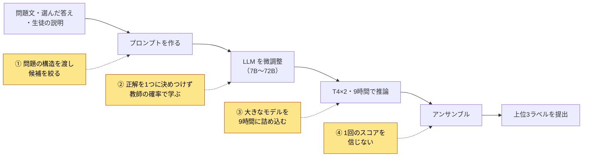
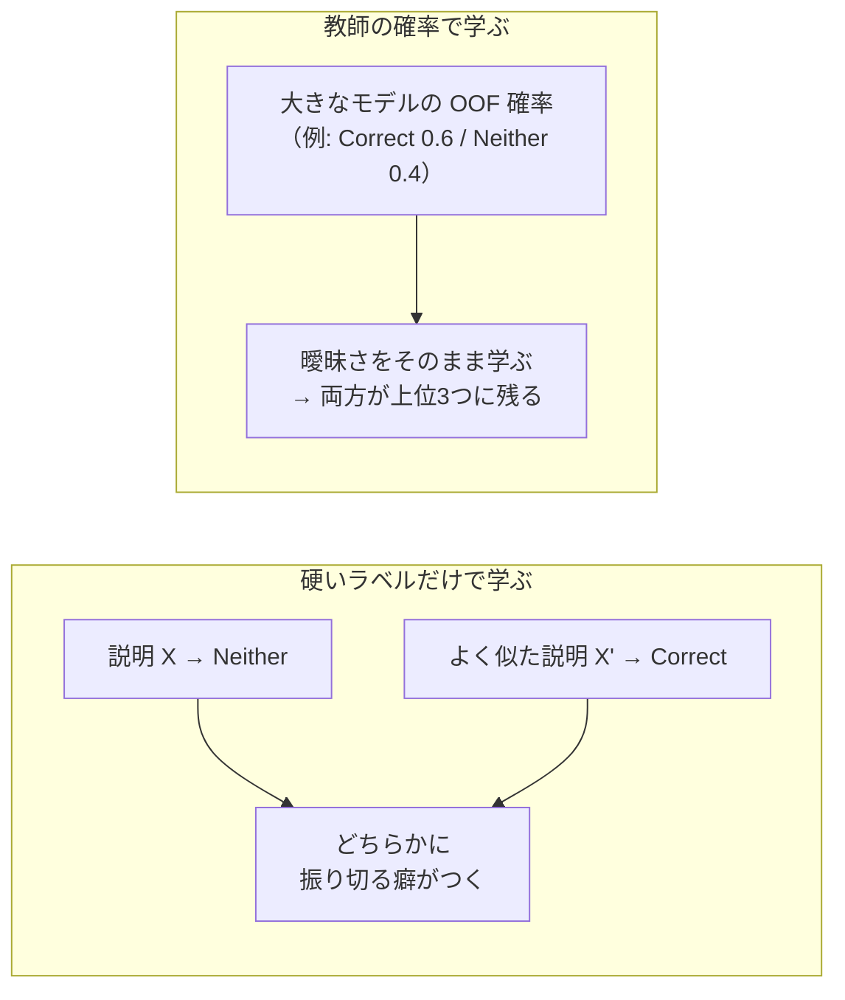

# MAP - Charting Student Math Misunderstandings 上位解法まとめ — 問題の構造で候補を絞り、曖昧なラベルは大きなモデルの確率で教える

## はじめに

[MAP - Charting Student Math Misunderstandings](https://www.kaggle.com/competitions/map-charting-student-math-misunderstandings) は、算数・数学の選択式問題に生徒が書いた「理由の説明」から、その生徒が持っている誤概念（misconception）を当てるコンペでした。2025年10月15日23:59（UTC）に終了しました。

上位チームのモデルは、分類ヘッド、文章生成、reranker とさまざまでしたが、差がついた場所は共通していました。結論を先に書きます。

> **上位13チームの差は、学習をやり直したときの揺れより小さく、ラベル自体も曖昧だった。上位チームはモデルに考えさせるより、問題の構造で候補を絞り、大きなモデルの「柔らかい確率」を学ばせることで差をつけた。それを9時間の推論に収め、1回のスコアを信じずに選んだ。**

本記事はこれを4つの勝負所に分けて、代表的なチームの例で説明します。

対象は最終順位1〜13位で、Kaggle CLIで取得できたDiscussionから12チーム・12本のSolution投稿を読みました。11位のチームについては、調べたKaggle CLI経由のDiscussionの中に本人によるSolution投稿が見つかりませんでした。

## コンペ概要

### タスク

- **入力**: 問題文、生徒が選んだ答え（`MC_Answer`）、生徒が書いた説明（`StudentExplanation`）。
- **出力**: `Category:Misconception` の形のラベルを、確からしい順に最大3つ。`Category` は「答えが正しいか（True/False）」と「説明の種類（Correct / Misconception / Neither）」の組み合わせで、たとえば `False_Misconception:WNB` のようになります。
- **評価**: MAP@3。正解ラベルを1番目に出せば1点、2番目なら1/2点、3番目なら1/3点、3つに入らなければ0点で、全行を平均します。

この指標とデータには、直感に反する性質が3つあります。

1. **「答えが正しいか」は予測しなくてよい。** 学習データとテストデータは同じ15問から作られています（[4位](https://www.kaggle.com/competitions/map-charting-student-math-misunderstandings/discussion/612178)）。正解の選択肢は学習データから分かるので、True/False はルールで決まります。これを除くと予測すべきラベルは37種類に減り、1問ごとに見れば候補は4〜6種類だけです。
2. **上位の差は、学習のやり直しによる揺れより小さい。** 1位と13位のPrivateの差は0.0013でした。13位は乱数のseed（初期値）を変えるだけでスコアが約±0.002動いたと報告しています（[13位](https://www.kaggle.com/competitions/map-charting-student-math-misunderstandings/discussion/612069)）。
3. **1番に当てなくても点になるので、迷う行は両方出せる。** 「Correct か Neither か」で迷う説明でも、両方を上位3つに入れれば大きくは失点しません。5位は、残りの勝負は「曖昧な説明で正しい誤概念を3つに入れられるか」だと見ました（[5位](https://www.kaggle.com/competitions/map-charting-student-math-misunderstandings/discussion/612124)）。

### 提供データ

| データ | 内容 |
| --- | --- |
| train.csv | 36,696行。入力3列と、正解の `Category`・`Misconception` |
| 問題 | 15問。各問は正解1つと誤答（distractor）3つの4択。学習とテストで同じ問題 |
| ラベル | `Category` と `Misconception` をつないだ65種類。誤概念のないものは `:NA` |
| テストデータ | 再実行時に約16,000行 |
| 実行環境 | Notebook提出、GPU 9時間以内、インターネットなし。公開済みの外部データ・学習済みモデルは使用可 |

### このコンペが難しい理由

- 同じ説明に違うラベルが付いていることがあり、Correct と Neither の境界は特に主観的だった。
- 30種類以上のラベルは例が少なかった（2位）。
- 大きなLLMほど強いが、推論はT4×2・9時間に収める必要があった。
- スコアの差が小さく、Public LBの順位も1回の学習の結果も当てにならなかった。

### 用語

| 用語 | 意味 |
| --- | --- |
| 誤概念（misconception） | 体系的な間違った考え方。例: 「0.355は0.8より大きい」と整数の感覚で比べる |
| CV / Public・Private LB | 手元の交差検証のスコア / テストの一部で期間中に公開されるスコアと、最終順位を決める残りのスコア |
| fold・seed | 交差検証で分けたデータの各組 / 学習の乱数の初期値 |
| OOF（out-of-fold） | 交差検証で、そのデータを学習に使っていないモデルが出した予測 |
| 蒸留・soft label | 大きなモデル（教師）が出した確率を、別のモデルの学習目標にすること。正解を1つに決めた「硬いラベル」の反対 |
| 量子化（AWQ / GPTQ / W8A8） | 重みや計算を4bit・8bitに落として、メモリと計算を減らすこと |
| vLLM | LLMの推論を高速化するライブラリ。文章生成の形で使うのが基本 |

## 上位解法の全体像

ほぼすべてのチームが、「プロンプトを作る → 7B〜72BのLLMを微調整する → T4で推論する → アンサンブルする」という骨格を使いました。差がついたのは、下図で色をつけた4か所です。

モデルの形式そのものは、決め手ではありませんでした。1位は、いくつかの形式を試して大きな差は見られなかったと答えています（[1位](https://www.kaggle.com/competitions/map-charting-student-math-misunderstandings/discussion/612268)）。

## 1. 問題の構造をモデルに渡し、候補を絞る

**問題**: 素直に65種類から選ばせると、ルールで決まる True/False まで学習させることになり、その問題では起こりえない誤概念に上位3枠を使ってしまいます。また、誤概念は選んだ誤答と結びつきます。9個中3個が白い三角形の図で「白い部分は？」と聞かれ 3/6 を選んだ生徒は、説明例を見ると白と色付きの個数をそのまま比にしています。ほかの選択肢が見えなければ、この区別はつけにくくなります。

**上位の対処**: 問題ごとに決まっている情報を、学習させるのではなく入力や制約として与えました。読んだ12チームのうち9チームが、次のどれかを使っています。

- **3位**は、True/False をルールで後から付け、その問題に出てくる誤概念と Correct・Neither だけを A〜E の選択肢としてプロンプトに並べました。これでLB/CVが+0.002〜0.003改善し、推論は約3倍速くなりました。ほかの選択肢をプロンプトに入れる工夫は、さらに+0.003〜0.004でした（[3位](https://www.kaggle.com/competitions/map-charting-student-math-misunderstandings/discussion/612059)）。
- **8位**は、生徒の説明から各問の選択肢 a〜d を復元し、問題文の後ろに付けました。選んだ答えとほかの選択肢を比べられるようにするためです（[8位](https://www.kaggle.com/competitions/map-charting-student-math-misunderstandings/discussion/612101)）。
- **4位**は、1問あたり4〜6個の候補ごとに「この診断は正しいか（Yes/No）」を判定させ、各候補の説明例もプロンプトに入れました。蒸留済みモデルのCVは0.9480から0.9493に上がりました（[4位](https://www.kaggle.com/competitions/map-charting-student-math-misunderstandings/discussion/612178)）。

**例外**: 12位では、選択肢をプロンプトに入れても効きませんでした（[12位](https://www.kaggle.com/competitions/map-charting-student-math-misunderstandings/discussion/612114)）。9位では、True/False を外した学習が65分類を超えませんでした（[9位](https://www.kaggle.com/competitions/map-charting-student-math-misunderstandings/discussion/612105)）。

**なぜ効くか**: 3位と8位は、ほかの選択肢と比べることで、どの誤概念に至ったかを読み取りやすくなると考えました。候補を絞ると、起こりえないラベルに確率を割かなくなり、3つの枠をすべて本当の候補に使えます。

## 2. 正解を1つに決めつけず、大きなモデルの確率で教える

この節が本記事の中心です。

**問題**: ラベル自体が曖昧です。2位は、1つの説明に複数のラベルが当てはまりうると分析しました（[2位](https://www.kaggle.com/competitions/map-charting-student-math-misunderstandings/discussion/612145)）。13位も、ラベルが主観的でばらつくと書いています。似た説明に Neither と Correct が混在すると、硬いラベルだけで学んだモデルはどちらかに振り切ろうとします。

**上位の対処**: 32B〜72Bの大きなモデルを教師にしてOOFの確率を作り、それを学習目標に加えました。

- **12位**は、Qwen2.5-72B系の教師から Qwen2.5-14B へ蒸留しました。著者はこれを最も効いた工夫とし、効果を+0.003〜0.005と報告しています（[12位](https://www.kaggle.com/competitions/map-charting-student-math-misunderstandings/discussion/612114)）。
- **4位**は、Qwen2.5-Math-72B を教師にしました。同じプロンプトで、Privateは0.9427から0.9450に上がりました（[4位](https://www.kaggle.com/competitions/map-charting-student-math-misunderstandings/discussion/612178)）。
- **2位**は、4種類のLLMの5-fold OOFを平均してsoft labelにしました。硬いラベルの損失と組み合わせた Qwen3-14B は、fold 0 のCVが0.955でした（[2位](https://www.kaggle.com/competitions/map-charting-student-math-misunderstandings/discussion/612145)）。

同じ狙いで、3位は dropout による出力の揺れを抑える R-Drop でCVを+0.001以上改善し（[3位](https://www.kaggle.com/competitions/map-charting-student-math-misunderstandings/discussion/612059)）、7位と10位は正解の確率を少し他のラベルに分ける label smoothing を使いました。一方9位では、同じ大きさのモデルからの soft label はPrivateで+0.001にとどまりました（[9位](https://www.kaggle.com/competitions/map-charting-student-math-misunderstandings/discussion/612105)）。

### 合成データも、教師が付け直したラベルで使う

例の少ないラベルを補うため、商用LLMで生徒の説明を作ったチームもあります。ここでも鍵は、生成時のラベルをそのまま信じないことでした。

- **7位**は、GPT-4.1とGPT-5-miniで20万件を作り、うち約5万件を使いました。Gemma2-9BではLBが+0.002〜0.005改善しましたが、ほかのモデルではまちまちでした。生成した説明とラベルのずれが原因で、教師の soft label で和らげたと説明しています（[7位](https://www.kaggle.com/competitions/map-charting-student-math-misunderstandings/discussion/612134)）。
- **2位**は、約8万件の合成データに4つのLLMで確率を付けました。Qwen2.5-32B の fold1 モデルでは、Privateが0.944から0.947に上がりましたが、アンサンブル後は差がなくなったと書いています（[2位](https://www.kaggle.com/competitions/map-charting-student-math-misunderstandings/discussion/612145)）。

一方、13位では合成データが効かず、8位の改善も0.001以下でした。合成データは、「例の少ないラベルを埋め、そのラベルは教師に付け直させる」という使い方に限って効いたと読み取れます。

**なぜ効くか**: MAP@3は2番目・3番目の候補にも点を与えます。教師の確率は「Correct とも Neither とも読める」という情報を伝えるので、上位3つを並べる目的と合っていると考えられます。ばらつく人手のラベルを、大きなモデルが均す役割です。

## 3. 大きなモデルを9時間のT4に詰め込む

**問題**: 多くのチームで、大きなモデルほど強い傾向が見られました。1位の比較では、seedを平均したMAP@3が Qwen3-14B の0.9477から Qwen3-32B の0.9484に上がり、32Bを2種類組み合わせると0.9496になりました（[1位](https://www.kaggle.com/competitions/map-charting-student-math-misunderstandings/discussion/612268)）。しかし推論はT4×2で9時間以内です。3位では、72Bでテスト全体を推論すると約190分かかりました。

**上位の対処**: 計算の型とメモリの使い方を変えて、32B〜72Bを時間内に収めました。

- **1位**は、T4のFP16が実測で約20 TFLOPSにとどまる一方、8bit整数の計算（W8A8）なら40 TFLOPS以上出ることを使いました。さらに、VRAMに収まらない32Bを動かすため、GPUには2層だけを置き、次の層をディスクから読みながら計算して、32Bで16,000件を約65分で推論しました（[1位](https://www.kaggle.com/competitions/map-charting-student-math-misunderstandings/discussion/612268)）。
- **3位**は、まず小さなモデルで全件を推論し、最大の予測確率が0.95未満の行だけを72Bでやり直しました。これで72Bの推論時間は約1時間に縮みました。bfloat16 を float16 に変え、padding をやめるだけでも約4倍速くなりました（[3位](https://www.kaggle.com/competitions/map-charting-student-math-misunderstandings/discussion/612059)）。
- **10位**は、分類用の32Bモデルを本体と分類ヘッドに分け、本体だけをGPTQで4bitにしてvLLMで特徴を取り出し、ヘッドはFP16のまま外で計算しました（[10位](https://www.kaggle.com/competitions/map-charting-student-math-misunderstandings/discussion/612038)）。

7位・8位・9位などは、ラベルを1トークンに対応させてその確率を読む形にし、vLLMで高速に推論しました（[7位](https://www.kaggle.com/competitions/map-charting-student-math-misunderstandings/discussion/612134)）。

**限界**: 大きくすれば必ず良いわけではありません。13位では、8B→14B→32Bと改善した後、72Bでは伸びませんでした（[13位](https://www.kaggle.com/competitions/map-charting-student-math-misunderstandings/discussion/612069)）。9位は、70B級の方がCVは良かったものの、約150分の推論時間が重すぎて最終構成から外しました。

## 4. 1回のスコアを信じない

**問題**: 1位の表では、Qwen3-8B の同じ設定でも、seedによってMAP@3が0.9433から0.9450まで動きました（[1位](https://www.kaggle.com/competitions/map-charting-student-math-misunderstandings/discussion/612268)）。1回の学習で「改善した」と判断すると、偶然を拾うことになります。

**上位の対処**: 判断の単位を「1回の学習」から「複数のseedの平均」に変えました。

- **1位**は、最もスコアの低いfoldを検証用に固定し、すべての実験を3つのseedで学習して平均しました。この比較から、「1つのseedのスコアは信じてはいけない」「大きいモデルほど良い」と結論しました。最終提出もfold違いではなくseed違いのモデルを組み合わせ、この検証の作り方を最も重要だった点に挙げています（[1位](https://www.kaggle.com/competitions/map-charting-student-math-misunderstandings/discussion/612268)）。
- **13位**は、各構成を2つのseedで学習してばらつきを吸収しました。Publicの順位だけに頼っていたらメダルを逃していただろうと書いています（[13位](https://www.kaggle.com/competitions/map-charting-student-math-misunderstandings/discussion/612069)）。

**Publicに引きずられた例**:

- **4位**の Qwen3-32B は、CVもPublicも高かったのに、Privateは0.946にとどまりました。そのため、最終アンサンブルはPrivateで最良の単体モデルを超えませんでした（[4位](https://www.kaggle.com/competitions/map-charting-student-math-misunderstandings/discussion/612178)）。
- **3位**は、Publicが低かったため72Bの EMA（重みの移動平均）版を最終提出から外しましたが、これが単体で最良のPrivate 0.948でした（[3位](https://www.kaggle.com/competitions/map-charting-student-math-misunderstandings/discussion/612059)）。

ただし、「Publicを無視せよ」という話ではありません。5位は、CVとLBの相関がほぼ消えたと見て、アンサンブルの採否をPublicだけで決め、自ら「賭け」と呼ぶ判断で金メダルを取りました（[5位](https://www.kaggle.com/competitions/map-charting-student-math-misunderstandings/discussion/612124)）。逆に3位と8位では、CVとLBがよく相関しました。共通していたのは、どの指標を使うにせよ「1回の差」で決めないことでした。

### 補足：そのほかに効いた工夫

| 工夫 | なぜ効くか | 代表例 |
| --- | --- | --- |
| 同じ・ほぼ同じ説明を同じfoldに入れる | 同じ説明が学習と検証に分かれると、CVが楽観的になる | 5位: StratifiedKFold から、空白と句点を除いた説明でまとめる StratifiedGroupKFold に変更（[5位](https://www.kaggle.com/competitions/map-charting-student-math-misunderstandings/discussion/612124)） |
| 単体では弱くても、違う間違い方をするモデルを残す | 曖昧な行では、モデルごとの癖が分かれる | 6位: 拡張データで学習した単体最弱のモデルを外すと、毎回アンサンブルが悪化した（[6位](https://www.kaggle.com/competitions/map-charting-student-math-misunderstandings/discussion/612099)） |
| eval_loss が最小の時点より少し後の checkpoint を使う | eval_loss が最小の時点と、MAP@3が最良の時点は一致しなかった | 7位: CV +0.008、LB +0.007（[7位](https://www.kaggle.com/competitions/map-charting-student-math-misunderstandings/discussion/612134)） |
| 学習率とバッチサイズを丁寧に探す | 小さな変更でCVが大きく揺れた | 8位: LoRAの r や alpha を変えても差は出ず、2つの値の組み合わせを重点的に探した（[8位](https://www.kaggle.com/competitions/map-charting-student-math-misunderstandings/discussion/612101)） |

## 上位解法から見えた、特に重要な発見

### 1. 難しさの正体は、推論の難しさではなくラベルの曖昧さ

9〜16歳向けの問題で、数学の推論そのものは難しくありません。伸びたのは「曖昧さを扱う」工夫で（第2節・第4節）、考える過程を書かせる方向は効きませんでした。

### 2. 決まっていることは、学ばせずに渡す

テストが同じ15問なので、正誤や候補の集合は計算で分かります。それを推測させると、学習データと上位3枠を無駄にします（第1節）。

### 3. モデルの大きさは、推論の工夫と引き換えに手に入る

大きさの利点を得られるかは、9時間で動かす方法を持っていたかで決まりました（第3節）。大きな教師から中くらいの生徒への蒸留も、同じ制約への答えと読み取れます。

### 4. 差が小さいコンペでは、評価の揺れが最大の敵

1回の実験やPublicの小さな上下で判断すると、偶然を選んでしまいます。複数seedの平均で比べることが、工夫の効果を見分ける前提でした（第4節）。

## うまくいかなかったアプローチ

- **考える過程（chain-of-thought）を学ばせる**: 4位は最も時間をかけたが改善しなかった。13位でも効かなかった。曖昧なラベルは、推論を深めても解消しない（[4位](https://www.kaggle.com/competitions/map-charting-student-math-misunderstandings/discussion/612178)）。
- **似た説明を検索してプロンプトに入れる**: 4位ではCVは0.9493と良かったが、PublicとPrivateは悪化した。CVだけ良くなる工夫は疑う（[4位](https://www.kaggle.com/competitions/map-charting-student-math-misunderstandings/discussion/612178)）。
- **上位候補を reranker で並べ替える**: 10位のlistwise型も9位の pairwise・pointwise 型も、元のモデルを超えなかった。4位と13位はこの形を主モデルにして成功しており、後段に足す使い方が効かなかったと読み取れる（[10位](https://www.kaggle.com/competitions/map-charting-student-math-misunderstandings/discussion/612038)）。
- **Eediの過去コンペで学習したモデルを流用する**: 3位では効かなかった。似たドメインの事前学習が効くとは限らない（[3位](https://www.kaggle.com/competitions/map-charting-student-math-misunderstandings/discussion/612059)）。
- **誤ラベルの疑いをルールで直接直す**: 3位は、問題31778で正誤が逆の可能性がある行に逆の版も上位2つに入れたが、CVはわずかに上がり、最終結果はわずかに下がった。決め打ちの修正は外れると損をする（[3位](https://www.kaggle.com/competitions/map-charting-student-math-misunderstandings/discussion/612059)）。

どれも、少なくノイズの多い信号から、さらに多くを引き出そうとして、ノイズに合わせてしまった例です。

## まとめ

上位解法の流れを6行にまとめると、次のとおりです。

1. 正誤はルールで決め、問題ごとの候補と選択肢をプロンプトに入れる。
2. 重複した説明を同じfoldにまとめ、検証用のfoldを固定する。
3. 32B〜72Bの教師でOOF確率を作り、硬いラベルと合わせて学習する。
4. 合成データは例の少ないラベルに絞り、教師に確率を付け直させる。
5. 量子化・層ごとの読み込み・自信のない行だけの再推論で、大きなモデルを9時間に収める。
6. 複数seedで平均してから比べ、Publicの小さな差では決めない。

> **ラベルが曖昧で差が小さいタスクでは、モデルに推測させる部分を減らし、教える目標を柔らかくし、判断の単位を1回の実験より大きくする。**

この考え方は、作文の採点やコンテンツ審査のように、ラベルが主観的で上位数件の並びで評価されるタスクに使えます。ただし、問題の構造をそのまま渡せるのは、学習とテストで同じ問題集合が使われている場合に限ります。

## 参照した上位Solution

各チームの要点を一言でまとめています。詳しく知りたいチームは、リンク先の投稿を参照してください。

| 順位 | チーム | 一言で言うと | 投稿 |
| --- | --- | --- | --- |
| 1位 | tascj | 3-seed平均の検証と、W8A8・層ごと推論で動かす32B | [1st Place Solution](https://www.kaggle.com/competitions/map-charting-student-math-misunderstandings/discussion/612268) |
| 2位 | looking for remote job | 8万件の合成データと、4つのLLMのOOF確率による soft label | [MAP2025_Private&Public 2nd](https://www.kaggle.com/competitions/map-charting-student-math-misunderstandings/discussion/612145) |
| 3位 | monsaraida & Masaya | 選択肢と問題ごとの候補をプロンプトに入れ、自信のない行だけ72B | [3rd place (Public 1st) solution](https://www.kaggle.com/competitions/map-charting-student-math-misunderstandings/discussion/612059) |
| 4位 | THLUO | 候補ごとのYes/No判定と、72Bからの蒸留 | [4th Place Solution](https://www.kaggle.com/competitions/map-charting-student-math-misunderstandings/discussion/612178) |
| 5位 | Naoism | 多様なモデルを、Public LBで採否を決めてアンサンブル | [5th place solution](https://www.kaggle.com/competitions/map-charting-student-math-misunderstandings/discussion/612124) |
| 6位 | Manan Jhaveri | 37分類のQwen群と、合成データ・疑似ラベル付きの重複 | [MAP 6th Place Solution - Qwen-semble FTW!](https://www.kaggle.com/competitions/map-charting-student-math-misunderstandings/discussion/612099) |
| 7位 | S T I T Y | 大量の合成データを、教師の確率で付け直して使う | [Private 7th (Public 10th) Place Solution](https://www.kaggle.com/competitions/map-charting-student-math-misunderstandings/discussion/612134) |
| 8位 | Takashi Someya | 選択肢の復元と、50モデルのアンサンブル | [8th Place Solution](https://www.kaggle.com/competitions/map-charting-student-math-misunderstandings/discussion/612101) |
| 9位 | kanto-kaggler | 32Bの2系統×5-foldを、ほぼ9時間かけて推論 | [9th Place Solution](https://www.kaggle.com/competitions/map-charting-student-math-misunderstandings/discussion/612105) |
| 10位 | Liwen Zheng | 32B分類モデルを本体とヘッドに分けてvLLMで推論 | [10th Place Solution](https://www.kaggle.com/competitions/map-charting-student-math-misunderstandings/discussion/612038) |
| 12位 | Eisuke Okuda | 72Bから14Bへの蒸留を5通り | [12th Place Solution](https://www.kaggle.com/competitions/map-charting-student-math-misunderstandings/discussion/612114) |
| 13位 | iws | 分類とlistwiseの混成を、seedの揺れを考えて重み付け | [MAP Competition 13th Place Gold Medal Solution](https://www.kaggle.com/competitions/map-charting-student-math-misunderstandings/discussion/612069) |

11位（sayoulala）は、調べたKaggle CLI経由のDiscussionの中に本人によるSolution投稿が見つかりませんでした。
