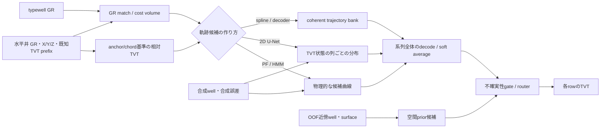
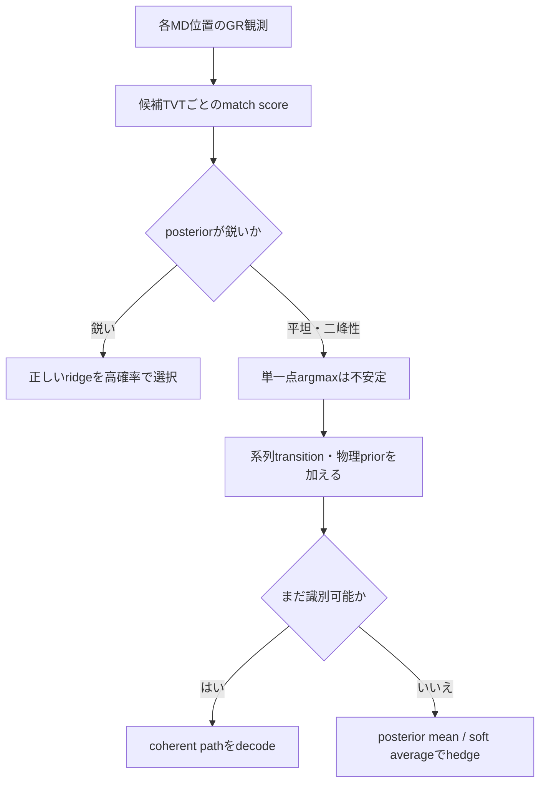

# ROGII - Wellbore Geology Prediction 上位解法まとめ — GRの別解を残し、参照・系列・不確実性で選ぶ

## はじめに

これは、[ROGII - Wellbore Geology Prediction](https://www.kaggle.com/competitions/rogii-wellbore-geology-prediction) の公開Solutionを、地質対比の因果パイプラインとして読み直した記事である。コンペは2026年8月5日23:59 UTC（日本時間8月6日8:59）に終了し、本稿の収集スナップショットは2026年8月7日17:54 JSTである。

課題は、水平井に沿って観測されたガンマ線ログ（GR）と近傍の垂直参照井（typewell）を手掛かりに、未知区間のTrue Vertical Thickness（TVT）を1行ごとに推定することだった。CNN、U-Net、HMM、particle filter（PF）、勾配ブースティングとモデル名は多彩だが、上位解法が解こうとした失敗は驚くほど共通している。

> **中心課題は局所的な回帰精度ではない。似たGR模様が複数の深度に現れるため、井戸全体が「どの地層の枝に乗るか」を外すと、長区間がまとめて約15 ftずれる。強い解法は、物理的な座標系で探索範囲を絞り、複数の軌跡仮説を保持し、系列全体と不確実性で選択または平均した。**

公式最終順位1〜22位を対象にし、公開済みの一次Solutionは15チーム・15投稿見つかった。対象は1、2、3、4、5、6、7、8、9、10、11、13、14、18、21位である。前回スナップショット後に2、3、4、5、8、10、11位の7投稿が加わり、単一の「正しい経路」を当てるより、参照系と候補の誤り方を設計することの重要性がさらに明確になった。

12位、15位、16位、17位、19位、20位、22位については、検索時点でKaggle CLIが公開していた全212件のDiscussionsから、順位・チーム・著者を結び付けられる一次Solutionを発見できなかった。これは「Solutionが存在しない」という意味ではなく、Kaggle CLIで取得できたDiscussion内では未発見という意味に限る。リーダーボードの異常行は0件だった。

## コンペ概要

### タスク

各wellの水平坑井データには、坑井長に沿うMeasured Depth（MD）、空間座標`X, Y, Z`、GR、そしてprefixだけ値が見える`TVT_input`がある。未知のevaluation zoneについて、各行の`TVT`を予測する。

評価指標は、全テスト行をまとめたRMSEである。したがって長いwellや大外ししたwellが二乗誤差を強く支配する。一方、学習上の独立単位は行ではなくwellなので、validationはwell単位で分割しなければならない。この「評価はrow pooled、汎化はwell単位」という二重構造が、CV設計を難しくした。

提出はKaggle Notebookのhidden rerunで行われ、CPU/GPUとも9時間以内、Internet off、`submission.csv`必須だった。小さな公開stubで速く見えるだけでは足りず、hidden well数に対するseconds-per-wellが実際の制約になった。

### 提供データ

| データ | 内容 | 解法上の役割 |
|---|---|---|
| `horizontal_well.csv` | `MD, X, Y, Z, GR, TVT_input`。trainのみ`TVT`とformation surface列を持つ | 観測GR、坑井軌跡、既知prefixのanchor、予測対象 |
| `typewell.csv` | TVT軸上のGRとGeology | 水平井GRをどの地層深度へ対応付けるかの参照ログ |
| 既知prefix | evaluation zone直前までの`TVT_input` | 絶対深度のtie-inと、well固有pseudo-typewellの構築 |
| trainの周辺well | 他wellの軌跡・formation surface・GR | dip field、近傍surface、代替GR参照。ただしOOF分離が必須 |
| hidden test | 約200 well。公開フォルダの少数例とはrerun時に置換 | 9時間制限下で未知wellへ再現可能な推論が必要 |

### このコンペが難しい理由

- GRは周期的・自己相似で、異なるTVTに似た谷が複数できる。局所一致が最良でも正しい地層枝とは限らない。
- 誤差は独立なrowノイズではなく、well全体または長いsegmentのlevelずれとして現れる。14位はper-well定数を除くだけで6.45から4.38へ下がると報告した。
- trainは773 wellと少なく、hard wellがfoldへ偏るだけでスコアが動く。row bootstrapやランダムrow splitは過信を生む。
- typewell GR、自己prefix GR、近傍well、空間surfaceはそれぞれ異なる条件で壊れる。単独の参照を強く信じるとwrong-modeが残る。
- Public/Privateで難易度と手法順位が入れ替わった。Publicの小差を最適化すると、正しいOOF判断を捨てる危険があった。
- 物理・近傍特徴は強力だが、validation well自身をfield構築へ混ぜると即座にleakする。
- 大規模U-Net、数十のPF、seed/fold ensembleは精度を上げる一方、9時間rerunとVRAMの制約を受ける。

## 上位解法の全体像

解法差は主に次の5軸へ整理できる。

1. **座標系**: 最終既知TVTからのresidual、`S=TVT+Z`、chordからのoffsetなど、絶対値ではなく狭い探索帯へ変換する。
2. **候補表現**: PF/HMMの曲線、TVT×MD画像のheatmap、spline bank、cost-volume posteriorのどれで多峰性を保持するか。
3. **合成データ**: 地質生成過程を模倣するか、モデルが失敗を直す練習問題として設計するか。
4. **外部文脈**: 自己prefix、近傍well、formation surfaceを常時使うか、信頼できるwellだけへrouteするか。
5. **選択の物差し**: pooled RMSEだけでなく、fold分散、per-well median、hard tail、well bootstrap、deploy runtimeまで見るか。

## 1. 絶対深度を捨て、探索帯を物理anchorの周囲へ畳む

### まず「11,000 ftを当てる問題」から降りる

21位は、生のTVT約11,000 ftではなく、既知区間末尾からおよそ±16 ftのdriftを予測した。[2位](https://www.kaggle.com/competitions/rogii-wellbore-geology-prediction/discussion/733432)はtypewell側を0.5 ft/binの±128 ft、MD側を32 ft/columnへ落とし、[5位](https://www.kaggle.com/competitions/rogii-wellbore-geology-prediction/discussion/733522)は通常anchor±64 ft、端へ寄ったwellだけ±96 ftで再推論した。目的は同じで、モデル容量を絶対深度の記憶ではなく、anchor周辺の曖昧性へ使うことだ。

最も明快な再座標化は[18位のchord](https://www.kaggle.com/competitions/rogii-wellbore-geology-prediction/discussion/733250)だった。既知坑井軌跡の始点と終点を直線で結び、その線からの残差を縦軸にする。単純な機械的chordが、first-stage予測から引く二段方式より強く、同チームは単体CVが6.4から5.2へ改善した主因を座標系、解像度、合成データと報告している。

### 座標系はfeatureではなく仮説空間である

chordやanchorは「入力列を1本増やす」話ではない。縦windowが狭くなるため0.5〜1 ft/binを確保でき、wrong-modeの複数ridgeを同じ画像内で比較できる。1位は最終既知TVT相対でtypewell側±100 ftを0.5 ft刻みにし、[10位](https://www.kaggle.com/competitions/rogii-wellbore-geology-prediction/discussion/733315)は`A=TVT+Z`の変動約160 ftを直接stateにすると、既知の幾何へ解像度を浪費すると指摘した。smoothness priorは`dA/dMD`へ置きつつ、予測stateは変動中央値26.4 ftのTVTへ置く、という役割分担である。

判断則は、まずtruthを使ったper-well定数・直線・低次曲線oracleを測ることだ。もし定数を除くだけで誤差が大きく消えるなら、複雑なrow featureより前に、levelを表す座標と候補を設計すべきである。

## 2. GR一致をスカラー特徴ではなく「地形」として見せる

### match surfaceには正解ridgeと偽ridgeが同居する

複数チームは、水平井位置×候補TVTの各点にGR一致度を描いたcost volumeを使った。[9位](https://www.kaggle.com/competitions/rogii-wellbore-geology-prediction/discussion/733150)はwhole-well U-Netで384 depth bins×640 MD columnsを分類し、18位はchord-relative画像の複数ridgeをheatmap/detection headで追跡した。5位はtypewell/horizontal GR、coverage、known path、relative row、`-ΔZ`、dip、azimuth、複数のmisfitを14 channelへ分け、同じTVT×MD canvasに「一致」と「物理的な動き」を共存させた。

[11位](https://www.kaggle.com/competitions/rogii-wellbore-geology-prediction/discussion/733305)は、そもそも照合先を変えた。別井戸・別装置のtypewellではなく、正解TVTが見える自well prefixから`GR-vs-TVT`表を作ると、評価可能な548 wellの64%で自己参照の方が近かった。例示wellではmisfitがtypewell 14.4に対しself 6.6であり、この自己照合画像が終盤最大のU-Net改善だった。ただし既知prefixが覆わないTVTではtypewellへ戻す。

### classificationで曖昧性を残し、期待値で連続値へ戻す

5位のheadはSDFとrow-classification logitsを併用し、2位は各`(MD, TVT)` anchorから21種類の次移動`P(dTVT|TVT)`を出した。[3位](https://www.kaggle.com/competitions/rogii-wellbore-geology-prediction/discussion/733319)のAdaptive 1D SDFも256候補をSoftMaxし期待TVTを返した。共通点はbinary maskや単一点argmaxではなく、候補分布を次段へ残すことにある。

ただし分布lossだけで情報不足は解消しない。18位はCE-onlyやmixupでposteriorを多峰化しようとしても分裂せず、「wrong-modeはlossではなく観測証拠の性質」と結論した。表現した曖昧性を解くには、次の系列制約が要る。

## 3. 行ごとの予測を、井戸全体で一貫した軌跡へdecodeする

### hard selectionよりcoherent posterior

[13位](https://www.kaggle.com/competitions/rogii-wellbore-geology-prediction/discussion/733174)は512×768 alignment imageから列ごとのfieldを出し、held foldを除いて作った1,536本のcubic spline bankから127本を尤度で残し、well全体で一度正規化したposterior meanを取った。row-wise readoutからcoherent decodeへ変えるだけで6.219から5.859へ改善した。

2位のAnchorCNNはさらに明示的である。各state anchorから「次の32 ftで何ft動くか」という21 classの条件付き遷移を出し、PSのpoint massから`p_{k+1}(s)=Σp_k(s')P(s-s'|s',k)`を伝播した。Viterbiや1,024 rolloutからのrerankingより、全pathを周辺化したDP期待値が一貫して強かった。最終sub076はOOF 5.140 / Private 5.802である。

[21位](https://www.kaggle.com/competitions/rogii-wellbore-geology-prediction/discussion/733190)は、piecewise constant dipとsparse switchをtransitionにしたforward-backwardを使った。8-channel CNNがrow×offset latticeのemissionを出し、測定したOU/heavy-tail dynamicsでposterior meanを復号した。一方、約600個の相関したemissionをそのまま積むと過信が増幅したため、32 ftごとのdecimationとentropy gate、fold内の短いreal fine-tuningが必要だった。

7位はHMM 5.676からlearned emissionsで5.301、さらにsecond-pass refinerで5.209へ進めた。refiner同士の不一致をgateにし、平均では弱い近傍signalを不確かな場所だけで使った結果、最終5.2025 pooled / 5.2128 near-endとなった。[7位の報告](https://www.kaggle.com/competitions/rogii-wellbore-geology-prediction/discussion/733154)が示すのは、強い系列priorの後でも「どこを直すか」の学習が残ることだ。

### 候補を増やすなら、間違い方を増やす

[6位](https://www.kaggle.com/competitions/rogii-wellbore-geology-prediction/discussion/733226)は、typewell、自分のprefix、XY近傍、GR類似近傍、self-graftという5参照と16 PF設定から91曲線を作った。top-kで1本を選ぶより、全候補をsoft averageするcurve ensemblerが強かった。15候補のCV 6.50から、30候補で5.94、最終91候補で5.4577、Private 5.984へ到達した。

3位は候補をHMM/PF内だけで増やさず、Last-PS offset NN、Delta NN、直接相関SDFまで混ぜた。5候補を行ごとに非負・和1へ制約するBiLSTM SoftMax Gateは5.2797で、候補範囲外へ自由補正するdirect BiLSTMの5.4023に全5 foldで勝った。弱い単体候補でも誤り方が違えば局所的に選べる一方、全候補共通のdriftは凸包の外へ直せない、という限界も明示している。

[8位](https://www.kaggle.com/competitions/rogii-wellbore-geology-prediction/discussion/733281)は20 PFの256 MD window oracleが1.2766まで下がることを確認し、1本選択ではなくLGBM/TCN rankerのweightをsegment間で補間した。さらに平均CVが0.41悪いspatial-group U-Netを30%混ぜると、stratified単独6.437から6.309へ改善した。多様性は単体順位ではなく、同じwellで違う失敗をするかで測るべきである。

重要なのは本数ではない。相関0.99の候補を追加しても効かず、弱くても異なる方向へ外すPFが効いた。14位でもXGBoostとU-Netという名称上異なるfamilyの予測相関は0.982で、family名は多様性の証拠にならなかった。

## 4. 合成データは「現実のコピー」ではなく、学ぶべき失敗を設計する

### 生成過程を合わせる流儀

21位は、dip increment、Brownian noise、300〜500 ftのcorrelation length、GR residual、typewellとのmisalignmentを測定してgeneratorを作った。さらにmatch-costの局所最小数をsynthetic 9.1対real 10.1、naive minimumがtruthに一致する比率を0.855対0.863まで合わせた。12k→120k→240k stepのpretraining効果はreal fine-tuning後も残り、中心stageはCV 6.30から5.60へ改善した。

13位も、他wellのTVTをそのまま移植するのではなく、地質座標`U=TVT+dZ`だけをdonorから借り、targetの`Z`で`TVT=U-Z`を再構成して12.641から8.981へ改善した。syntheticのtruth offsetがtop-1になる割合100%に対してrealは85%だったため、GR gain/offset/driftやmissing gapを追加した。

### 「教科書として難しい」合成データの流儀

[5位](https://www.kaggle.com/competitions/rogii-wellbore-geology-prediction/discussion/733522)は、typewellとhorizontal GRを「同じ波形＋noise」から進め、0.25 ftのlatent geologyを別の平滑化・観測演算で見る2つのlogとして生成した。synthetic-onlyでもPrivate 6.342まで届き、real finetuneは約2 epochだけに抑えた。OOF改善は約1.5 ftでもPrivate改善は約0.5 ftだったため、realへの深い適応自体がdomain shift riskになった。

[4位](https://www.kaggle.com/competitions/rogii-wellbore-geology-prediction/discussion/733480)は500k V0.1→37k filtered V3という二段pretrainを採った。V0は`TVT→GR→BUDA→Z`、V3は`BUDA→Z→TVT→GR`と生成順を変え、よりrealisticなV3だけへ置き換えるよりstaged curriculumを選んだ。約3M sampleを超えるとConvNeXt LargeがMTP classificationを捨て、加重平均lossだけを下げるdegenerate behaviorも観測している。大きくすれば自動的に良いわけではない。

8位のU-Net legは別の結論へ進んだ。200 epochのsynthetic pretrain後も、real学習中にsyntheticを50%流し続けると、同一pretrainからfold 1が6.758→6.496へ改善した。±15 ftの偽matchを25%注入し、real wellのsurface skeletonへfold-localなdeviationを足すことで、fine-tuneを「syntheticを忘れる段階」にしなかった。

7位はさらに別の使い方をした。in-foldのfirst-pass予測はRMSE 3.20なのにheld-outは9.34で、refinerがconditioning channelをコピーしてしまう。そこでtruthへlow-pass random walk誤差を足した約6,000 synthetic wellを作り、「自信ありげに間違う親をいつ疑うか」を60 epoch学習し、realは8 epochだけfine-tuneした。

合成データの判断則は、見た目のrealismではない。学習させたい技能、誤り分布、mode数、既存priorのwin shareを定義し、それがrealの診断統計と対応しているかで採否を決める。

## 5. 物理・近傍signalは、OOFで作り、不確実な場所だけに使う

### GRだけではdatum branchを決め切れない

6位は、`X,Y,Z`と周囲wellのdipだけでGR-free physical priorを作った。単体はCV 10.1 / Private 9.342と弱いが、PF likelihoodへ注入するとCV 6.98→6.50、Private 7.112→6.67となり、GR-onlyでPublicだけ良かったずれを縮めた。構築時はfoldごとにvalidation wellをdip field、calibration、neighbor poolから完全除外した。

[1位](https://www.kaggle.com/competitions/rogii-wellbore-geology-prediction/discussion/733220)は、局所surfaceを`S=TVT+Z+C`と置き、近傍から`ΔTVT=aΔX+bΔY-ΔZ`を推定した。XY channelはlocal CVを約0.3改善したがPublicを悪化させた。それでもCVを信じ、近傍品質が低い約10%のwellにはXYなしmodelを使う条件付きensembleにした。

[10位](https://www.kaggle.com/competitions/rogii-wellbore-geology-prediction/discussion/733315)は、近傍surface stageでCV 5.7544→5.5762という全期間最大の改善を得た一方、Publicは5.648→5.977へ悪化した。同じ52 Public well上のpaired差は2.95 sigmaで、hidden queryの最近傍train well距離中央値はtrain内470 ftに対し683 ftだった。CVは壊れていたのではなく、donorが密なtraining geometryへ正しく答えていたのである。

3位のgateは、候補値だけでなくcandidate spread、GR missing、PSからの距離、Last-PS NNの予測標準偏差を使った。1位の約10% fallback、7位のrefiner disagreementと同じく、priorを作ることと使う場所を決めることを分離している。

### abstentionはモデル能力の一部

近傍signalの本質は平均的な強さではなく適用可能性である。7位ではneighbour fieldとresidualの相関が約-0.02でも、refinerが不一致な箇所だけにgateすると役立った。21位のreference-free Transformerも単体14.18と弱いが、entropy-based per-well gatingでensembleへ貢献した。

したがって「弱い単体modelを捨てる」でも「全wellへblendする」でもない。OOF-purged candidateを作り、uncertainty、donor density、candidate disagreementで適用を決め、証拠がなければ親予測をそのまま通す。

## 6. CVはwell単位で閉じ、平均・tail・順序を分けて読む

### pooled RMSEだけでは改善の分布が見えない

14位は固定5-fold、全773 well・3,783,989 rowのpooled RMSEを使い、OOF上でfitするridge、gate、係数は4 foldで学習してheld foldへ適用した。さらにwellを3,000回cluster bootstrapし、0.01以上かつ`P(gain>0)≥0.9`をpromotion gateにした。[14位](https://www.kaggle.com/competitions/rogii-wellbore-geology-prediction/discussion/733201)は607完了実験のうち237を棄却したが、最終的にはCV順位がPrivateで反転し、同じ順位表の上側から2提出を選んだことを反省している。

21位はpooledのほか、近傍が少ない155 well、per-well median、worst 5 wellを追った。pooledを4.80まで下げた後期modelがPrivate 6.57にとどまり、medianを悪化させる案を捨てた最終版はPrivate 6.504だった。9位はcombiner自身も4/5 foldで再fitするheldfoldと、fold-seedを隔離するstrict scoreを用い、banded ensembleのchain 5.06に対しheldfold 5.27、strict 5.28と見積もった。

2位はbase/treatのper-well SSE差が大きいwellを順に除き、何well外すと改善が消えるかを見た。見かけ上−0.28でも8/773 wellを除くとほぼ消える案を棄却し、Public規模の52 wellを除いても残る案を採用した。3位は5-foldを5種類作り、同一Gaussian-NLL系を3 splitから5 splitへ増やしてCV 5.3069→5.2884、Private 5.903→5.836とした。1つのsplitでcandidateとgateを二重にOOF化するだけでなく、well割当そのものへの依存も平均している。

### Public LBは絶対差と順位を分ける

7位ではlocal CVがv18をbest、v9をworstとしたのに、Publicは完全に逆順だった。Privateはlocalの順序をほぼ支持した。6位でもSubmission BはCVが良くPublicが悪かったが、Private 5.984でSubmission Aの5.997を上回った。5位の直近6提出もPublicとPrivateがほぼ逆相関で、CVとPrivate順位はよく対応した。一方10位は3 sigmaで棄却した近傍版が結果としてPrivate 6.179、最終版6.269だった。良い意思決定過程と、1回のhidden sampleで良い結果を引くことは同じではない。

結論は「Publicを無視」ではなく、Publicが示せるものを限定することだ。一定のoffsetや大きなregime差は監視できるが、150 well前後の小splitにおける0.1未満の順序はmodel selectionの根拠にしない。well単位のfold分散とtailを併記し、2提出はスコア順位だけでなく実測error diversityでhedgeする。

## 7. 9時間で動く経路だけを解法と呼ぶ

7位は直前24時間の提出が9時間wallで得点されず、numba-JITのbanded HMMでdecodeを25秒から12秒へ短縮した。flip TTAを落とす精度コストも受け入れ、T4 stub 5分54秒、hidden wellあたり約50〜65秒のv9だけが生き残った。

6位はPFをGPU化し、初期実装より約200倍高速化したと報告した。総scoringは約7時間、200 wellに対するfull-smoothing PF 1本は約250秒だった。2位は15 checkpoint×TTA8×2 gridでも200 hidden wellをT4約40分で処理した。一方8位のPF側は6.5時間かかり、CPU推論可能selectorへ候補を絞った。

5位はPrivate 5.835相当のMaxViT-baseモデルで、`timm`構築時の`img_size`不足により締切30分前にcrashした。5分前に再提出できたが採点完了は締切10分後で、最終2提出へ入らなかった。精度だけでなく、実行引数と締切まで含めて再現できなければ、そのmodelはleaderboard上存在しない。

再現性もruntimeの一部である。PF seed、fold artifact、feature順、学習済みtransformを固定し、「research CVを出した経路」ではなく「hidden rerunで実際に走る経路」をOOF評価する。高速化は最後の最適化ではなく、試行回数、smoother、seed ensemble、最終提出の生存確率を決めるモデリング判断だった。

## 上位解法から見えた、特に重要な発見

### 1. 誤差の本体はshapeよりlevelである

14位のoracle分解と、6・18・21位のwrong-ridge分析は一致する。局所曲線が滑らかでも、datum branchを1つ外すだけで長区間の二乗誤差が支配される。まずper-well定数・直線oracleでlevel/shape比を測るべきだ。

### 2. 最良の表現は「候補を消さずに並べる」

PF曲線、alignment volume、cost volume、spline bankは外見が違うが、いずれも複数仮説を系列文脈へ渡す。早いargmaxやrow regressionでmodeを潰すより、posterior mean、forward-backward、soft curve averageで不確実性を保つ方が強かった。

### 3. 物理priorは答えではなく、GRの別解を絞る補助証拠である

単体の空間priorは弱く、密に使うほど転移が悪い例もあった。しかしGR-only PFへ軽く注入したり、routerで条件付き使用したりするとPrivate改善へつながった。priorを万能予測器にせず、mode識別の一票として扱う。

### 4. 合成データの品質は、realismではなく目的関数で決まる

21位はrealのaliasing統計を再現し、5位はlatent geologyから2種類の観測を作り、8位は±15 ft decoyを注入し、7位は親modelの失敗をfabricateした。成功条件は「何を学ばせる合成か」が明確で、その診断量がreal taskと結び付くことだった。

### 5. uncertaintyは予測区間よりroutingに効いた

entropy、refiner disagreement、candidate spreadは、不確実性を表示するだけでなく、弱い近傍signalをどこで使うか、どのstage incrementを足すか、いつabstainするかを決めた。平均的に無価値なsignalも条件付きでは価値を持つ。

### 6. selection errorもモデル誤差と同じく設計対象である

fold seed、hard-well偏り、Publicの小標本、seed luck、runtime failureにより、良いmodelを作っても選べない。well bootstrap、strict heldfold、median/tail、実測error correlation、shippable runtimeをmodel selectionへ含める必要がある。

## うまくいかなかったアプローチ

- **row-wise tabular regressionを主役にする**: 残差がsegment単位の二峰性になるとfeatureを増やしても頭打ちになった。error decompositionでlevel支配ならwhole-path表現へ移る。
- **候補をhard top-k/MAPで選ぶ**: GRだけで枝を識別できないwellでは、鋭い選択がwrong-modeを固定する。2位では1,024 rollout内のoracleは強くてもrerankerとGRPOがoverfitした。情報が足りない領域ではsoft averageやposterior meanが合理的である。
- **PF出力を無条件に単純平均する**: 異なる枝へcommitした曲線の中間は物理的に不正確になった。曲線全体のquality/diversityを学習し、候補がtruthをbracketする条件を確認する。
- **空間priorを全wellへ強く入れる**: 近傍密度を上げたstandalone priorやwell-level constant shiftはCVだけ改善してLBで逆転した。OOFでpurgeし、信頼度gateとabstentionを持たせる。
- **合成データを見た目だけrealにする**: too-easy synthetic、poor generator、real統計への過度な接近はいずれも失敗した。mode数、prior性能、誤差spectrumなどtask固有の診断量で校正する。
- **相関したemissionをそのままforward-backwardへ積む**: 数百行の軽い過信が指数的に増幅した。decimation、entropy gate、real fine-tuneでcalibrationを戻す。
- **posteriorをlossだけで多峰化する**: CE-onlyやmixupではwrong-modeは救えなかった。観測にない識別情報はlossから生まれないので、座標、物理、参照、系列contextを改善する。
- **model family名をdiversityとみなす**: XGBとU-Netでも予測相関0.982だった。OOF error correlationとpairでのtail改善を測る。
- **seedやcandidateを無制限に増やす**: 相関0.99の候補は増やしても効かず、8位では同じrecipeのseed平均が良いseed単体より悪化した。一方pretrain seed再抽選だけでfoldが9.081→6.496となり、前段scoreから良いseedを識別できなかった。seed数ではなく後段OOFの独立誤差で判断する。
- **最後にruntimeを考える**: 高精度variantが9時間を超え、採点されない例が出た。hidden wellあたり時間を早期に測り、精度と生存marginを同じpromotion gateへ入れる。

失敗の共通原因は、平均スコアだけを改善し、wrong-modeの識別可能性、well間の不均一性、OOF独立性、deploy制約のいずれかを無視したことだった。手法そのものが普遍的に悪いのではなく、その手法が使える条件を検証せず全域へ適用したことが問題だった。

## まとめ

公開済み15解法から再構成できる勝ち筋は次の通りである。

1. per-well定数・直線oracleで、誤差がrow noiseかlevel/branchかを診断する。
2. 最終既知TVT、`S=TVT+Z`、chordなどで状態空間を狭い相対座標へ変える。
3. GRをscalarではなく、candidate TVT×MDのmatch surfaceまたは複数のcoherent curveとして表す。
4. PF/HMM、U-Net field、spline bankで複数仮説を保持し、系列全体でdecodeする。
5. 合成データは、生成過程、学ぶ技能、または親modelの失敗のどれを再現するか明示して設計する。
6. 物理・近傍priorはfold内で再構築し、uncertainty gate/routerが有効と判断したwellだけへ使う。
7. well単位OOF、median/tail、cluster bootstrap、error correlationで選択し、Publicの小差へ過適合しない。
8. 同じartifact・seed・feature順のshippable pathを9時間内で検証する。

> **転用すべき原則は、曖昧な観測から一点を急いで回帰するのではなく、物理的に意味のある候補集合を作り、系列文脈と不確実性で「選ぶ・平均する・何もしない」を分けることだ。**

この判断過程は、地層対比だけでなく、音声・生体信号のalignment、地理時系列のmap matching、stereo depth、tracking、周期模様を含む異常検知へ転用できる。ただし、複数の局所一致があり、誤りが長区間で相関し、候補間のtransitionや物理制約を定義できることが条件である。

## 参照した上位Solution

- 1位 Ruby — [1st Place Solution](https://www.kaggle.com/competitions/rogii-wellbore-geology-prediction/discussion/733220)
- 2位 Bilzard — [AnchorCNN — Conditional Probabilistic Path Modeling](https://www.kaggle.com/competitions/rogii-wellbore-geology-prediction/discussion/733432)
- 3位 tereka & Takoi — [3rd Place Solution](https://www.kaggle.com/competitions/rogii-wellbore-geology-prediction/discussion/733319)
- 4位 L & J & A & A — [4th Place Solution](https://www.kaggle.com/competitions/rogii-wellbore-geology-prediction/discussion/733480)
- 5位 daimaru — [5th Place Solution](https://www.kaggle.com/competitions/rogii-wellbore-geology-prediction/discussion/733522)
- 6位 k256.dev — [PF, PF, PF, PF, Physics and Row-Level Bagging](https://www.kaggle.com/competitions/rogii-wellbore-geology-prediction/discussion/733226)
- 7位 roglike — [HMM + UNet (agent is all you need)](https://www.kaggle.com/competitions/rogii-wellbore-geology-prediction/discussion/733154)
- 8位 富士山 — [PF ranker + Synthetic-Pretrained U-Net](https://www.kaggle.com/competitions/rogii-wellbore-geology-prediction/discussion/733281)
- 9位 tremors — [9th Place Solution](https://www.kaggle.com/competitions/rogii-wellbore-geology-prediction/discussion/733150)
- 10位 Can — [A Compass, Not a Map](https://www.kaggle.com/competitions/rogii-wellbore-geology-prediction/discussion/733315)
- 11位 IIDA — [Using the Well's Own Known Section as the Reference](https://www.kaggle.com/competitions/rogii-wellbore-geology-prediction/discussion/733305)
- 13位 monnu — [13th Place Solution](https://www.kaggle.com/competitions/rogii-wellbore-geology-prediction/discussion/733174)
- 14位 keithtyser — [A Hierarchical U-Net Stack with Seed Averaging](https://www.kaggle.com/competitions/rogii-wellbore-geology-prediction/discussion/733201)
- 18位 yu4u — [18th Place Solution](https://www.kaggle.com/competitions/rogii-wellbore-geology-prediction/discussion/733250)
- 21位 goonew — [21st Place Solution](https://www.kaggle.com/competitions/rogii-wellbore-geology-prediction/discussion/733190)
