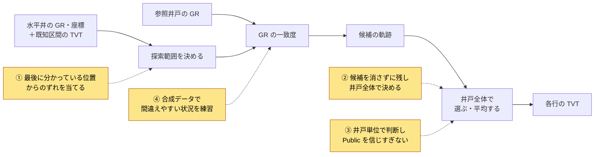
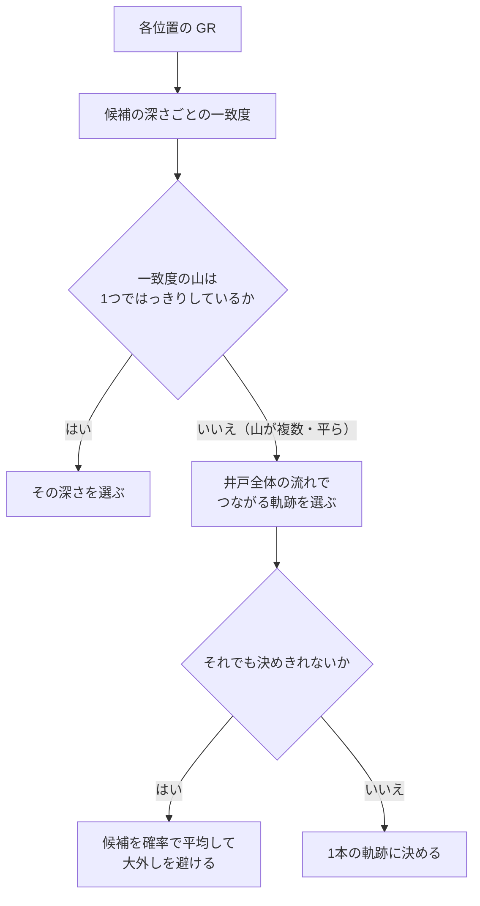

# ROGII - Wellbore Geology Prediction 上位解法まとめ — GRの別解を残し、参照・系列・不確実性で選ぶ

## はじめに

[ROGII - Wellbore Geology Prediction](https://www.kaggle.com/competitions/rogii-wellbore-geology-prediction) は、水平に掘った井戸（水平井）が地層のどの深さを通っているかを推定するコンペでした。手がかりは、井戸に沿って測ったガンマ線ログ（GR）と、近くの垂直な参照井戸（typewell）のGRです。2026年8月5日23:59（UTC）に終了しました。

上位のモデルはCNN、U-Net、HMM、particle filter（PF）、勾配ブースティングとばらばらでしたが、解こうとした問題は共通していました。結論を先に書きます。

> **似たGRの模様が複数の深さに現れるため、本当の誤差は「1行ずつの小さなずれ」ではなく、井戸の長い区間がまとめて別の地層に乗ってしまう「枝の取り違え」だった。上位チームは、探索範囲を狭い相対座標に絞り、複数の候補の軌跡を消さずに残し、井戸全体の文脈と不確実性で選ぶか平均した。そして、773本しかない実データを合成データで補い、枝を取り違えやすい状況をモデルに練習させた。**

本記事はこれを4つの勝負所に分けて、代表的なチームの例で説明します。

対象は最終順位1〜22位で、Kaggle CLIで取得できたDiscussionから18チーム・18本のSolution投稿を読みました。12位・15位・16位・19位のチームについては、調べたKaggle CLI経由のDiscussionの中に本人によるSolution投稿が見つかりませんでした。

## コンペ概要

### タスク

- **入力**: 水平井に沿った各行の掘削長（MD）、座標 `X, Y, Z`、GR。区間の途中までは正解の深さ（`TVT_input`）が見えている。加えて、近くの参照井戸のGRが深さごとに与えられる。
- **出力**: 正解が見えていない区間の、各行の地層上の深さ（TVT）。
- **評価**: 全テスト行をまとめたRMSE。

この問題には、直感に反する性質が3つあります。

1. **GRの「一番よく合う場所」が正解とは限らない。** GRの模様は周期的で、違う深さに似た波形が何度も現れます。局所的な一致だけで決めると、別の地層の枝に乗ってしまいます。
2. **誤差の正体は、行ごとのノイズではなく井戸全体の高さずれ。** 14位の分析では、井戸ごとの定数ずれを取り除くだけで、誤差が6.45から4.38に下がりました（[14位](https://www.kaggle.com/competitions/rogii-wellbore-geology-prediction/discussion/733201)）。
3. **評価は行単位でも、学習の単位は井戸。** 学習データは773本の井戸しかありません。長い井戸や大外しした井戸がRMSEを支配するので、行をランダムに分けた検証は当てになりません。

### 提供データ

| データ | 内容 |
| --- | --- |
| 水平井 | `MD, X, Y, Z, GR, TVT_input`。学習データには正解のTVTもある |
| 参照井戸（typewell） | 深さごとのGRと地質 |
| 学習用の井戸 | 773本。周辺の井戸の情報は、近傍特徴としても使える |
| 隠しテスト | 約200本。インターネットなしのNotebookで9時間以内に推論する |

### このコンペが難しい理由

- 参照井戸のGR、自分の既知区間のGR、近くの井戸、地層面の推定は、それぞれ違う条件で壊れる。1つの手がかりを信じすぎると、別の枝に乗る。
- 近くの井戸から作る特徴は強力だが、検証用の井戸を混ぜるとすぐにリークする。
- Public LBとPrivate LBで手法の順位が入れ替わった。
- 大きなモデルやアンサンブルほど、9時間の制限に引っかかる。

## 上位解法の全体像

ほぼすべてのチームが、「探索範囲を決める → GRの一致度を測る → 候補の軌跡を作る → 井戸全体で1本に決める」という骨格を使いました。差がついたのは、下図で色をつけた4か所です。

## 1. 絶対深度ではなく「最後に分かっている位置からのずれ」を当てる

**問題**: TVTの値そのものは約11,000 ftあります。それを直接当てようとすると、モデルは「絶対的な深さ」を覚えることに容量を使ってしまいます。本当に知りたいのは、既知区間の最後の位置から、その後どれだけずれたかです。

**上位の対処**: 予測の対象を、最後に分かっている位置（anchor）からの差に変えました。

- **21位**は、TVT約11,000 ftではなく、既知区間の末尾から約±16 ftの変化を予測しました（[21位](https://www.kaggle.com/competitions/rogii-wellbore-geology-prediction/discussion/733190)）。
- **18位**は、既知の坑井軌跡の始点と終点を直線（chord）で結び、その線からのずれを縦軸にしました。単体のCVは6.4から5.2に改善し、主な要因を座標系・解像度・合成データの3つと報告しています（[18位](https://www.kaggle.com/competitions/rogii-wellbore-geology-prediction/discussion/733250)）。
- **10位**は、`TVT+Z`（変動幅約160 ft）をそのまま状態にすると、既に分かっている幾何に解像度を浪費すると指摘しました（[10位](https://www.kaggle.com/competitions/rogii-wellbore-geology-prediction/discussion/733315)）。

**なぜ効くか**: 探索範囲が狭くなるので、0.5〜1 ft単位の細かい解像度を確保できます。さらに、正解の枝と偽の枝を同じ画面の中で比べられるようになります。

## 2. 候補を消さずに残し、井戸全体で決める

この節が本記事の中心です。

### GRの一致は「地形」として見せる

上位チームの多くは、「水平井の位置 × 候補の深さ」の各点にGRの一致度を描いた画像を作りました。そこには、正解の尾根と偽の尾根が一緒に写っています。9位は井戸全体を、384（深さ）× 640（掘削長）の画像として分類するU-Netを使いました（[9位](https://www.kaggle.com/competitions/rogii-wellbore-geology-prediction/discussion/733150)）。

ポイントは、この段階で1本に決めないことです。各位置で一番よく合う深さを選ぶ（argmax）と、偽の尾根に乗ったまま戻れなくなります。

### 1行ずつではなく、井戸全体で1本の軌跡にする

- **13位**は、候補の曲線を多数用意し、井戸全体で確率を正規化して平均をとりました。行ごとの読み取りから、この方式に変えるだけで、6.219が5.859に改善しました（[13位](https://www.kaggle.com/competitions/rogii-wellbore-geology-prediction/discussion/733174)）。
- **2位**は、各位置から「次の32 ftでどれだけ動くか」の確率を出し、全経路を足し合わせた期待値で軌跡を求めました。最もありそうな1本を選ぶ方式（Viterbi）や、1,024本の候補から選び直す方式より、一貫して強かったそうです。最終提出はOOF 5.140 / Private 5.802 です（[2位](https://www.kaggle.com/competitions/rogii-wellbore-geology-prediction/discussion/733432)）。

### 候補は「数」ではなく「間違い方の違い」で増やす

- **6位**は、5種類の参照と16種類のPF設定から91本の曲線を作りました。1本を選ぶより全候補を重みづけ平均する方が強く、候補15本のCV 6.50から、30本で5.94、91本で5.4577まで下がりました（Private 5.984）（[6位](https://www.kaggle.com/competitions/rogii-wellbore-geology-prediction/discussion/733226)）。
- **3位**は、候補を非負・合計1の重みで混ぜるゲートを使いました。CVは5.2797で、候補の範囲の外まで自由に補正するモデル（5.4023）に全5 foldで勝ちました（[3位](https://www.kaggle.com/competitions/rogii-wellbore-geology-prediction/discussion/733319)）。

ただし、似た間違い方をする候補を足しても効きません。14位では、XGBoostとU-Netという見た目は別系統のモデルでも、予測の相関は0.982でした（[14位](https://www.kaggle.com/competitions/rogii-wellbore-geology-prediction/discussion/733201)）。20位では、単体では強い（8.44）が既存モデルとの残差相関が0.96のモデルは、アンサンブルの改善が0でした。逆に、単体では弱い（11〜14）が違う方向に外すモデルは、約0.4の改善をもたらしました（[20位](https://www.kaggle.com/competitions/rogii-wellbore-geology-prediction/discussion/733845)）。

## 3. 井戸単位で判断し、Publicを信じすぎない

**問題**: Public LBの井戸は少なく、小さな差は偶然で入れ替わります。実際に、PublicとPrivateで順位が逆になる例が多くありました。

- **7位**では、ローカルCVが最良とした版と最悪とした版の順序が、Publicでは完全に逆でした。Privateは、ローカルCVの順序をほぼ支持しました（[7位](https://www.kaggle.com/competitions/rogii-wellbore-geology-prediction/discussion/733154)）。
- **22位**の終盤36提出では、PublicとPrivateの順位相関が −0.48、773本のCVとPrivateの相関が +0.84 でした（[22位](https://www.kaggle.com/competitions/rogii-wellbore-geology-prediction/discussion/733739)）。

**上位の対処**: 井戸単位で検証し、平均だけでなく「どの井戸が良くなったか」まで見ました。

- **14位**は、井戸単位で3,000回のbootstrapを行い、改善が0.01以上かつ改善の確率が90%以上の変更だけを採用しました（[14位](https://www.kaggle.com/competitions/rogii-wellbore-geology-prediction/discussion/733201)）。
- **17位**は、井戸を難易度で4層に分けました。大外しの井戸は全体の約6%（50/773）ですが、全体のRMSEを大きく動かします。そこで、全層、特に普通の井戸も改善する変更だけを採用しました（[17位](https://www.kaggle.com/competitions/rogii-wellbore-geology-prediction/discussion/733860)）。

ただし、正しい手順でも結果が報われるとは限りません。10位は、近傍の地層面を使う版をCVでは採用候補にしながら、Publicの悪化を見て却下しました。ところが、却下した版の方がPrivateは良い結果でした（6.179 vs 最終版6.269）（[10位](https://www.kaggle.com/competitions/rogii-wellbore-geology-prediction/discussion/733315)）。

## 4. 合成データで「間違えやすい状況」を練習させる

**問題**: 学習用の井戸は773本しかなく、枝の取り違えが起きる場面はその中でもさらに少数です。実データだけでは、「似た模様が複数ある中から正しい枝を選ぶ」練習を十分に積めません。

**上位の対処**: 読んだ18チームの半数以上が、合成した井戸で事前学習するか、実データに混ぜて学習しました。チームによっては、これが最大の改善源でした。

- **21位**は、合成データの量を12k→120k→240k stepと増やした効果が実データでの微調整後も残り、この段階だけでCVが6.30から5.60に下がりました。著者は「単一の施策で最大の改善」と書いています（[21位](https://www.kaggle.com/competitions/rogii-wellbore-geology-prediction/discussion/733190)）。
- **4位**は、合成データでの事前学習で初期のCVが8.2から6.7に改善しました。実データで微調整しない合成のみのモデルでも、CVは5.9に達しました（[4位](https://www.kaggle.com/competitions/rogii-wellbore-geology-prediction/discussion/733480)）。
- **5位**は、合成データだけでPrivate 6.342を出しました。実データでの微調整は約2 epochに抑えています。微調整でOOFは約1.5 ft改善しましたが、Privateの改善は約0.5 ftにとどまり、実データに深く合わせること自体がリスクでした（[5位](https://www.kaggle.com/competitions/rogii-wellbore-geology-prediction/discussion/733522)）。
- **2位**も、各epochで実データ約620本に、その場で生成した合成井戸2,048本を混ぜて学習しました（[2位](https://www.kaggle.com/competitions/rogii-wellbore-geology-prediction/discussion/733432)）。

### 作り方：見た目の自然さより「何を学ばせるか」

| 狙い | 代表例 |
| --- | --- |
| 実データの「紛らわしさ」を再現する | 21位: GRの一致度に現れる局所的な山の数を合成9.1 / 実10.1、一番よく合う場所が正解である割合を0.855 / 0.863まで合わせた。13位: 合成では正解が常に1位（100%）だが実データでは85%だったため、GRのゲイン・オフセット・ドリフトや欠損を加えて難しくした（[13位](https://www.kaggle.com/competitions/rogii-wellbore-geology-prediction/discussion/733174)） |
| 間違えやすい状況を意図的に入れる | 8位: ±15 ftの偽の一致を25%の確率で注入（[8位](https://www.kaggle.com/competitions/rogii-wellbore-geology-prediction/discussion/733281)）。20位: 珍しい折れ曲がり（kink）や大きく外れる軌跡を専用のローダーで生成（[20位](https://www.kaggle.com/competitions/rogii-wellbore-geology-prediction/discussion/733845)） |
| 前段モデルの失敗を練習させる | 7位: 正解に低周波のランダムな誤差を加えた約6,000本で、「自信ありげに間違う前段の予測をいつ疑うか」を学習（[7位](https://www.kaggle.com/competitions/rogii-wellbore-geology-prediction/discussion/733154)） |

### 使い方：段階的に入れ、実データの学習中も混ぜ続ける

- **4位**は、50万件で事前学習した後、絞り込んだ3.7万件で学習しました。約300万サンプルを超えると、モデルが分類の出力を捨てて楽な解に逃げる崩れ方をしました。量を増やせば良いわけではありません。
- **8位**は、実データの学習中も合成データを50%流し続け、fold 1が6.758から6.496に改善しました。13位でも、微調整中に合成を混ぜ続ける効果が最後まで0.228残りました。

ただし、どんな合成でも効くわけではありません。20位では見た目が自然な急傾斜の合成がCVを悪化させ、6位では自前の合成データでの事前学習が効きませんでした。成否を分けたのは、「何を練習させる合成か」が明確で、それを実データの統計で確かめていたかどうかです。

### 補足：そのほかに効いた工夫

4つの勝負所ほどではありませんが、多くのチームが取り入れた工夫です。

| 工夫 | なぜ効くか | 代表例 |
| --- | --- | --- |
| 自分の井戸の既知区間をGRの参照にする | 別の井戸・別の装置の参照井戸より、自分の井戸の方が似ていることが多い | 11位: 評価可能な548本の64%で、自分の既知区間の方が近かった（[11位](https://www.kaggle.com/competitions/rogii-wellbore-geology-prediction/discussion/733305)） |
| 物理的な事前情報は「補助の一票」として入れる | 単体では弱いが、GRの別解を絞り込める | 6位: 座標と周囲の傾斜から作った事前情報をPFに注入し、CV 6.98 → 6.50（[6位](https://www.kaggle.com/competitions/rogii-wellbore-geology-prediction/discussion/733226)） |
| 近傍の情報は、信頼できる井戸だけに使う | 近くに井戸が少ない場所では、近傍情報が外れやすい | 1位: 近傍の質が低い約10%の井戸では、位置情報を使わないモデルに切り替え（[1位](https://www.kaggle.com/competitions/rogii-wellbore-geology-prediction/discussion/733220)） |
| 9時間で確実に動く経路だけを提出する | 精度が高くても、時間切れやエラーなら得点にならない | 5位: Private 5.835相当のモデルが締切30分前にエラーで落ち、最終提出に入らなかった（[5位](https://www.kaggle.com/competitions/rogii-wellbore-geology-prediction/discussion/733522)） |

## 上位解法から見えた、特に重要な発見

### 1. 誤差の本体は、形ではなく高さ

局所的な曲線の形が合っていても、地層の枝を1つ取り違えるだけで、長い区間の二乗誤差が全体を支配します。まず「井戸ごとの定数ずれを消したら誤差がどれだけ減るか」を測ると、何に取り組むべきかが分かります。

### 2. 最良の表現は「候補を消さずに並べる」こと

PFの曲線、一致度の画像、曲線の候補集合と、形は違っても、上位はどれも複数の仮説を後段に渡していました。早い段階で1本に決めるより、井戸全体の文脈で選ぶか、確率で平均する方が強かったです。

### 3. 773本の不足は、合成データで補える

学習用の井戸が少ないこのコンペでは、合成データが単一の施策として最大級の改善をもたらしました。ただし効いたのは、見た目が本物らしい合成ではなく、枝の取り違えや偽の一致といった「実データで不足している難しい場面」を狙って作った合成でした。

### 4. 選び方の誤差も、モデルの誤差と同じくらい重要

foldの分け方、難しい井戸の偏り、Publicの小ささ、実行時間の失敗で、良いモデルを作っても選べないことがありました。平均CVだけでなく、「どの井戸が良くなったか」「違う間違い方をしているか」「本番と同じ経路で動くか」を確かめる必要があります。

## うまくいかなかったアプローチ

- **行ごとの表形式の回帰だけで解く**: 誤差が区間単位の高さずれなので、特徴を増やしても頭打ちになった。17位のGBDTが残ったのは、傾きの積分と区間ごとの補正を別に足したから（[17位](https://www.kaggle.com/competitions/rogii-wellbore-geology-prediction/discussion/733860)）。
- **候補を1本だけ選ぶ**: 2位では、1,024本の候補の中に良い軌跡はあっても、選び直すモデルが過学習した。情報が足りない場所では、平均した方が安全（[2位](https://www.kaggle.com/competitions/rogii-wellbore-geology-prediction/discussion/733432)）。
- **lossの工夫だけで複数の可能性を表現させる**: 18位では効かなかった。観測にない情報は、lossからは生まれない（[18位](https://www.kaggle.com/competitions/rogii-wellbore-geology-prediction/discussion/733250)）。
- **見た目だけ本物らしい合成データを作る**: 20位では、視覚的に自然な急傾斜の合成がCVを悪化させた。22位では、他の井戸の軌跡を移植した合成井戸は多様性を増やさなかった（[22位](https://www.kaggle.com/competitions/rogii-wellbore-geology-prediction/discussion/733739)）。
- **近傍情報をすべての井戸に強く入れる**: 20位では、井戸ごとに重みを学習するゲートがCVでは良く、LBで崩れた（[20位](https://www.kaggle.com/competitions/rogii-wellbore-geology-prediction/discussion/733845)）。
- **実行時間を最後に考える**: 7位では、締切前24時間の提出が9時間を超えて得点されなかった（[7位](https://www.kaggle.com/competitions/rogii-wellbore-geology-prediction/discussion/733154)）。

どれも、平均スコアだけを見て、「枝の取り違え」「井戸ごとの違い」「本番の制約」のどれかを見落とした例です。

## まとめ

上位解法の流れを6行にまとめると、次のとおりです。

1. 井戸ごとの定数ずれを測り、誤差の本体が「高さ」かどうかを確かめる。
2. 予測の対象を、最後に分かっている位置からのずれに変える。
3. GRの一致度を画像や曲線の候補として表し、複数の仮説を残す。
4. 井戸全体の文脈で候補を選ぶか、確率で平均する。
5. 間違えやすい状況を狙った合成データで事前学習し、実データの学習中も混ぜ続ける。
6. 井戸単位のCVで選び、9時間で確実に動く経路を提出する。

> **曖昧な観測から一点を急いで決めてはいけない。物理的に意味のある候補を並べ、系列全体の文脈と不確実性で「選ぶ・平均する・何もしない」を使い分ける。**

この考え方は、音声や生体信号の位置合わせ、地図上の経路推定など、似た局所一致が複数あって、誤りが長い区間でまとめて起きるタスクに使えます。

## 参照した上位Solution

各チームの要点を一言でまとめています。詳しく知りたいチームは、リンク先の投稿を参照してください。

| 順位 | チーム | 一言で言うと | 投稿 |
| --- | --- | --- | --- |
| 1位 | Ruby | 近傍の地層面を使い、近傍の質が低い井戸だけ別モデルに切り替え | [1st Place Solution](https://www.kaggle.com/competitions/rogii-wellbore-geology-prediction/discussion/733220) |
| 2位 | Bilzard | 次の移動量の確率を出し、全経路の期待値で軌跡を決めるAnchorCNN | [AnchorCNN](https://www.kaggle.com/competitions/rogii-wellbore-geology-prediction/discussion/733432) |
| 3位 | tereka & Takoi | 多様な候補を、範囲内に制約したゲートで行ごとに混ぜる | [3rd Place Solution](https://www.kaggle.com/competitions/rogii-wellbore-geology-prediction/discussion/733319) |
| 4位 | L & J & A & A | 2段階の合成データで事前学習したConvNeXt | [4th Place Solution](https://www.kaggle.com/competitions/rogii-wellbore-geology-prediction/discussion/733480) |
| 5位 | daimaru | 潜在的な地質から2種類の観測を作る合成データで、合成だけでも高精度 | [5th Place Solution](https://www.kaggle.com/competitions/rogii-wellbore-geology-prediction/discussion/733522) |
| 6位 | k256.dev | 5種類の参照×16設定のPFで91本の曲線を作り、重みづけ平均 | [PF, PF, PF, PF, Physics and Row-Level Bagging](https://www.kaggle.com/competitions/rogii-wellbore-geology-prediction/discussion/733226) |
| 7位 | roglike | HMMの後に、不確かな場所だけ直すrefinerを重ねる | [HMM + UNet](https://www.kaggle.com/competitions/rogii-wellbore-geology-prediction/discussion/733154) |
| 8位 | 富士山 | 20本のPFを区間ごとに選ぶrankerと、合成データで事前学習したU-Net | [PF ranker + Synthetic-Pretrained U-Net](https://www.kaggle.com/competitions/rogii-wellbore-geology-prediction/discussion/733281) |
| 9位 | tremors | 井戸全体を1枚の画像として扱うU-Net | [9th Place Solution](https://www.kaggle.com/competitions/rogii-wellbore-geology-prediction/discussion/733150) |
| 10位 | Can | 近傍の地層面とPublic LBの乖離を詳しく分析 | [A Compass, Not a Map](https://www.kaggle.com/competitions/rogii-wellbore-geology-prediction/discussion/733315) |
| 11位 | IIDA | 自分の井戸の既知区間をGRの参照に使う | [Using the Well's Own Known Section as the Reference](https://www.kaggle.com/competitions/rogii-wellbore-geology-prediction/discussion/733305) |
| 13位 | monnu | 候補曲線を井戸全体で確率平均する | [13th Place Solution](https://www.kaggle.com/competitions/rogii-wellbore-geology-prediction/discussion/733174) |
| 14位 | keithtyser | 階層的なU-Netと、井戸単位bootstrapによる厳密な採用判定 | [A Hierarchical U-Net Stack with Seed Averaging](https://www.kaggle.com/competitions/rogii-wellbore-geology-prediction/discussion/733201) |
| 17位 | Falcon | 高さ・傾き・区間ごとのずれを、別々のモデルで補正 | [Direct level + Integrated slope + Segment correction](https://www.kaggle.com/competitions/rogii-wellbore-geology-prediction/discussion/733860) |
| 18位 | yu4u | 既知軌跡の両端を結ぶ直線からのずれを予測 | [18th Place Solution](https://www.kaggle.com/competitions/rogii-wellbore-geology-prediction/discussion/733250) |
| 20位 | Yannan Chen | GRと参照井戸の対応を反復で修正するRAFT型のマッチャー | [RAFT-refined GR↔typewell matcher](https://www.kaggle.com/competitions/rogii-wellbore-geology-prediction/discussion/733845) |
| 21位 | goonew | 実データの統計に合わせた合成データと、前後方向の確率計算による復号 | [21st Place Solution](https://www.kaggle.com/competitions/rogii-wellbore-geology-prediction/discussion/733190) |
| 22位 | N & A & O & A & A | 5系統のモデルと、Public LBの落とし穴の分析 | [Five Engines and a Hard Lesson About Leaderboards](https://www.kaggle.com/competitions/rogii-wellbore-geology-prediction/discussion/733739) |

12位（jmm）、15位（Herra Huu）、16位（Katastrofik Kuyu Tahmincileri）、19位（Orson Wells）は、調べたKaggle CLI経由のDiscussionの中に本人によるSolution投稿が見つかりませんでした。
