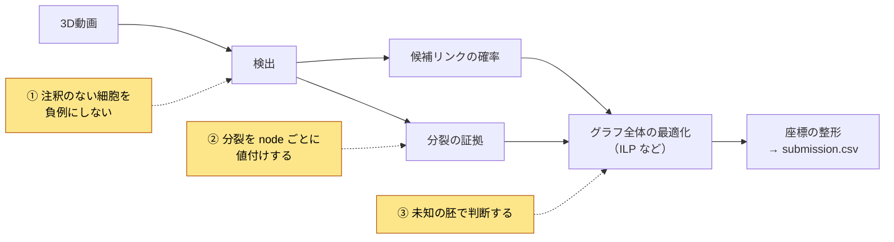
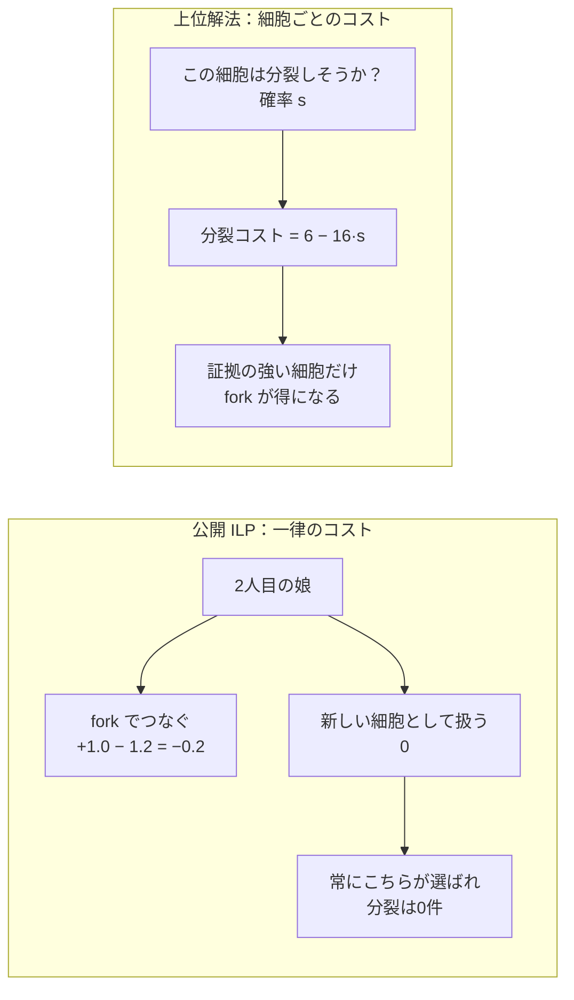

# Biohub - Cell Tracking During Development 上位解法まとめ — 分裂を細胞ごとの証拠で値付けし、系譜グラフ全体で決める

## はじめに

[Biohub - Cell Tracking During Development](https://www.kaggle.com/competitions/biohub-cell-tracking-during-development) は、ゼブラフィッシュ胚の3D顕微鏡動画から細胞核を見つけ、フレーム間でつなぎ、細胞分裂まで含めた「系譜グラフ」を作るコンペでした。2026年9月29日（UTC）に終了し、3,947チームが参加しました。

上位のモデル構成はばらばらでしたが、勝負を分けたポイントは共通していました。結論を先に書きます。

> **注釈が数%しかなく、分裂1件がedge数十本分の価値を持つ評価では、検出精度より「分裂の値付け」が勝負を決めた。この細胞は分裂するか、どれが娘かを細胞ごとの証拠で値付けし、系譜グラフ全体の最適化に渡したチームが上位に来た。**

これを支える前提が2つあります。注釈のない細胞を「負例」にしないことと、学習に使っていない胚で判断することです。本記事はこの3点に絞って、代表的なチームの例で説明します。

対象は最終順位1〜17位で、Kaggle CLIで取得できたDiscussionから14チーム・15本のSolution投稿を読みました。8位・13位・15位のチームについては、調べたKaggle CLI経由のDiscussionの中に本人によるSolution投稿が見つかりませんでした。

## コンペ概要

### タスク

- **入力**: 1本100フレームの3Dボリューム動画（64×256×256ボクセル）。z方向だけ解像度が4倍粗い。
- **出力**: 各フレームの細胞の位置（**node**）と、t の細胞から t+1 の細胞へのリンク（**edge**）。1つのnodeから2本のedgeが出る分岐（**fork**）が分裂を表す。
- **評価**: `score = adjusted_edge_jaccard + 0.1 × division_jaccard`。予測と正解のnodeを7 µm以内で対応づけ、edgeの正しさと分裂の正しさを測る。

この指標には、直感に反する性質が3つあります。

1. **注釈のある細胞しか採点されない。** 正解の注釈は推定細胞数の約2.8%だけです。注釈のない細胞同士を正しくつないでも加点はありません。一方、予測nodeの総数が推定細胞数を超えると減点されます。
2. **分裂1件がとても重い。** 分裂の重みは0.1ですが、分裂は全部で151件しか注釈がありません。12位の計算では、学習データ上で分裂1件の見逃しはedge約74本の見逃しに相当しました（[12位](https://www.kaggle.com/competitions/biohub-cell-tracking-during-development/discussion/744501)）。
3. **テストは別の胚。** 学習の2胚とは違う胚で採点され、Public LBとPrivate LBもそれぞれ別の胚でした。

### 提供データ

| データ | 内容 |
| --- | --- |
| 学習動画 | 2つの胚から切り出した199本（`.zarr`） |
| 正解グラフ | 疎な注釈（約133,000 node、分裂151件、`.geff`） |
| 推定細胞数 | 動画ごとの細胞数の推定値。node数の減点の基準になる |
| 実行環境 | インターネットなしのNotebookで12時間以内 |

### このコンペが難しい理由

- 見えている細胞の大半にラベルがないので、「ラベルなし＝背景」と学習させると本物の細胞を消すモデルになる。
- 分裂の教師が151件しかなく、分類問題として素直に学習すると負例ばかり覚える。
- 公開ノートブックの重みは学習データ199本すべてで学習されていて、学習データ上のスコアが当てにならない。
- 胚が変わると、核の大きさも密度も変わる。

## 上位解法の全体像

ほぼすべてのチームが、「細胞を検出する → 候補リンクに確率をつける → グラフ全体を最適化で確定する → 座標を整える」という同じ骨格を使いました。差がついたのは、下図で色をつけた3か所です。

ここでのILP（整数線形計画法）は、「どのnode・edge・forkを採用するか」を0/1の変数にし、コストの合計が最小になる組み合わせをソルバーで解く方法です。

## 1. 注釈のない細胞を負例にしない

**問題**: 正解の位置にだけ「細胞」の印をつけ、残りをすべて背景として学習すると、注釈のない本物の細胞まで「ここには何もない」と教えることになります。

**上位の対処**: 画像を「注釈あり」「確実に背景」「不明」の3つに分け、「不明」は学習に使わないか、ごく弱くしか使いませんでした。

- **4位**は、暗さで判断した「確実な背景」以外を不明として扱いました。さらに3つのグループの重みをそれぞれの面積で割ってそろえました。そうしないと注釈部分がlossの0.5%未満しか占めず、モデルが「全部背景」と答えるようになったそうです（[4位](https://www.kaggle.com/competitions/biohub-cell-tracking-during-development/discussion/744673)）。
- **6位**は「不明」を学習から外す代わりに、検出の総量を推定細胞数に近づける制約（count prior）を入れて、出しすぎを防ぎました（[6位](https://www.kaggle.com/competitions/biohub-cell-tracking-during-development/discussion/744582)）。

**逆をやるとどうなるか**: 9位は、注釈のない場所を背景として学習した検出器を試しました。結果はPublic +.002 に対しPrivate −.019 で、全提出の中で最悪でした（[9位](https://www.kaggle.com/competitions/biohub-cell-tracking-during-development/discussion/744835)）。学習した胚の「注釈のつき方」まで覚えてしまい、別の胚で崩れたと考えられます。

同じ考え方は分裂モデルにも当てはまります。4位では、「難しい負例」を集めて学習させるとひどく悪化しました。難しい負例の大半が、実は注釈のない本物の分裂だったからです（[4位](https://www.kaggle.com/competitions/biohub-cell-tracking-during-development/discussion/744673)）。

## 2. 分裂をnodeごとに値付けし、グラフ全体で決める

この節が本記事の中心です。

### 公開パイプラインは分裂を1件も作れなかった

公開ノートブックのILPは、次の設定でした（14位の整理による）。

- edgeを1本採用すると、+1.0（報酬）。
- forkを1つ開くと、−1.2（コスト）。
- 細胞が新しく現れたことにするのは、0。

2人目の娘をforkでつなぐと +1.0 − 1.2 = −0.2 になります。一方、新しく現れた細胞として扱えば0です。後者が常に得なので、ILPは**構造上forkを1つも開きません**（[14位](https://www.kaggle.com/competitions/biohub-cell-tracking-during-development/discussion/744486)）。9位は、最良の公開パイプラインが検証の40本すべてでforkを0件しか作らないことを確認し、分裂を後から書き戻すだけで Public +.011 / Private +.013 を得ました（[9位](https://www.kaggle.com/competitions/biohub-cell-tracking-during-development/discussion/744835)）。

### 一律のコストから、細胞ごとのコストへ

分裂コストが全細胞で同じだと、ソルバーは「forkを一度も開かない」か「近くに細胞があるだけで偽のforkを開く」かの両極端になります（[4位](https://www.kaggle.com/competitions/biohub-cell-tracking-during-development/discussion/744673)）。上位チームはこれを、細胞ごとの証拠で決まるコストに変えました。

代表例が4位です。各細胞について「分裂する母細胞である確率」s を学習し、分裂コストを `6 − 16·s` にしました。s が0.375を超えるとコストが負、つまり分裂が「報酬」に変わります。この変更だけで、LBは0.913から0.948へ（Public/Privateとも +0.035）上がりました（[4位](https://www.kaggle.com/competitions/biohub-cell-tracking-during-development/discussion/744673)）。

### 「分裂しそうか」は細胞を見れば分かる

s をどう作るかでは、細胞そのものの見た目を使ったチームが強かったです。1位は人手で細胞を追跡しているうちに、分裂直前の細胞が「震え、明るくなり、大きくなり、突然2つに割れる」ことに気づきました。そこで、各細胞の前後3フレームを切り出して「分裂間近か」を判定する小さなモデル（Soon Net）を作り、分裂の改善だけでPublic LBを約0.925から約0.963へ伸ばしました（[1位](https://www.kaggle.com/competitions/biohub-cell-tracking-during-development/discussion/744801)）。

### 決めるのはグラフ全体で一度に

リンクを先に確定させてから分裂を足そうとすると、正しい娘がすでに別の親に取られていて、手遅れになります。3位はnode・リンク・分裂を1つの最適化で同時に選びました。その段階を加えた時点で、スコアは0.901953から0.964493になり、全工程で最大の伸びでした。ただし、この段階では分裂モデルや確率の調整も同時に入れています（[3位](https://www.kaggle.com/competitions/biohub-cell-tracking-during-development/discussion/744484)）。7位も、1回目の最適化の後に分裂の候補を評価し直し、グラフ全体をもう一度解き直しています（[7位](https://www.kaggle.com/competitions/biohub-cell-tracking-during-development/discussion/744937)）。

## 3. 未知の胚で判断する

**問題**: 公開の重みは学習データ199本すべてで学習されていたので、それを使ったパイプラインを学習データで測ると、「答えを見たテスト」の点数になります。

- **12位**の自前ベンチマークは、Privateより約0.03高く出ていました。104組の比較のうち17組で、PublicとPrivateの改善の向きが逆でした（[12位](https://www.kaggle.com/competitions/biohub-cell-tracking-during-development/discussion/744501)）。
- **9位**では、自前で学習したモデルの価値がPublicでは +.004 に見えたのに、Privateでは +.023 でした（[9位](https://www.kaggle.com/competitions/biohub-cell-tracking-during-development/discussion/744835)）。

**上位の対処**: 片方の胚で学習し、もう片方の胚で評価しました。

- **10位**はこの方法で開発を進め、Publicは1838位でしたが、Privateで10位まで上がりました（[10位](https://www.kaggle.com/competitions/biohub-cell-tracking-during-development/discussion/744980)）。
- **17位**は、変更を設計する動画と確認する動画を分け、確認で落ちた変更は捨てました。それでも、CVでの改善のうちPrivateまで届いたのは23%でした（[17位](https://www.kaggle.com/competitions/biohub-cell-tracking-during-development/discussion/744930)）。

Publicの小さな差は誤差と考えた方が安全です。16位では、乱数seedを変えただけでPublicに0.006の差が出ました（Privateは0.001）（[16位](https://www.kaggle.com/competitions/biohub-cell-tracking-during-development/discussion/744671)）。

### 補足：そのほかに効いた工夫

3つの勝負所ほどではありませんが、多くのチームが取り入れた工夫です。

| 工夫 | なぜ効くか | 代表例 |
| --- | --- | --- |
| 集団の動きを差し引いてからリンクを比べる | 胚全体が流れると、止まっている細胞も動いて見える | 6位: 試料台のずれを除いた距離で、検証 +0.009（[6位](https://www.kaggle.com/competitions/biohub-cell-tracking-during-development/discussion/744582)） |
| Linkerに「対応相手なし（新規細胞）」の選択肢を持たせる | ないと、相手のいない細胞まで無理に隣とつながる | 5位: 新規細胞・分裂のheadを追加して Public +0.020 / Private +0.024（[5位](https://www.kaggle.com/competitions/biohub-cell-tracking-during-development/discussion/744549)） |
| 擬似ラベルはパイプライン全体の出力から作る | 最適化後のつながりは、モデル単体の判断より正確 | 6位: 最初の自己学習ラウンドで検証 +0.008（[6位](https://www.kaggle.com/competitions/biohub-cell-tracking-during-development/discussion/744582)） |
| ILPのコストを評価指標で調整する | ソルバーの目的と、コンペの評価はずれている | 11位: 再学習とコスト調整を合わせて Public 0.89618 → 0.94905（[11位](https://www.kaggle.com/competitions/biohub-cell-tracking-during-development/discussion/745092)） |
| 座標はグラフを決めた後に整え、整数で書く | 先に動かすと正しいリンクが減る。正解は整数座標 | 9位: 切り捨てを四捨五入に直して Public +.009 / Private +.013（[9位](https://www.kaggle.com/competitions/biohub-cell-tracking-during-development/discussion/744835)） |
| 消えた暗い細胞は「何フレームも続く」ときだけ戻す | 1フレームだけの点は誤検出の可能性が高い | 2位: 捨てた候補から長い経路を回収し、正しいedge +360本（[2位](https://www.kaggle.com/competitions/biohub-cell-tracking-during-development/discussion/744723)） |

## 上位解法から見えた、特に重要な発見

### 1. 点数は検出より分裂で動いた

分裂1件はedge数十本分の重さを持つのに、公開ILPはコストの設定上、分裂を作れませんでした。分裂を細胞ごとに値付けする変更が、4位・9位で最大級の改善になり、3位でも最大の伸びを含む段階になっています。

### 2. 「分からない」を「違う」として学習させない

検出でも分裂でも、注釈のない対象を負例にすると、別の胚で崩れました。ラベルのない場所は「不明」として、学習から外します。

### 3. 物差しを間違えると、良い手法でも負ける

学習データ上のスコアやPublicの小さな差で選んだ改善は、Privateで消えることが多くありました。見ていない胚で測ったものだけを信じたチームが、Privateで順位を上げています。

## うまくいかなかったアプローチ

- **注釈のない場所を背景として学習する**: 9位でPrivate −.019。不明領域は学習から外す（[9位](https://www.kaggle.com/competitions/biohub-cell-tracking-during-development/discussion/744835)）。
- **分裂モデルで難しい負例を集める**: 4位で大きく悪化。難しい負例の多くは、注釈のない本物の分裂だった（[4位](https://www.kaggle.com/competitions/biohub-cell-tracking-during-development/discussion/744673)）。
- **合成データで事前学習した検出器をメインにする**: 7位ではPublicが上がる一方、Privateは0.956から0.947に下がった。補助として使う方が安全（[7位](https://www.kaggle.com/competitions/biohub-cell-tracking-during-development/discussion/744937)）。
- **見逃しを減らすためにnodeを足す**: 17位では、ごく狭い例外を除き、node数の減点か誤ったリンクで帳消しになった（[17位](https://www.kaggle.com/competitions/biohub-cell-tracking-during-development/discussion/744930)）。
- **学習データ上のベンチマークで判断する**: 12位はPrivateを約0.03高く見積もった（[12位](https://www.kaggle.com/competitions/biohub-cell-tracking-during-development/discussion/744501)）。

どれも、「多い方が良い」「学習データで良い方が良い」という直感が、この評価条件では成り立たなかった例です。

## まとめ

上位解法の流れを5行にまとめると、次のとおりです。

1. 注釈のない領域を「不明」として扱い、時間方向の文脈も使って細胞を検出する。
2. 集団の動きを差し引いて、候補リンクに確率をつける。
3. 細胞ごとの「分裂しそうか」の証拠から、分裂コストを決める。
4. node・リンク・分裂を、グラフ全体の最適化で同時に決める。
5. 学習に使っていない胚で評価して、最終提出を選ぶ。

> **稀で価値の高いイベントを、一律の閾値やコストで扱ってはいけない。そのイベントに固有の証拠で1件ずつ値付けし、他の決定と同じ最適化の中で決める。そしてラベルがないことを、負の証拠として扱わない。**

この考え方は、注釈の少ない多物体追跡や、稀なイベントを含むグラフ構築など、評価が稀なイベントに大きな重みを置くタスク全般に使えます。

## 参照した上位Solution

各チームの要点を一言でまとめています。詳しく知りたいチームは、リンク先の投稿を参照してください。

| 順位 | チーム | 一言で言うと | 投稿 |
| --- | --- | --- | --- |
| 1位 | Sergio Alvarez | 細胞を3フレーム見て分裂状態と行き先を予測し、学習済みLinkerで分裂を判定 | [1st Place Solution](https://www.kaggle.com/competitions/biohub-cell-tracking-during-development/discussion/744801) |
| 2位 | Soheil Ayati | 弱い検出を捨てずに保持し、何フレームも続く暗い細胞を後から回収 | [2nd Place Solution](https://www.kaggle.com/competitions/biohub-cell-tracking-during-development/discussion/744723) |
| 3位 | yu4u | flow・対応・分裂を別々に学習し、node・リンク・分裂をLP/MILPで同時に選択 | [3rd Place Solution](https://www.kaggle.com/competitions/biohub-cell-tracking-during-development/discussion/744484) |
| 4位 | Barry | 生物学の観察を小さなモデルに落とし込み、細胞ごとの分裂コストで +0.035 | [4th Place Solution](https://www.kaggle.com/competitions/biohub-cell-tracking-during-development/discussion/744673) |
| 5位 | Tang | 公式baselineに「新規細胞」と分裂のheadを足し、多段のILPで仕上げ | [5th Place Solution](https://www.kaggle.com/competitions/biohub-cell-tracking-during-development/discussion/744549) |
| 6位 | Cyrus | 検出とリンクを1つのネットワークで行い、パイプライン全体を先生にして自己学習 | [Detect, Link, Solve, Repeat](https://www.kaggle.com/competitions/biohub-cell-tracking-during-development/discussion/744582)、[A Tracker That Teaches Itself](https://www.kaggle.com/competitions/biohub-cell-tracking-during-development/discussion/745676) |
| 7位 | tatsutaka | 単一の強い検出器と専用の分裂パイプライン、2段階のILP | [7th Place Solution](https://www.kaggle.com/competitions/biohub-cell-tracking-during-development/discussion/744937) |
| 9位 | yuto083 | 公開パイプラインが作れなかった分裂を書き戻し、自前モデルでPrivateを伸ばした | [9th Place Solution](https://www.kaggle.com/competitions/biohub-cell-tracking-during-development/discussion/744835) |
| 10位 | Kaggle Agent | 胚単位の検証を徹底し、Public 1838位からPrivate 10位へ | [10th place solution](https://www.kaggle.com/competitions/biohub-cell-tracking-during-development/discussion/744980) |
| 11位 | tanbo | 検出・動き・分裂を同時に学習し、ILPのコストを評価指標で調整 | [11th Place Solution](https://www.kaggle.com/competitions/biohub-cell-tracking-during-development/discussion/745092) |
| 12位 | Corwin | 公開パイプラインに修復処理を重ね、in-sample評価の落とし穴を詳しく分析 | [12th Place Solution](https://www.kaggle.com/competitions/biohub-cell-tracking-during-development/discussion/744501) |
| 14位 | Vibes & Edges Trade-Off | 失敗の仕方が違う2本のパイプラインを動画ごとに統合し、分裂は対応関係の回帰で検出 | [14th place solution](https://www.kaggle.com/competitions/biohub-cell-tracking-during-development/discussion/744486) |
| 16位 | r3takahashi | 自前の検出器を自己学習で育て、公開のリンク処理と組み合わせ | [16th Place Solution](https://www.kaggle.com/competitions/biohub-cell-tracking-during-development/discussion/744671) |
| 17位 | ibyyue | 胚単位の検証と、評価指標への影響を教師にした後処理の学習 | [17th Place Solution](https://www.kaggle.com/competitions/biohub-cell-tracking-during-development/discussion/744930) |

8位（Amin）、13位（The Boys）、15位（Yapay Hücre）は、調べたKaggle CLI経由のDiscussionの中に本人によるSolution投稿が見つかりませんでした。
