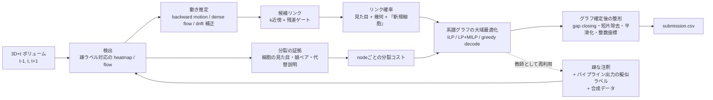
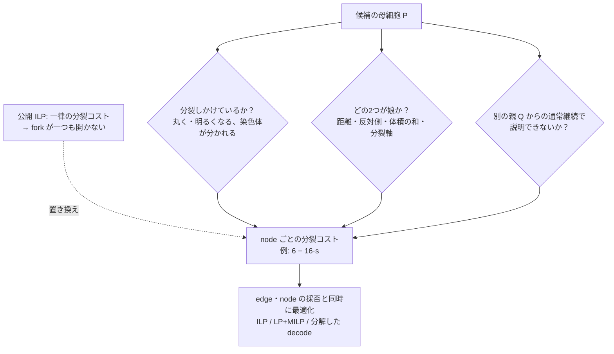
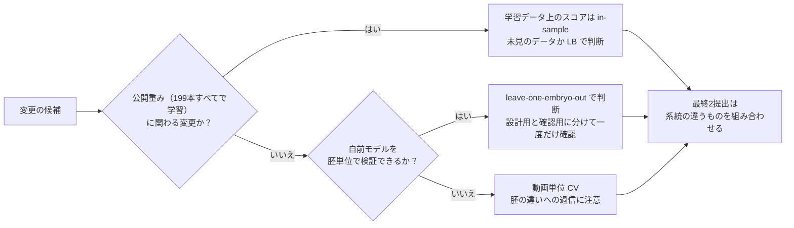

# Biohub - Cell Tracking During Development 上位解法まとめ — 分裂を細胞ごとの証拠で値付けし、系譜グラフ全体で決める

## はじめに

[Biohub - Cell Tracking During Development](https://www.kaggle.com/competitions/biohub-cell-tracking-during-development) は、ゼブラフィッシュ胚の3D+時間の蛍光顕微鏡動画を扱うコンペでした。細胞核を見つけ、フレーム間で同じ細胞をつなぎ、細胞分裂も見つけて、誰が誰から生まれたかを表す「系譜グラフ」を作ります。2026年9月29日（UTC）に終了し、3,947チームが参加しました。

上位解法のモデル構成はばらばらです。

- **検出器**: Cellpose型のベクトル場、2.5D U-Net、nnU-Netなど
- **Linker（フレーム間で細胞をつなぐモデル）**: LightGlue風のTransformer、GBDTなど
- **系譜グラフの確定**: ILP（整数線形計画法）、LP緩和+MILP、greedy decode（貪欲法）など

それでも、どこで点差がついたかを追うと共通点がはっきりします。上位チームは検出をさらに数%伸ばすことよりも、**分裂という稀なイベントを、その細胞に固有の証拠で値付けし、リンクと一緒にグラフ全体で決める**ことに労力を注いでいました。

> **注釈が数%しかなく、分裂1件がedge数十本分の価値を持つ評価では、勝負を決めるのは検出精度ではない。「この細胞は分裂するか」「どの2つが娘か」を細胞ごとの証拠で値付けし、系譜グラフ全体の最適化に渡せるかどうかで決まる。**

この主張には前提が2つあります。

1. 注釈のない細胞を「背景」や「負例」として扱わないこと。
2. 学習に使っていない胚で判断すること。テストの胚は学習データにない胚で、Public LBとPrivate LBもそれぞれ別の胚でした。

この2点を外したチームでは、Publicで効いた改善がPrivateで消えたり逆転したりしています。

本記事は最終順位1〜17位を対象に、Kaggle CLIで取得できたDiscussionから14チーム・15本のSolution投稿を読み、パイプラインの段階ごとに整理したものです。8位・13位・15位のチームについては、調べたKaggle CLI経由のDiscussionの中に本人によるSolution投稿が見つかりませんでした。

## コンペ概要

### タスク

入力は1本あたり `(T, Z, Y, X) = (100, 64, 256, 256)` の `uint16` ボリューム動画です。ボクセル間隔は z=1.625 µm、y=x=0.40625 µm で、z方向だけ4倍粗い異方性データです。出力は2種類の行からなるCSVです。

- **node**: 各フレームで検出した細胞の重心（整数ボクセル座標）。
- **edge**: 時刻 t の細胞から t+1 の細胞へのリンク。1つの細胞から2本以上のedgeが出れば「分裂」とみなされます。本記事では、グラフ上のこの分岐を **fork**、生物学的な事象を **分裂** と呼び分けます。

評価指標は次の式です。

```text
score = adjusted_edge_jaccard + 0.1 × division_jaccard
```

- **edge側**: 各時刻で予測nodeと正解nodeを、最大7.0 µmの二部マッチングで対応づけます。両端が正解edgeの両端に対応した予測edgeを正解（TP）とします。予測node数が主催者推定の細胞数を上回ると、ペナルティがかかります（以下「node数補正」）。
- **分裂側**: 正解の分裂ごとに、分裂前の段階と両方の娘の系譜に触れる連結成分が予測にあるかで判定します。

この指標から、戦略上の帰結が3つ出てきます。

1. **nodeを多めに出しても得をしにくい。** edgeの評価は、注釈された細胞に触れるedgeだけを数えます。注釈のない細胞同士を正しくつないでも加点されません。一方でnodeの総数は推定細胞数と比べられ、超えた分は減点されます。「多めに出す」は、edge側ではあまり得をせず、node側で損をする構造です。
2. **分裂1件は非常に重い。** 12位チームの計算では、edge側の分母（正解・見逃し・誤りのedgeの合計）は133,795本、分裂側の分母は181件（正解の分裂151件に、誤って予測した分裂30件を加えた数）でした。分裂側に重み0.1がかかっても、1件あたりの重さは桁違いです。学習データ上で見逃した分裂1件の損失は、見逃したedge約74本分に相当しました（[12位](https://www.kaggle.com/competitions/biohub-cell-tracking-during-development/discussion/744501)）。
3. **位置のずれがそのまま失点になる。** 座標は整数で書き出す必要があります。位置が数µmずれるだけで、7 µm以内のマッチングを失います。

### 提供データ

| データ | 内容 | 解法上の役割 |
| --- | --- | --- |
| `train/*.zarr` | 2胚（`44b6`: 71本、`6bba`: 128本）から切り出した199本の3D+t動画 | 検出・動き・分裂モデルの入力 |
| `train/*.geff` | 疎な正解系譜グラフ（node重心と時間edge）。約133,000 node、分裂は151件 | 教師。注釈は推定細胞数の約2.8%しかない |
| `estimated_number_of_nodes` | 動画ごとの推定細胞数（`.geff` メタデータ） | node数補正の基準。count priorやnode数の調整に使える |
| `test/*.zarr` | 学習データのコピー4本（提出時に隠しテストへ差し替え） | 実行時間の見積もりとパイプラインの動作確認 |
| フォルダ名 `{embryo_id}_{fov}` | 胚IDが分かる。学習とテストは胚単位で分離 | 胚単位の検証分割の根拠になる |

### このコンペが難しい理由

- **注釈が極端に疎**: 見えている核の大半にラベルがありません。12位チームの集計では注釈率は `44b6` で0.77%、`6bba` で5.37%でした（[12位](https://www.kaggle.com/competitions/biohub-cell-tracking-during-development/discussion/744501)）。ラベルのない場所をすべて背景として学習させると、本物の細胞を抑制するように学習してしまいます。
- **分裂の教師が151件しかない**: 稀な事象の分類として素直に学習すると、モデルは負例ばかりを覚えます。
- **テストの胚が学習と違う**: 3位チームの調査では、Publicの胚 `fdad` とPrivateの胚 `ea36` で細胞密度が大きく違い、Privateは学習の2胚よりまばらでした（[3位](https://www.kaggle.com/competitions/biohub-cell-tracking-during-development/discussion/744484)）。動画単位のCVは、同じ胚を学習と検証の両方に含んでしまいます。
- **公開重みの検証リーク**: 公開ノートブックのcheckpointは、学習データ199本すべてで学習されていました。そのため、公開重みを使ったパイプラインを学習データ上で測ると、モデルが既に見たデータでの成績（in-sample）になり、未知の胚での実力を過大に見せます（[9位](https://www.kaggle.com/competitions/biohub-cell-tracking-during-development/discussion/744835)、[12位](https://www.kaggle.com/competitions/biohub-cell-tracking-during-development/discussion/744501)）。
- **撮像のアーティファクト**: `6bba` の114本には、直前フレームとバイト単位で同一のコピーフレームが947枚あります。ボリューム全体が数µm跳ぶフレームや、ステージ（試料台）のドリフトもあります（[12位](https://www.kaggle.com/competitions/biohub-cell-tracking-during-development/discussion/744501)、[17位](https://www.kaggle.com/competitions/biohub-cell-tracking-during-development/discussion/744930)）。
- **実行制約**: インターネットなしのNotebookで12時間以内です。隠しテストは学習データと同程度の量があり、6位チームは2×T4で約10時間をかけています（[6位](https://www.kaggle.com/competitions/biohub-cell-tracking-during-development/discussion/744582)）。

### この記事で使う用語

| 用語 | この記事での意味 |
| --- | --- |
| node / edge / fork | 予測グラフの細胞 / フレーム間のリンク / 1つのnodeから2本のedgeが出る分岐 |
| GT | ground truth。主催者の正解注釈 |
| ILP | 整数線形計画法。各node・edge・forkを採用するかどうかを0/1の変数にし、コストの総和が最小になる組み合わせをソルバーで解く |
| LP緩和 / MILP | 0/1の制約をいったん緩めて連続値で解く近似 / 一部の変数だけ整数に戻して解く混合整数版 |
| node数補正 | 予測node数が推定細胞数を超えた分だけedgeのスコアを割り引く、指標上のペナルティ |
| count prior | 検出の総量を推定細胞数に引き寄せる学習上の制約 |
| null / 新規細胞 | 「この細胞には前フレームの対応相手がいない」というLinkerの選択肢 |
| in-sample | モデルが学習に使ったデータの上で測った成績 |
| OOF | out-of-fold。各foldで学習に使っていないデータへの予測 |
| TTA | test-time augmentation。反転や回転をかけた入力の予測を平均する手法 |
| DoG | Difference of Gaussians。ぼかし画像の差分で斑点を拾う古典的な検出法 |

## 上位解法の全体像

上位解法は、ほぼすべて「先に細胞を検出してから、フレーム間でつなぐ」形（tracking-by-detection）をとります。違いは、各段階でどの証拠を作り、それをどこで統合するかにあります。下図は、収集したSolutionから再構成した典型的な流れです。



チーム間の違いは、主に次の軸に現れました。かっこ内は、本記事で扱う節です。

1. **疎ラベルの扱い（1節）**: ラベルのない領域をlossから外すか、弱い負例にするか。count priorを入れるか。
2. **教師の増やし方（2節）**: 擬似ラベルを検出器単体から作るか、トラッカー全体の出力から作るか。分裂を掘り出すか。合成データを使うか。
3. **リンクの根拠（3節・4節）**: 距離と動きだけで決めるか。細胞の見た目と「新規細胞」という選択肢まで学習させるか。
4. **分裂の決め方（5節）**: 一律の分裂コストか、nodeごとの学習済みスコアか。最適化の中で決めるか、後段で付け足すか。
5. **座標とnode数の整え方（6節）**: 位置補正をどの順番でかけるか。nodeを足す条件をどう決めるか。
6. **検証の物差し（7節）**: 動画単位CV、胚単位CV、in-sampleの自前ベンチマーク、Public LBのどれで判断するか。

## 1. 注釈のない細胞を背景にしない

### 3状態のラベルで検出器を守る

最初の分岐点は検出器の学習です。正解の中心にGaussianを置き、それ以外をすべて背景として学習させると、注釈のない本物の核まで「ここには何もない」と教えることになります。上位チームはほぼ例外なく、ボクセルを「注釈あり」「確信できる背景」「不明」の3状態に分け、不明領域のlossを消すか、ごく弱くしました。

- **3位**は低閾値のDoGで候補を拾い、注釈と対応しない候補の周囲6 µmをlossから除外しました。正例と背景のMSEは別々に平均し、背景の重みを0.5にしています（[3位](https://www.kaggle.com/competitions/biohub-cell-tracking-during-development/discussion/744484)）。
- **4位**は「注釈あり」「局所最大の0.4倍より暗い確実な背景」「その他」の3段に分け、各段の重みをその段のボクセル数で割って、段ごとの寄与をそろえました。そうしないと注釈ボクセルはlossの0.5%未満しか占めず、「全部背景」と答えるのが一番の近道になります。実際、確率headがゼロに崩壊したと報告しています（[4位](https://www.kaggle.com/competitions/biohub-cell-tracking-during-development/discussion/744673)）。
- **6位**は不明領域の重みを0にしました。ただし、それだけでは不明領域で何を出しても罰せられないため、検出器はそこで過剰に発火したそうです。そこで、クロップ内のheatmap総量を主催者の推定細胞数に引き寄せる **count prior** を加え、「検出の総数」の側から不明領域を抑えました（[6位](https://www.kaggle.com/competitions/biohub-cell-tracking-during-development/discussion/744582)）。
- **2位**は、明るさのaugmentationをかける前に教師マスクを作りました。暗くした未注釈の細胞が、背景のターゲットにならないようにするためです（[2位](https://www.kaggle.com/competitions/biohub-cell-tracking-during-development/discussion/744723)）。
- **11位**は正例/背景/未注釈の重みを4/1/0.03にしました（[11位](https://www.kaggle.com/competitions/biohub-cell-tracking-during-development/discussion/745092)）。
- **16位**は12/1/0.02とし、外部の核検出モデルFOCUS-3Dが出す核の重心を「ここは背景にしない」ための参照点に使いました（[16位](https://www.kaggle.com/competitions/biohub-cell-tracking-during-development/discussion/744671)）。
- **17位**は注釈の周りの球の中だけを完全に教師ありとし、暗い背景だけを弱い負例にしました（[17位](https://www.kaggle.com/competitions/biohub-cell-tracking-during-development/discussion/744930)）。

この選択がどれほど重いかを最もはっきり示すのは、9位の失敗です。未注釈の背景を負例として学習した検出器は、Publicでは +.002 でしたが、Privateでは −.019 で、全提出の中で最悪でした（[9位](https://www.kaggle.com/competitions/biohub-cell-tracking-during-development/discussion/744835)）。未注釈を負例にすると、学習した胚の「注釈の付き方」にまで合わせた検出器になり、別の胚では崩れやすいと考えられます。

### 胚によって核の大きさが違う

同じ「核を見つける」でも、2つの胚は見た目が違い、片方で調整した検出器はもう片方で崩れます。4位の計測では、密な胚の核間隔は約13〜19 µm、まばらな胚は約17〜31 µmでした（[4位](https://www.kaggle.com/competitions/biohub-cell-tracking-during-development/discussion/744673)）。対策は2通りありました。

- **入力の縮尺を合わせる（17位）**: `44b6` で学習した検出器は、`6bba` の大きな核に2つのピークを出し、平行な重複トラックを作っていました。そこで、各核から2番目に近い核までの距離（核間隔の目安）が基準を超えたら、ボリュームを縮小して再検出する「adaptive scale」を入れました。単一foldの検出器で、`6bba` のCVが0.717から0.829に上がりました（[17位](https://www.kaggle.com/competitions/biohub-cell-tracking-during-development/discussion/744930)）。
- **動画ごとに閾値を切り替える（4位）**: 検出器に依存しないDoGで動画ごとの核間隔を測り、まばらな動画だけ検出の閾値を厳しくしました。検出器自身のnode数で判断しなかったのは、未知の胚ではその数自体がずれるからです。この切り替えでPublicが +0.002 になっています（[4位](https://www.kaggle.com/competitions/biohub-cell-tracking-during-development/discussion/744673)）。

接触した核を分けるために、1位・4位・14位はCellpose型の「各ボクセルから自分の核の中心を指すベクトル場」を予測しました（[1位](https://www.kaggle.com/competitions/biohub-cell-tracking-during-development/discussion/744801)、[4位](https://www.kaggle.com/competitions/biohub-cell-tracking-during-development/discussion/744673)、[14位](https://www.kaggle.com/competitions/biohub-cell-tracking-during-development/discussion/744486)）。14位の説明では、2つの核が触れていても境界面でベクトルの向きが逆になります。そのため、明るさの閾値では分けられない核を、ベクトル場をたどることで分けられます。

**判断ルール**: 疎ラベル下の検出では、まず「どこを負例と呼んでよいか」を決める。lossの重みは段ごとに正規化する。未注釈を背景にする変更は、Privateで最も壊れやすいものとして扱う。

## 2. 教師を増やす：トラッカー全体を先生にする

注釈の不足を補う方法として、擬似ラベル、分裂の掘り出し、合成データの3つが使われました。うまくいったチームに共通するのは、**検出器単体ではなく、トラッキングまで通した出力を教師にした**点です。

6位は、先生モデルの出力で生徒モデルを学習する自己学習（teacher → student）を何ラウンドも回しました。先生にしたのは検出器単体ではなく、検出・リンク・リンク確率の再採点（re-scorer）・ILPまでを含むパイプライン全体です。系譜のつながりはILPの解から取り、位置は平滑化前の生の検出から取りました。

- 注釈済みの系譜で比べると、ILPのリンクは、各細胞が独立に最も確率の高い親を選ぶ方式（argmax）よりはるかに正確でした（0.949 vs 0.885）。各細胞が勝手に親を選ぶと、隣同士で同じ親を取り合うような矛盾が残りますが、ILPはグラフ全体で整合する解を返すからだと考えられます。
- 最初のラウンドが最大の単独改善（検証で +0.008）で、最終的なラベル数は注釈の約38倍になりました。
- ただし、単純な自己蒸留はその後頭打ちになり、以降の改善は新しいアーキテクチャ、分割、アンサンブルの先生から来ています（[6位](https://www.kaggle.com/competitions/biohub-cell-tracking-during-development/discussion/744582)）。
- 16位も同様に、ILPと後処理を経た最終nodeを、次のラウンドの擬似ラベルにしました（[16位](https://www.kaggle.com/competitions/biohub-cell-tracking-during-development/discussion/744671)）。

擬似ラベルで学習したモデルは、そのまま使うと危険でした。4位では、擬似ラベルで学習した検出器を単独で使うと、LBが −0.003〜−0.004 になりました。そこで、GTだけで学習したモデルと「1対1で6 µm以内に一致するnodeが50%以上あるトラック」だけを残す方式に変えると、+0.004 になりました（[4位](https://www.kaggle.com/competitions/biohub-cell-tracking-during-development/discussion/744673)）。新しいモデルを「置き換え」に使うのではなく、独立したモデルとの「合意」でしか通さない設計です。

残る2つの方法は、分裂の掘り出しと合成データです。分裂の教師は特に足りないため、1位は既存の注釈の外から分裂を集めました。2位・11位は、細胞そのものを合成して検出器の教師を増やしています。

- **1位**は初期版のSoon Net（5節で説明する、細胞ごとに分裂状態を見るモデル）で分裂を掘り出し、数百件を目視で確認しました。その結果、元のGTにある151件に対して515件の分裂で学習しています（[1位](https://www.kaggle.com/competitions/biohub-cell-tracking-during-development/discussion/744801)）。
- **2位**は、孤立した実在の細胞トラックから背景を差し引き、暗く・z方向にぼかして、同じ動画の別の場所に合成しました。この「合成した暗い細胞」を検出器の学習に入れると、Publicが0.943から0.952に上がりました（[2位](https://www.kaggle.com/competitions/biohub-cell-tracking-during-development/discussion/744723)）。
- **11位**はFOCUS-3Dの重心統計と、注釈された軌跡の統計から合成動画を作りました。ただし、各要素の寄与は分離していないと明記しています（[11位](https://www.kaggle.com/competitions/biohub-cell-tracking-during-development/discussion/745092)）。

合成データには反例もあります。7位は、合成データで事前学習した検出器に切り替えたとき、Publicが0.960から0.966に上がる一方、Privateは0.956から0.947に下がりました。完全に統制した比較ではないとしつつ、汎化の改善は確認できなかったと述べています（[7位](https://www.kaggle.com/competitions/biohub-cell-tracking-during-development/discussion/744937)）。2位でも、合成データを強めた検出器V24をメインに置き換えると、CVは +0.001306 だったのにPublicは0.957から0.950に下がりました。V24は補助的なトラックの供給源に回されています（[2位](https://www.kaggle.com/competitions/biohub-cell-tracking-during-development/discussion/744723)）。

**判断ルール**: 擬似ラベルはトラッカーの最終出力から作り、GTを常に優先する。新しく増えた検出は、独立したモデルが同意する場合に限って採用する。合成データで学習したモデルは、まず補助的な証拠源として試す。

## 3. 集団の動きを差し引いてから細胞を比べる

### 時間文脈がないと、検出すら崩れる

リンク以前に、検出の段階で隣のフレームを見ることが重要でした。4位では、前後フレームの差分を入れる2つ目のencoderを外すと、胚をまたいだ検証で検出スコアが0.93から0.73に落ちました。5フレームに広げても、追加の改善はありませんでした（[4位](https://www.kaggle.com/competitions/biohub-cell-tracking-during-development/discussion/744673)）。2位・6位・7位・11位も、t−1, t, t+1 を入力にして、heatmapと「前のフレームのどこから来たか」（backward motion）を同時に予測しています（[2位](https://www.kaggle.com/competitions/biohub-cell-tracking-during-development/discussion/744723)、[6位](https://www.kaggle.com/competitions/biohub-cell-tracking-during-development/discussion/744582)、[7位](https://www.kaggle.com/competitions/biohub-cell-tracking-during-development/discussion/744937)、[11位](https://www.kaggle.com/competitions/biohub-cell-tracking-during-development/discussion/745092)）。

### 距離のゲートは「動きの残差」にかける

細胞は個別にも動きますが、組織全体や試料台も動きます。たとえば胚全体が1フレームで5 µm流れていれば、その場に留まっている細胞も5 µm動いたように見えます。「1フレームでX µm以上は動かない」というゲートは、この2つを混ぜて測っています。上位チームは、集団の動きを先に推定して差し引き、残った「予測からのずれ」（残差）にだけゲートをかけました。

- **3位**はdense 3D flowを学習し、移動先の座標で候補を探しました。ablationでは、ドリフト補正付きのHungarian法（割当問題の最適解法）による0.890211が、flowを足すと0.901919になっています（[3位](https://www.kaggle.com/competitions/biohub-cell-tracking-during-development/discussion/744484)）。
- **6位**は、確信度の高いリンクの変位の中央値から、フレームごとのステージドリフトを推定しました。リンクコストをドリフト除去後の距離にすると、検証で +0.009 でした。平滑化も同じくドリフトを除いてから行い、通常の平滑化より +0.005 でした（[6位](https://www.kaggle.com/competitions/biohub-cell-tracking-during-development/discussion/744582)）。
- **7位**は、予測したbackward motionで現在の細胞を前フレームへ投影し、投影位置から7 µm以内の上位5候補を残しました。7 µmは「動ける距離」ではなく、「予測からのずれ」の上限です（[7位](https://www.kaggle.com/competitions/biohub-cell-tracking-during-development/discussion/744937)）。
- **14位**はフレーム全体の平行移動を引いた残差に、5.5 µmと10.0 µmの2段ゲートをかけました（[14位](https://www.kaggle.com/competitions/biohub-cell-tracking-during-development/discussion/744486)）。**17位**は5 µm以上の全体ジャンプがあるときだけ、対象フレームを位置合わせし、+0.0026 を得ています（[17位](https://www.kaggle.com/competitions/biohub-cell-tracking-during-development/discussion/744930)）。

ただし、学習データの撮像アーティファクトへの補正は、隠しテストにそのアーティファクトがなければ効きません。3チームがそう読んでいます。

- **5位**は、ドリフトしたフレームの補正でCVが大きく上がったのに、LBは上がりませんでした。そこから、隠しテストには大きなドリフトがないと推測し、これがCVとLBのずれの一因だと述べています。コピーフレームを除きドリフトを補正して学習すると、fold 0モデルのPrivateは +0.011 でしたが、Publicが下がったので採用しませんでした（[5位](https://www.kaggle.com/competitions/biohub-cell-tracking-during-development/discussion/744549)）。
- **4位**では、リンクの幾何特徴を計算する前にフレームを位置合わせすると −0.003 でした（[4位](https://www.kaggle.com/competitions/biohub-cell-tracking-during-development/discussion/744673)）。
- **12位**は、コピーフレームの扱いを外してもPublic/Privateの両方で変化がなかったことから、隠しテストにはコピー動画がないと読んでいます（[12位](https://www.kaggle.com/competitions/biohub-cell-tracking-during-development/discussion/744501)）。

また7位は、動きの予測にTTAをかけると悪化することを示しました。変換ごとの予測が別々の候補を指すと、平均したベクトルはその中間、つまり別の細胞の近くを指してしまいます。12本の開発動画で、変換なしの予測は0.91931、ベクトル平均は0.91619、親候補への投票は0.90218でした（[7位](https://www.kaggle.com/competitions/biohub-cell-tracking-during-development/discussion/744937)）。

**判断ルール**: リンクは、集団の動きを除いた残差で比べる。ただし学習データの撮像アーティファクトはテストにないかもしれないので、その補正はCVで効いても、LBで確かめてから採用する。検出のTTAは平均してよいが、「どこから来たか」の予測は平均しない。

## 4. 「誰が誰か」を見た目と「新規細胞」の選択肢で決める

疎な注釈のもとでは、リンクの誤りの多くは「隣の細胞との入れ替わり」です。

- 6位の検証では、隣接細胞との入れ替わり（identity swap）がedgeエラーの51〜57%を占めました。正解データだけでは、注釈のない隣の細胞へのつなぎ間違いは罰せられません（[6位](https://www.kaggle.com/competitions/biohub-cell-tracking-during-development/discussion/744582)）。
- 12位の集計でも、edgeの失点の83%は「7 µm以内の隣接細胞がリンクを取る」「正解の端点の7 µm以内にnodeがない」「リンクの入れ替わり」の3つで説明されました（[12位](https://www.kaggle.com/competitions/biohub-cell-tracking-during-development/discussion/744501)）。

隣の細胞は距離も動きもほぼ同じなので、座標だけのLinkerには、この誤りを減らす手がかりがありません。そこで上位チームは、座標だけを見るLinkerから、細胞の見た目と「つながらない」という選択肢を持つLinkerへ移りました。「null / 新規細胞」は、「この細胞には前フレームの対応相手がいない（新しく視野に入った、または前フレームで見逃した）」という選択肢です。この選択肢がないと、本当は相手がいない細胞まで誰かにつなぐ方向に押されてしまいます。

| 順位 | Linker | 見た目の情報 | null / 新規細胞 |
| --- | --- | --- | --- |
| 1位 | LightGlue風のcross-attention Transformer（ペアの採点head + 分岐の判定head） | Soon Netが前後フレームで「自分の居場所」を予測したoccupancy mapを、相手の位置で読み取る | 親ごとに「子なし」・子1つ（16通り）・子ペア（120通り）を合わせた137選択肢 |
| 3位 | 2.5D U-Net特徴 + self/cross attentionのmatcher | decoder中間層の64ch特徴、cosine類似度 | null scoreを予測 |
| 5位 | フレーム内self-attn + フレーム間cross-attn | 16次元のidentityベクトル | New cell head、Division head |
| 6位 | 検出と同じ特徴を使う疎なgraph attention + モデルごとのLightGBM re-scorer | 検出器と共有した特徴を細胞中心でサンプリング | 親候補のsoftmaxに「new cell」クラス |
| 10位 | HOCT風のedge Transformer | DINO ViT-B/16を自己教師ありcontrastive学習した256次元embedding | 記載なし（ILPはnodeの選別に使用） |

数字の裏付けもあります。

- **5位**はLinkerにNew cell headとDivision headを加えて、Public +0.020 / Private +0.024 を得ました。同チームの改善の中で最大です（[5位](https://www.kaggle.com/competitions/biohub-cell-tracking-during-development/discussion/744549)）。
- **6位**のモデルごとのre-scorerは、モデルあたり検証で +0.004〜+0.007 でした。6位によれば、明示的な「new cell」確率はよく較正されている（確率の値が実際の正解率とよく一致する）ので、そのままILPの出現コストに使えます。その結果、手作りの修復ルールが不要になりました（[6位](https://www.kaggle.com/competitions/biohub-cell-tracking-during-development/discussion/744582)）。
- **10位**は、U-Netの特徴は「細胞か背景か」を区別するように学習されており、「どの細胞か」の区別には向かないと指摘しています。U-Netをcontrastive lossでfine-tuneするより、独立した2Dモデルのembeddingの方が良かったそうです（[10位](https://www.kaggle.com/competitions/biohub-cell-tracking-during-development/discussion/744980)）。

1位は「細胞を見る」ことを最も徹底しました。Linkerのnode特徴自体は、体積や形などの手作り特徴です。しかしペア特徴には、次の値が入ります。

- 親に「t+1で自分はどこにいると思うか」を尋ね、そのheatmapを子の中心で読んだ値。
- 子に「t−1でどこにいたか」を尋ね、そのheatmapを親の中心で読んだ値。

1位は、これは手作り特徴でも「盲目」ではない、と説明しています。3フレームを見たモデルが出した値なので、Soon Netが良くなればこの特徴も良くなるからです（[1位](https://www.kaggle.com/competitions/biohub-cell-tracking-during-development/discussion/744801)）。

一方で14位は、見た目でリンクを学習するモデルが2つの胚の間で転移しなかったため、採用しませんでした（[14位](https://www.kaggle.com/competitions/biohub-cell-tracking-during-development/discussion/744486)）。見た目の特徴は強力ですが、胚が変わると分布も変わるので、生のままLinkerに渡すのは危ういと考えられます。1位は「その場の画像から予測させた位置」に、6位は「較正した確率」に変換してから渡しており、この形の方が胚が変わっても壊れにくいと読み取れます。

**判断ルール**: Linkerには「つながらない」という選択肢を持たせ、確率を較正する。見た目は、その場の画像を見て予測させた位置や確率の形で使うと、胚が変わっても使い続けやすい。

## 5. 分裂をnodeごとに値付けし、グラフ全体で決める

### 公開パイプラインは分裂を一度も作っていなかった

この節が本記事の中心です。ILPは、採用したnode・edge・forkのコストの総和を最小にします。14位が整理した公開ノートブックの設定は、次のとおりです。

- edgeを1本採用すると、コスト −1.0（つまり報酬1.0）。
- forkを1つ開くと、コスト1.2。
- 細胞が新しく出現する（appearance）のは、コスト0。

2人目の娘の扱い方は2つあります。

- forkを開いて2本目のedgeを採用する: 1.0を得て1.2を払うので、差し引き −0.2。
- forkを開かず、2人目の娘を「新しく出現した細胞」にする: edgeの報酬はないが、出現コストも0なので、差し引き0。

どんな状況でも後者の方が得なので、14位は「forkは構造上いつも損になる」とまとめています（[14位](https://www.kaggle.com/competitions/biohub-cell-tracking-during-development/discussion/744486)）。9位も同じ指摘をしており、最良の公開パイプラインx138（公開ノートブック「Biohub 0.953 LB | ORIGINAL」）のILPが、検証用の40本すべてでforkを1つも作らないことを確かめました（[9位](https://www.kaggle.com/competitions/biohub-cell-tracking-during-development/discussion/744835)）。12位も、学習199本で公開ILPがforkを1つも作らず、テストのコピー4本で出た352件の分裂はすべて、後段で幾何条件から付け足されたものだったと報告しています（[12位](https://www.kaggle.com/competitions/biohub-cell-tracking-during-development/discussion/744501)）。

このため、公開パイプラインを土台にしたチームでは、「分裂を数え直す」だけで大きく伸びました。

- **9位**はILPを自分のコストで解き直し、条件を通ったforkについて、2人目の娘へのedgeを最終CSVに書き戻すDIVCARRYを作りました。これだけでPublic +.011 / Private +.013 です（[9位](https://www.kaggle.com/competitions/biohub-cell-tracking-during-development/discussion/744835)）。
- **12位**が、計測のためにすべてのforkを切った提出をしたところ、Public −0.048、Private −0.033 でした（[12位](https://www.kaggle.com/competitions/biohub-cell-tracking-during-development/discussion/744501)）。

### 一律コストから、nodeごとのコストへ

4位の説明が、この問題の構造をよく表しています。ILPでは、分裂は「1つのnodeが2本の出力edgeを持つこと」です。ところが2人目の娘へのedgeは、通常弱いのです。娘は母から遠く、見た目も母と違うからです。分裂コストが一律だと、forkを開くかどうかを決める材料は「2本目のedgeがどれだけ強いか」だけになります。本物の2人目の娘が通るところまでコストを下げると、たまたま近くにいる無関係な細胞も同じ基準を通ってしまいます。そのため4位によれば、ソルバーは「forkを一度も開かない」か、「細胞が近くにあるだけで偽のforkを開く」かのどちらかになります。

そこで4位は、学習した「このnodeが分裂する母細胞である確率」s を使い、nodeごとに `cost = 6 − 16·s`（まばらな動画では `5 − 16·s`）としました。s が小さい細胞では分裂は高くつき、s が0.375を超えると分裂コストが負になります。つまり、証拠の強い細胞では、分裂が「罰」から「報酬」に変わります。これでLBは0.913から0.948へ、Public/Privateとも +0.035 上がり、同チームで最大の単独改善になりました（[4位](https://www.kaggle.com/competitions/biohub-cell-tracking-during-development/discussion/744673)）。



上位チームは、上図の3つの問いを別々のモデルで答え、最適化の中で合流させました。

| 問い | チーム | どう答えたか | 報告された効果 |
| --- | --- | --- | --- |
| 分裂しかけているか | 1位 | Soon Net: 細胞ごとに t−1, t, t+1 の16×64×64クロップを見て、interphase / soon-to-divide / just-divided の3状態を予測 | 分裂の改善だけで Public LB 約0.925 → 約0.963 |
| 分裂しかけているか | 7位 | 近傍細胞の動きで前後フレームを位置合わせしてから差分をとり、3D CNN + BiGRUで分類 | — |
| 分裂しかけているか | 3位 | 元画像と、flowで位置合わせした画像の両方を親モデルに入力 | — |
| どの2つが娘か | 7位 | 73の幾何・時間特徴を使うExtraTreesで娘ペアを順位付け | — |
| どの2つが娘か | 1位 | 「分裂するか（kind）」と「誰が娘か（who）」に分け、`p(kind) × p(who \| kind)` | 単一softmaxより偽の分裂が減ったと報告 |
| どの2つが娘か | 4位 | ペアモデルとグラフモデルの最大値 `s = max(pair, graph)` | グラフモデル単独より +0.003 |
| 別の説明はないか | 7位 | 分裂仮説を採点するMLPで「実は2本の通常トラック」の可能性も評価し、ILPを2段階で解く | 表の下の補足を参照 |

表の背後にある理由をいくつか補います。

- 7位は「分裂の判定が正しくても、娘を1人取り違えれば系譜イベントとしては誤り」として、母の判定と娘ペアの選択を分けました。2段階最適化では、1回目のILPで暫定の系譜を作り、分裂仮説を評価し直してから、元の候補グラフ全体でもう一度ILPを解いています。効果は、分裂コストの調整でPrivate 0.910 → 0.937、娘ペアのモデル化と2段階最適化を含む変更で0.942 → 0.956でした（後者は複数要素の同時変更です）（[7位](https://www.kaggle.com/competitions/biohub-cell-tracking-during-development/discussion/744937)）。
- 1位は、137選択肢を1つのsoftmaxで扱うと、120通りのペア選択肢が稀な分裂判定を埋もれさせ、偽の分裂が増えたと報告しています（[1位](https://www.kaggle.com/competitions/biohub-cell-tracking-during-development/discussion/744801)）。
- 3位が元画像も残したのは、1本の変位場では「1つが2つに割れる」動きを表しきれないからです（[3位](https://www.kaggle.com/competitions/biohub-cell-tracking-during-development/discussion/744484)）。

3位は、リンクを先に固定すると、正しい娘が別の親に取られて後から分裂を足せなくなる、と指摘しました。そこで、残すnode、通常のリンク、分裂の娘ペアを、HiGHSというソルバーのLP/MILPで同時に選びます。「生まれたばかりの娘は次の時刻にすぐ分裂できない」「分裂する親は入力リンクを持つ」といった制約も入れました。ablationの第3段階（A3）でこの変更を入れると、スコアは0.901953から0.964493になり、全段階の中で最大の段差になりました。ただしA3では、ゲート距離の変更、確率の較正、分裂モデル、同時最適化を一度に入れているので、個々の寄与は分離されていません（[3位](https://www.kaggle.com/competitions/biohub-cell-tracking-during-development/discussion/744484)）。

### 疎な注釈で、分裂の負例を作らない

分裂モデルの学習で最も多かった注意点は、負例の作り方です。

- **4位**は「注釈された子が2つ」を正例、「注釈された子が1つ」を負例とし、未注釈のnodeは負例にしませんでした。難しい負例を集めるhard negative miningは、ひどく悪化しました。「最も難しい負例」の大半は、実は注釈のない本物の分裂だったからです（[4位](https://www.kaggle.com/competitions/biohub-cell-tracking-during-development/discussion/744673)）。3位・11位も同じ規則でラベルを作っています（[3位](https://www.kaggle.com/competitions/biohub-cell-tracking-during-development/discussion/744484)、[11位](https://www.kaggle.com/competitions/biohub-cell-tracking-during-development/discussion/745092)）。
- **12位**は、ボリュームの端の近くのforkを切ってみました。注釈された分裂は1つも失わなかったのに、Publicは −0.004 でした。12位は「未注釈は偽を意味しない」とまとめています（[12位](https://www.kaggle.com/competitions/biohub-cell-tracking-during-development/discussion/744501)）。

分類以外の方法で分裂を扱ったチームもあります。

- **14位**は、分裂を「対応関係の回帰」として扱いました。後のフレームの各ボクセルが「親はどこにいたか」を回帰します。2つの細胞の予測した親の位置が4 µm以内に集まり、しかも今は3〜16 µm離れていれば、分裂候補とします。稀な事象の分類を、全ボクセルが学習に寄与する密な回帰に置き換える発想です（[14位](https://www.kaggle.com/competitions/biohub-cell-tracking-during-development/discussion/744486)）。
- **17位**は、娘候補の間に暗い「谷」（明るさの比が0.8未満）があれば、閾値より少し低い分裂候補も採用する規則（sister-valley promotion、SVP）を入れ、+0.0078 を得ました。Privateへの転移も +0.007 で、同チームで最も良好でした（[17位](https://www.kaggle.com/competitions/biohub-cell-tracking-during-development/discussion/744930)）。

それでも、分裂は最後まで最大の弱点でした。

- **2位**は151件中89件（58.9%）しか回収できませんでした。見逃した62件のうち30件は、1人目の娘は正しくつながっているのに、2人目が別のトラックに属していました。娘は割り当てられた親から平均2.33 µm、本当の親からは10.0 µm離れていました。2位は、より近い別の細胞が局所的なリンクの判断に勝ってしまう、と説明しています（[2位](https://www.kaggle.com/competitions/biohub-cell-tracking-during-development/discussion/744723)）。
- **17位**も、見逃した分裂のうち17件は娘が別のトラックにつながり、16件は2人目の娘が独立したトラックを始めていたと報告しています（[17位](https://www.kaggle.com/competitions/biohub-cell-tracking-during-development/discussion/744930)）。
- **12位**がMILPで同時に解き直すと、見逃した96件のうち正しいforkを選べたのは22件でした。正解を知っている前提の手がかり（oracle）を与えると67件になったので、限界はソルバーではなく、分裂の証拠そのものにあったと結論しています（[12位](https://www.kaggle.com/competitions/biohub-cell-tracking-during-development/discussion/744501)）。

**判断ルール**: 借り物のパイプラインを使うときは、各段階で分裂の数を数える。分裂コストはnodeごとの証拠で決め、「分裂するか」「どれが娘か」「別の説明はないか」を分けて評価する。負例は、注釈された非分裂だけから作る。

## 6. 座標とnode数は、グラフを決めた後で整える

### 位置はリンクの後に直す

指標は7 µmでマッチングするので、正しくつないでいても位置が揺れると点を失います。複数のチームが、座標の補正をグラフ確定後に回しました。

- **3位**は、通常リンクから連続フレームごとのアフィン運動モデル（平行移動・回転・伸縮をまとめた変換）を推定しました。そのうえで検出座標を、「予測される動きとの整合」と「元の位置への近さ」のバランスで最適化しました。node数とedgeは変えません。この座標補正で、0.971297が0.977151になりました（[3位](https://www.kaggle.com/competitions/biohub-cell-tracking-during-development/discussion/744484)）。
- **14位**は「GT − 予測」の平均から求めた定数ベクトル（z, y, x の順に +0.6807, +0.2067, +0.1725 µm）を、すべてのグラフ判断の後に加え、LBで +0.002 を得ました。同じ補正をリンクの前にかけると、Linkerが正しいedgeを73本少なく引き、グラフ側で −0.00573 になりました。最後にかければ、良い面だけを得られます（[14位](https://www.kaggle.com/competitions/biohub-cell-tracking-during-development/discussion/744486)）。
- **トラックに沿った直線フィットによる平滑化**は、多くのチームで効きました。14位では外すと −0.01914 で、パイプライン中最大の要素でした（[14位](https://www.kaggle.com/competitions/biohub-cell-tracking-during-development/discussion/744486)）。5位の平滑化は Public +0.004 / Private +0.005 です（[5位](https://www.kaggle.com/competitions/biohub-cell-tracking-during-development/discussion/744549)）。17位は、平滑化はnodeをGTに近づけるのではなく、隣り合う細胞の間でフレームごとにマッチング相手が入れ替わるのを止めることで効く、と分析しています（[17位](https://www.kaggle.com/competitions/biohub-cell-tracking-during-development/discussion/744930)）。
- **書き出しの細部**も効きました。9位は、float座標が `int16` への変換で切り捨てられていたのを四捨五入に直しただけで、Public +.009 / Private +.013 でした（[9位](https://www.kaggle.com/competitions/biohub-cell-tracking-during-development/discussion/744835)）。12位では、同じグラフでも整数座標0.950に対しfloat座標0.942でした（[12位](https://www.kaggle.com/competitions/biohub-cell-tracking-during-development/discussion/744501)）。GTが整数ボクセルなので、整数で書くことが前提です。

16位と17位は、位置ずれには学習では直せない限界があることを示しました。16位では、recallをそろえても注釈位置の約14%は2.5 µm以上離れた検出と対応しました。これは別のアーキテクチャや自己学習の系統でも共通で、モデル間の誤差相関は0.93〜0.96でした。つまり、どのモデルも同じ場所で同じようにずれています。検出をGT座標に移してからリンクすると局所スコアが約0.05上がるので伸びしろはあるのですが、学習した位置回帰では縮まりませんでした（[16位](https://www.kaggle.com/competitions/biohub-cell-tracking-during-development/discussion/744671)）。17位はその原因を注釈の慣習（胚ごとのzのずれなど）とみており、明るさの重心への寄せやzの補正は、胚をまたぐと効かなかったと述べています（[17位](https://www.kaggle.com/competitions/biohub-cell-tracking-during-development/discussion/744930)）。

### nodeは「時間的に続き、独立に裏付けられる」ときだけ足す

node数補正があるので、recallを上げる変更は損になりやすいです。

- **17位**では、狭い範囲の延長やgapの橋渡しを除き、nodeを足す変更は1つも検証を通りませんでした。増えたrecallが、node数補正か誤ったリンクで帳消しになったからです（[17位](https://www.kaggle.com/competitions/biohub-cell-tracking-during-development/discussion/744930)）。
- **10位**も、近くに増えたnodeがLinkerに余計な選択肢を与え、その一部が誤リンクになったと報告しています。そのため2.5D検出器は単独でつなぎ、完成したグラフの空白を埋めるだけに使いました（CV +0.002）（[10位](https://www.kaggle.com/competitions/biohub-cell-tracking-during-development/discussion/744980)）。

成功した追加には、2つの条件がありました。時間方向に続いていることと、独立した証拠があることです。

- **2位**は、検出器が出したのにトラッカーが捨てた候補から、9フレーム以上連続する経路を探しました。元画像で中心と周囲のコントラストを確かめてから戻すと、正しいedgeが360本増え、CVは0.951217から0.953024になりました。ただし、使うのは暗い撮像条件の動画グループ（acq_01）だけに限定しています。そのグループでも80本中60本はむしろ損をしており、正の寄与の57%は5本の動画から来ていました。効果は少数の動画に偏っていたことになります（[2位](https://www.kaggle.com/competitions/biohub-cell-tracking-during-development/discussion/744723)）。
- **14位**は、2つの検出モデルが1対1で一致したnodeを、さらに別アーキテクチャの検出器が6 µm以内で裏付けたときだけ残しました。2つ目の検出器は「拒否権」だけを持ち、「票」は持ちません（[14位](https://www.kaggle.com/competitions/biohub-cell-tracking-during-development/discussion/744486)）。4位の結論も同じで、2つ目のモデルは置き換えではなく「確認」に使うべきだとしています（[4位](https://www.kaggle.com/competitions/biohub-cell-tracking-during-development/discussion/744673)）。

短い断片を消す処理にも注意が必要です。12位の短成分フィルタは、xy方向で取り逃したトラックの細胞279個と、正解分裂で欠けていた娘28個のうち9個を消していました（[12位](https://www.kaggle.com/competitions/biohub-cell-tracking-during-development/discussion/744501)）。3位は、欠けたフレームをつなぐgap closingを先に行ってから、6 node未満の成分を消しました。短い断片も、欠落を埋めれば長いトラックの一部になるからです（[3位](https://www.kaggle.com/competitions/biohub-cell-tracking-during-development/discussion/744484)）。7位は、分裂を含む成分を保護し、動画の端に触れる成分は条件付きで復元しました（[7位](https://www.kaggle.com/competitions/biohub-cell-tracking-during-development/discussion/744937)）。

**判断ルール**: 位置補正はグラフ判断の後に行い、整数で書き出す。nodeを足すのは、時間的に続いていて、独立した証拠で裏付けられるときだけにする。短い断片を消す前に、つなげられる断片はつなぐ。

## 7. 胚が変わることを前提に検証し、最終提出を選ぶ

最後の段階は、どの物差しで判断するかです。収集したSolutionには、Publicで効いた改善がPrivateで消えた例が数多くあります。下図は、各チームの経験を判断の手順にまとめたものです。



### in-sampleの物差しは、判断を誤らせた

- **12位**は、公開ネットワークが学習199本すべてで学習されていたため、自分たちのベンチマークがin-sampleだったと率直に書いています。最終提出2本のベンチマークのスコア（0.975 / 0.979）は、Private 0.946より約0.03高く出ていました。公開TTAの一部を外す変更は、in-sampleで +0.0143 でしたが、Publicで −0.012、Privateで −0.003 でした。104組の比較のうち17組で、PublicとPrivateの符号が逆でした（[12位](https://www.kaggle.com/competitions/biohub-cell-tracking-during-development/discussion/744501)）。
- **9位**でも、自前の検証セットでは、公開ノートブック由来の2つのcheckpoint（A/B）の重みを増やすほど良く見えました。しかしA/Bは、それらの検証動画で学習済みでした。実際、自前モデルの価値はPublicで +.004 だったのに対し、Privateでは +.023 でした（[9位](https://www.kaggle.com/competitions/biohub-cell-tracking-during-development/discussion/744835)）。

### 胚を分けて検証したチームは、PublicとPrivateの差が小さかった

- **10位**は、PublicとPrivateが別の胚であることを確かめたうえで、片方の胚で学習し、もう片方で検証する2分割（leave-one-embryo-out）を使いました。Publicは0.937（1838位）でしたが、Privateは0.948で10位です（[10位](https://www.kaggle.com/competitions/biohub-cell-tracking-during-development/discussion/744980)）。
- **11位**は、アーキテクチャや合成データの比較を「片方の胚で学習し、もう片方で評価」で行い、最終提出のPublic/Privateの差は0.00162でした（[11位](https://www.kaggle.com/competitions/biohub-cell-tracking-during-development/discussion/745092)）。
- **4位**は、検出器の変更を胚をまたいで確認し、下流のモデルはすべてOOFの検出で学習しました（[4位](https://www.kaggle.com/competitions/biohub-cell-tracking-during-development/discussion/744673)）。

**17位**は、最も厳密な手順をとりました（[17位](https://www.kaggle.com/competitions/biohub-cell-tracking-during-development/discussion/744930)）。

- 学習するコンポーネントはすべて、胚をまたいだCVで評価した。
- 後半の変更は、学習199本を「設計用」89本と「確認用」110本に分けた。設計用で作り、コードと合格条件を凍結してから、確認用で1回だけ確かめた。
- 設計用で勝った19の変更のうち、7つが確認で落ちた。手で調整した規則は、設計時の改善の中央値約40%しか残らなかった。一方、指標への影響でラベル付けして学習した編集は、すべて残った。
- それでも、CVでの改善 +0.066 のうち、Privateに届いたのは +0.015（23%）だった。

例外もあります。3位は胚単位の分割を検討したうえで、動画単位の5-fold CVを使いました。そのOOFでのCVはPrivateより0.011高く出ていますが、それでも3位に入りました（[3位](https://www.kaggle.com/competitions/biohub-cell-tracking-during-development/discussion/744484)）。12位は3位との差の原因として、自前の検出器を疎ラベル向けのlossで学習したこと、OOFの固定検出の上で一貫したablationを積み上げたことを挙げています（[12位](https://www.kaggle.com/competitions/biohub-cell-tracking-during-development/discussion/744501)）。検証分割の形よりも、「判断に使うモデルが検証データを見ていないこと」の方が重要だった、と読めます。

### Publicの小さな差で選ばない

- **16位**は、乱数seedだけを変えた比較で、Publicに0.006の差が出た一方、Privateの差は0.001でした。選ばなかったMAE事前学習のResEnc-Lが、Private最高の0.946でした（[16位](https://www.kaggle.com/competitions/biohub-cell-tracking-during-development/discussion/744671)）。
- **7位**では、検出閾値はPrivateでは低い方が良い傾向でした。9月後半のPublicの改善（事前学習、分裂評価の拡大）は、Privateに届きませんでした（[7位](https://www.kaggle.com/competitions/biohub-cell-tracking-during-development/discussion/744937)）。
- **9位**は、検証データを29%/71%に分けるbootstrapで、2つのパイプラインのスコア差が.006〜.010（標準偏差）揺れることを確かめました。そのため、最終提出を「最良」と「後処理の系統が違う2番手」の組み合わせにしました（[9位](https://www.kaggle.com/competitions/biohub-cell-tracking-during-development/discussion/744835)）。

**判断ルール**: 判断に使うモデルが見ていない胚で評価する。公開重みが関わる変更は、学習データ上では判断しない。Publicで0.002〜0.003程度の差は誤差として扱い、最終2提出は系統の違うものを選ぶ。

## 上位解法から見えた、特に重要な発見

各節の判断ルールは「何をするか」でした。ここでは、それが「なぜ効いたのか」を、このコンペの条件からまとめます。

### 1. 分裂の値付けが、上位と中位を分けた

分母の小さい分裂は、1件でedge数十本分の重みを持ちます。それなのに公開ILPは、コストの設計上forkを開きませんでした。そのため、分裂をnodeごとの証拠で値付けして最適化の内側に入れる変更が、複数のチームで最大の単独改善になりました（4位・3位・9位。5節）。このコンペでは、検出器の改良より先に、ここを直す価値がありました。

### 2. 「注釈がない」は「間違い」ではない

同じ原則が3か所で現れました。検出器の学習（1節）、分裂の負例（5節）、forkや短片の削除（5節・6節）です。指標は注釈されたnodeに触れるedgeしか採点しませんが、未注釈の細胞もnode数補正と、隣の細胞とのリンクの取り合いを通じて、スコアに必ず効きます。分からないものを、lossの中で「負」と呼んではいけません。

### 3. 細胞そのものを見ると、分裂も同一性も分かる

1位は人手で細胞を追跡した経験から、分裂の直前に細胞が「震え、明るくなり、大きくなり、突然2つに割れる」ことに気づきました。4位は「母が丸く明るくなり、染色体が分かれ、2つの小さく明るい娘が現れて数フレーム離れ続ける」という観察を、そのまま特徴とモデルにしました。手作りの幾何特徴では見えない情報が、局所的な画像の時間変化にあります（4節・5節）。

### 4. 決定はグラフ全体で一度に行い、座標は最後に整える

リンクを先に固定すると、正しい娘が別の親に取られ、後から分裂を足せなくなります。逆に、座標補正をリンクの前にかけると、正しいedgeが減ります。決めるべきことは同じ目的関数の中で同時に決め、決まった構造は崩さずに位置だけを後から整える、という順序が効きました（5節・6節）。

### 5. 判断の物差しが条件に合っていないと、正しい手法でも負ける

自前で学習したモデルは、公開重みの上でのチューニングより未知の胚に強く出ました（7節）。後の「うまくいかなかったアプローチ」の多くも、手法が悪いというより、in-sampleやPublicの小さな差という、条件に合わない物差しで判断した結果でした。

## うまくいかなかったアプローチ

- **未注釈の背景を負例として学習する**: 9位ではPublic +.002に対しPrivate −.019で、最も大きく落ちた提出でした。疎ラベルの検出器では、未注釈領域は除外か弱い重みにとどめる（[9位](https://www.kaggle.com/competitions/biohub-cell-tracking-during-development/discussion/744835)）。
- **分裂モデルでhard negative miningをする**: 4位では「最も難しい負例」の大半が注釈のない本物の分裂で、ひどく悪化しました。負例は注釈された非分裂から作る（[4位](https://www.kaggle.com/competitions/biohub-cell-tracking-during-development/discussion/744673)）。
- **一律の分裂コストのILPをそのまま使う**: 出現コスト0に対し分裂コスト1.0〜1.2だと、forkは一度も開きません。借り物のパイプラインでは、段階ごとに分裂の数を数える（[9位](https://www.kaggle.com/competitions/biohub-cell-tracking-during-development/discussion/744835)、[14位](https://www.kaggle.com/competitions/biohub-cell-tracking-during-development/discussion/744486)）。
- **合成データで事前学習した検出器をメインに置き換える**: 7位はPublic +0.006 / Private −0.009、2位はCV +0.001306 / Public −0.007 でした。合成データ由来のモデルは、まず補助的な証拠源として使う（[7位](https://www.kaggle.com/competitions/biohub-cell-tracking-during-development/discussion/744937)、[2位](https://www.kaggle.com/competitions/biohub-cell-tracking-during-development/discussion/744723)）。
- **動きの予測をTTAで平均する**: 平均したベクトルが候補の間にある別の細胞を指し、7位の開発動画で0.91931から0.91619に下がりました。「どこから来たか」の予測は平均せず、変換なしの予測を使う（[7位](https://www.kaggle.com/competitions/biohub-cell-tracking-during-development/discussion/744937)）。
- **recallを上げるためにnodeを足す**: 17位では、閾値を下げる、刈った成分を戻すなどの変更が、すべてnode数補正か誤リンクで相殺されました。4位の、DoGだけで裏付けるフィルタはPrivate −0.011でした。nodeは時間的に続き、独立に裏付けられるときだけ足す（[17位](https://www.kaggle.com/competitions/biohub-cell-tracking-during-development/discussion/744930)、[4位](https://www.kaggle.com/competitions/biohub-cell-tracking-during-development/discussion/744673)）。
- **意味的なラベルで後処理の編集を学習する**: 17位の重複統合は、「本当に重複か」というラベルでAUC 0.78〜0.82でしたが、適用すると0.004〜0.074下がりました。「その編集で指標がどう変わるか」をラベルにすると、利益が出ました。編集モデルは指標への寄与で学習する（[17位](https://www.kaggle.com/competitions/biohub-cell-tracking-during-development/discussion/744930)）。
- **見つけた分裂で学習した検証器を、提案器としても使う**: 14位の系譜検証器は、見つけた分裂では中央値0.9393、見逃した分裂では0.0001でした。特徴として使うと、かえって分裂を抑えてしまいます。検証器はフィルタとしてだけ使う（[14位](https://www.kaggle.com/competitions/biohub-cell-tracking-during-development/discussion/744486)）。
- **公開重みの上のin-sampleのベンチマークで判断する**: 12位のベンチマークはPrivateより約0.03高く、104組の比較のうち17組でPublic/Privateの符号が逆になりました。判断に使うモデルが見ていないデータで評価する（[12位](https://www.kaggle.com/competitions/biohub-cell-tracking-during-development/discussion/744501)）。

これらの失敗は、同じ構造から生まれています。疎な注釈、node数補正、少数の分裂、胚の違いという条件のもとでは、「多い方が良い」「見つかった方が良い」「学習データで良い方が良い」という直観がそのままでは成り立ちません。成り立たない前提をどの物差しで見抜くかが、7節で扱った内容です。

## まとめ

上位解法を1本のパイプラインとして組み直すと、次のようになります。

1. ボクセルを「注釈あり」「確実な背景」「不明」に分け、不明領域を負例にせずに、時間文脈を持つ検出器を学習する。
2. トラッカー全体の出力を擬似ラベルにし、独立したモデルが同意したものだけで教師を増やす。
3. 集団の動きとステージのドリフトを除いた残差で、前後フレームの候補リンクを作る。
4. 見た目と「新規細胞」の選択肢を持つLinkerで、較正されたリンク確率を出す。
5. 「分裂するか」「どれが娘か」「別の説明はないか」を別々に評価し、nodeごとの分裂コストにする。
6. edge・分裂・nodeの採否を、ILP、LP+MILP、または分解したdecodeで同時に決める。
7. グラフ確定後に、gap closing、短片除去、平滑化、座標補正を行い、整数座標で書き出す。
8. 判断に使うモデルが見ていない胚で評価し、最終提出は系統の違うものを組み合わせる。

> **稀で価値の高いイベントを、一律の閾値やコストで扱ってはいけない。そのイベントに固有の局所的な証拠でnodeごとに値付けし、他の決定と同じ最適化の中で決める。そして、ラベルがないことを負の証拠として扱わない。**

この考え方は、生物画像のトラッキング以外にも当てはまります。たとえば、疎な注釈のもとでの多物体追跡、イベントの少ない時系列のセグメンテーション、系譜や分岐を伴うグラフの構築です。転用が有効なのは、評価が稀なイベントに大きな重みを置き、そのイベントの判断が他の決定と競合する場合です。この条件が成り立つなら、検出を数%伸ばすより先に、イベントの値付けと同時最適化に手をつける価値があります。

## 参照した上位Solution

- 1位 Sergio Alvarez — [1st Place Solution](https://www.kaggle.com/competitions/biohub-cell-tracking-during-development/discussion/744801)
- 2位 Soheil Ayati — [2nd Place Solution](https://www.kaggle.com/competitions/biohub-cell-tracking-during-development/discussion/744723)
- 3位 yu4u — [3rd Place Solution](https://www.kaggle.com/competitions/biohub-cell-tracking-during-development/discussion/744484)
- 4位 Barry — [4th Place Solution](https://www.kaggle.com/competitions/biohub-cell-tracking-during-development/discussion/744673)
- 5位 Tang — [5th Place: 3D U-Net + Transformer Linker + Multi-stage ILP Tracking](https://www.kaggle.com/competitions/biohub-cell-tracking-during-development/discussion/744549)
- 6位 Cyrus — [6th Place: Detect, Link, Solve, Repeat](https://www.kaggle.com/competitions/biohub-cell-tracking-during-development/discussion/744582)
- 6位 Cyrus — [6th Place Solution: A Tracker That Teaches Itself](https://www.kaggle.com/competitions/biohub-cell-tracking-during-development/discussion/745676)
- 7位 tatsutaka — [7th Place Solution](https://www.kaggle.com/competitions/biohub-cell-tracking-during-development/discussion/744937)
- 9位 yuto083 — [9th Place Solution: Own Detectors + Public Tracker + Restored Divisions](https://www.kaggle.com/competitions/biohub-cell-tracking-during-development/discussion/744835)
- 10位 Kaggle Agent — [10th place solution: Grandmaster Powered Agentic Approach](https://www.kaggle.com/competitions/biohub-cell-tracking-during-development/discussion/744980)
- 11位 tanbo — [11th Place Solution](https://www.kaggle.com/competitions/biohub-cell-tracking-during-development/discussion/745092)
- 12位 Corwin — [12th Place Solution](https://www.kaggle.com/competitions/biohub-cell-tracking-during-development/discussion/744501)
- 14位 Vibes & Edges Trade-Off — [14th place solution from Vibes&Edges Trade-Off](https://www.kaggle.com/competitions/biohub-cell-tracking-during-development/discussion/744486)
- 16位 r3takahashi — [16th Place Solution](https://www.kaggle.com/competitions/biohub-cell-tracking-during-development/discussion/744671)
- 17位 ibyyue — [17th Place Solution](https://www.kaggle.com/competitions/biohub-cell-tracking-during-development/discussion/744930)

8位（Amin）、13位（The Boys）、15位（Yapay Hücre）については、調べたKaggle CLI経由のDiscussionの中に本人によるSolution投稿が見つかりませんでした。
