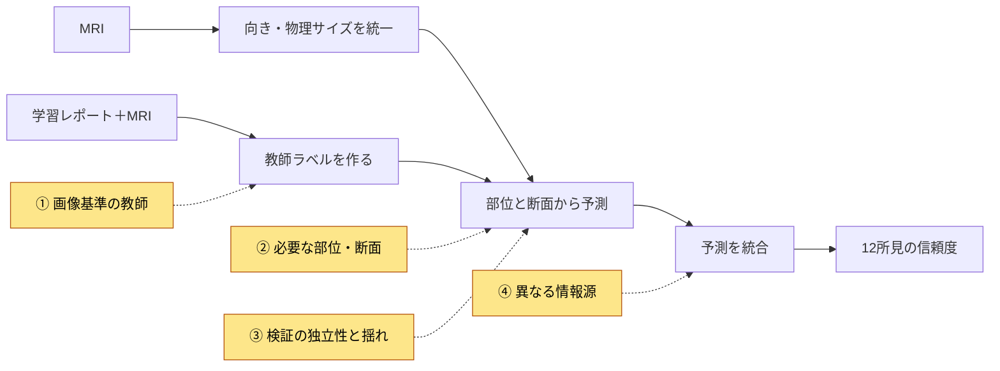
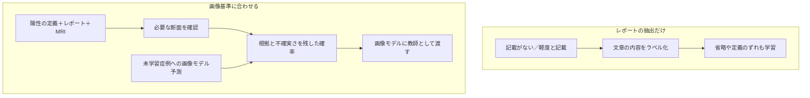

# RSNA Knee Abnormality Detection 上位解法まとめ — レポートの言葉を、画像で判定できる教師に変える

## はじめに

[RSNA Knee Abnormality Detection](https://www.kaggle.com/competitions/rsna-knee-abnormality-detection)は、膝のMRI検査から靱帯損傷、半月板損傷などを予測するコンペでした。提出期限は2026年10月22日（UTC）です。学習用の読影レポートは豊富でしたが、画像を専門医が評価した正解はごく少数しかありませんでした。

モデルの構成はさまざまでしたが、上位の大きな改善は共通した場所から生まれています。結論を先に書きます。

> **勝負の中心は、読影レポートに書かれたことをそのまま覚えるのではなく、コンペの基準で画像を評価するための教師を作ることでした。画像も調べる大規模言語モデルでラベルを補い、その判断の根拠になる部位や断面を、小さな画像モデルが十分に見られるようにします。**

本記事では、教師の作り方、画像の見せ方、検証の読み方、予測の組み合わせ方の4点を説明します。対象は最終順位1〜10位で、Kaggle CLIが公開するDiscussion全276件を確認し、7チーム・8投稿を収集しました。4位・6位・9位は、今回調べたDiscussion内では本人によるSolution投稿を特定できていません。順位とスコアは取得時点の公式リーダーボードに従い、投稿中の審査・順位確定に関する留保は残します。

## コンペ概要

### タスク

- **入力**: 1回の膝MRI検査に含まれる複数の画像列。1枚ずつの断面を「スライス」、同じ撮像条件で並んだ画像列を「シリーズ」と呼びます。学習時だけ読影レポートも使えます。
- **出力**: 検査ごとの12所見の信頼度。靱帯・半月板損傷、3部位の変形性関節症、関節液貯留、滑膜炎、ベーカー嚢腫、骨挫傷、骨折が対象です。
- **評価**: 所見ごとにROC AUCを求め、その単純平均を取ります。AUCは、陽性例を陰性例より高く並べられるかを見る指標です（[公式評価](https://www.kaggle.com/competitions/rsna-knee-abnormality-detection/overview/evaluation)）。

この指標には、直感に反する性質が3つあります。

1. **確率の絶対値より、同じ所見の中の順序が重要です。** 順序を変えない単調変換ならAUCは変わりません。ただし、複数モデルを平均するときは値の尺度が違うと影響力が変わるため、順位に変換して混ぜる意味があります。2位はこの性質を利用しました（[2位](https://www.kaggle.com/competitions/rsna-knee-abnormality-detection/discussion/752370)）。
2. **珍しい所見も、よくある所見も、最終スコアでは同じ重さです。** 症例数に比例した平均ではありません。上位では膝蓋大腿関節の変形性関節症など、弱い所見を補うモデルが使われました。全部の所見を少しずつ伸ばす以外にも改善経路があります（[3位](https://www.kaggle.com/competitions/rsna-knee-abnormality-detection/discussion/752510)）。
3. **レポート由来のラベルで高いAUCを出しても、採点対象に合うとは限りません。** 最終的には画像に基づく専門医の判断に合う必要があります。5位では、レポートラベルに対する検証AUCが同じでも、Private AUCには0.008の差がありました（[5位](https://www.kaggle.com/competitions/rsna-knee-abnormality-detection/discussion/752190)）。

### 提供データ

| データ | 内容 |
| --- | --- |
| 学習MRI | 4,407検査。複数施設・撮像装置・撮像条件を含む |
| 専門医ラベル | 58検査に12所見の正解。以下ではGold58と呼ぶ |
| 読影レポート | 学習検査に付属する多言語の自由文。残りの教師を作る材料 |
| シリーズ情報 | 撮像方向、液体を強調する撮像か、脂肪信号を抑える撮像かなど |
| テスト | 約1,300検査。レポートは提供されない |
| 実行条件 | インターネットなしのNotebookで9時間以内 |

データと実行条件は[公式データ説明](https://www.kaggle.com/competitions/rsna-knee-abnormality-detection/data)と[公式概要](https://www.kaggle.com/competitions/rsna-knee-abnormality-detection/overview)に基づきます。

### このコンペが難しい理由

- レポートに記載がないことは、画像に異常がないことを意味しません。
- 「軽度の損傷」などの表現が、コンペで定めた陽性条件を満たすとは限りません。
- 病変は小さく、特定の撮像方向や断面でしか見えない場合があります。
- 少数の専門医ラベルを何度も見て選ぶと、改善に見える偶然を拾います。
- 撮像施設の違いとレポートの書き方が結び付き、画像モデルが病変以外の手掛かりを覚え得ます。

| 用語 | 本記事での意味 |
| --- | --- |
| LLM | 大規模言語モデル。ここでは画像も扱えるモデルを含む |
| ソフトラベル | 0か1に決めず、0〜1の連続値で表した教師 |
| OOF | その症例を学習していない分割モデルによる予測 |
| CV | 手元のデータを分けて行う検証。分け方と正解の出所で意味が変わる |
| Public / Private | 公開評価用／最終評価用のテスト部分。LBはリーダーボード |
| ROI | 注目する解剖学的領域。病変そのものの位置とは区別する |
| 2.5D | 隣接する断面を色の3チャネルのように重ね、2D画像モデルへ渡す方法 |
| OA / PF OA | 変形性関節症／膝蓋骨と大腿骨の間の関節に生じる変形性関節症 |

## 上位解法の全体像

共通する骨格は「レポートと画像から教師を作る → MRIの位置と大きさをそろえる → 複数の断面から所見を予測する → 予測を組み合わせる」です。差がついたのは、下図で色をつけた4か所です。

LLMやレポートを使うのは教師作成時です。提出する画像モデルには、その時点で得た知識をソフトラベルや位置の教師として渡します。テストで同じ読影エージェントを動かす構成ではありません（[1位](https://www.kaggle.com/competitions/rsna-knee-abnormality-detection/discussion/752474)）。

## 1. レポートを写す教師から、画像で確かめる教師へ

この節が本記事の中心です。

**問題**: 診療用の文章と、コンペの正解は目的が違います。臨床上わざわざ記載しない軽い所見が、コンペでは陽性になることがあります。一方、異常が書かれていても、重症度が基準に届かなければ陰性です。単語を正確に抽出するだけでは、このずれを解消できません。

2位のGold58では、専門医が陽性とした所見は240件でしたが、レポートが述べた陽性は154件でした。PF OAでは差がさらに大きく、専門医の21件に対してレポートは2件です。これは単なる翻訳ミスではなく、文章に残っていない情報の問題です（[2位](https://www.kaggle.com/competitions/rsna-knee-abnormality-detection/discussion/752370)）。

**上位の対処**: コンペの陽性条件を明示し、LLMにレポートと画像の両方を確認させ、判断の不確実さを連続値で残しました。

- **1位**のsakakuは、追加断面や別の撮像条件を自分で要求できる読影エージェントを作りました。同じCoAtNetという画像モデルを使った比較で、従来の画像・文章ラベルを、画像も読むLLMのAstraが作ったラベルに置き換えると、Public AUCは0.922から0.935になりました。モデルの大型化ではなく、学習する答えの変更です（[1位・sakaku](https://www.kaggle.com/competitions/rsna-knee-abnormality-detection/discussion/752474)）。
- **2位**はレポートだけのラベルから、全画像も読むラベルへ進みました。Gold58との一致はAUC 0.899から0.942へ改善し、ラベル品質について最大の伸びだったと報告しています。この値は提出モデルのAUCではなく、作ったラベル自体の評価です（[2位](https://www.kaggle.com/competitions/rsna-knee-abnormality-detection/discussion/752370)）。

### 確率の品質は、順位の品質だけでは測れない

**なぜ効くか**: 「ありそうだが断定できない」をすべて陽性にすると、誤りにも強い学習信号を与えます。連続値なら、弱い根拠に対して弱い教師を渡せます。ただし、出力が小数であるだけでは十分ではなく、自信の強さが実態に合っている必要があります。

1位のtascjは、ラベルAUCが似ていても、誤った判断に強く自信を持つケースの数が違うことに気付きました。そこで、確率の外れ方を評価するlog lossも確認しました。LLMに画像の読み方を指示するガイドは、症例を分けた評価でAUCが同じでも、過信した誤りを減らしています（[1位・tascj](https://www.kaggle.com/competitions/rsna-knee-abnormality-detection/discussion/752468)）。

### 画像モデル自身の予測も、教師の補修に使う

上位では、最初の教師で画像モデルを育て、そのOOF予測を教師へ混ぜる方法も広く使われました。画像モデルは、レポートの表現とは異なる共通パターンを画像から学びます。そのため、文章やLLMの個別の読み違いをならす働きが期待できます。ただし、元の教師が間違っていれば、その誤りも継承します。

10位のCoAtNet系統では、画像だけを読むAstraの判断を導入したラウンドが最大の伸びでした。Privateでは約0.017改善しています。ただし、そのラウンドではチェックポイントの選び方も変わっており、画像ラベルだけの効果とは切り分けられません。後続ラウンドではOOF予測も混ぜ、複数の教師を育てています（[10位](https://www.kaggle.com/competitions/rsna-knee-abnormality-detection/discussion/752730)）。

### 外部データも、増やす前に正解の意味を合わせる

外部の膝MRIデータOAIを使ったチームでも、元の診断尺度をそのままコンペのラベルにはしていません。3位は専門医の評価と画像教師を混ぜ、対応が確かな項目とそれ以外を区別しました。10位も、外部データの評価項目をコンペの定義へ対応付け、根拠不足の項目を負例にせず、学習対象から外す仕組みを使いました（[3位](https://www.kaggle.com/competitions/rsna-knee-abnormality-detection/discussion/752510)、[10位](https://www.kaggle.com/competitions/rsna-knee-abnormality-detection/discussion/752730)）。

## 2. 全体を残しながら、必要な部位と断面を大きく見せる

**問題**: 膝全体を小さく縮めると、小さな病変に割り当てる画素が減ります。逆に拡大した部分だけを見せると、それがどこの組織なのか分かりにくくなります。断面を少なく抜き出せば、病変のある位置自体を飛ばすこともあります。

**上位の対処**: 画像の物理的な大きさと向きをそろえた上で、全体像と局所の情報を併用し、十分な断面と撮像条件を残しました。

- **5位**は骨の位置を推定し、膝関節、内側・外側、膝蓋大腿関節を拡大して、全体像に追加しました。同じラベルとモデルに解剖学的な切り出しを加えた段階で、Private AUCは0.954から0.957へ上がりました（[5位](https://www.kaggle.com/competitions/rsna-knee-abnormality-detection/discussion/752190)）。
- **8位**は保存する断面数を増やし、隣接関係を保つ画像列を用意しました。キャッシュを64枚から最大168枚に変えた比較では、Public AUCが0.930から0.937へ上がっています（[8位](https://www.kaggle.com/competitions/rsna-knee-abnormality-detection/discussion/752219)）。

**なぜ効くか**: 画像の縦横サイズが同じでも、写す実寸範囲を狭めれば、小さな構造が大きくなります。5位は全体像を150 mm、局所を80 mmの範囲で切り出しました。局所では同じ構造にほぼ倍の幅の画素を割けます。全体像も残すので、拡大した場所と周囲の関係を失いません（[5位](https://www.kaggle.com/competitions/rsna-knee-abnormality-detection/discussion/752190)）。

また、「枚数が十分」と「必要な情報がある」は同じではありません。5位ではPF OA専用モデルに、脂肪信号を抑えない撮像シリーズを追加することが、その所見に対する最大の単独改善でした。見やすい撮像条件だけを一律に選ぶと、特定の所見に有効な情報を捨てる可能性があります（[5位](https://www.kaggle.com/competitions/rsna-knee-abnormality-detection/discussion/752190)）。

### 学習時と推論時で、見る量が違う問題もある

多くの断面を一度に学習させるとメモリを使います。そのため少数の断面で学習し、推論で大量に見る構成では、情報をまとめる部分が学習時と異なる条件に置かれます。

8位は画像特徴を抽出する部分を固定してメモリを節約し、最後の集約部分をより多い断面で学び直しました。分類部分を初期化してから再学習すると、Gold AUCは0.9447から0.9507へ上がりました。これはGold上の結果ですが、画像を増やすだけでなく、増えた情報のまとめ方も合わせる必要があることを示しています（[8位](https://www.kaggle.com/competitions/rsna-knee-abnormality-detection/discussion/752219)）。

## 3. 検証の「正解」と「独立性」を別々に確かめる

**問題**: 大きな検証セットを作っても、正解がレポート由来なら、レポートに似た答えを出すモデルが高く評価されます。専門医の正解へ切り替えると、今度は症例が少なく、細かな比較が不安定になります。どちらも同じ「AUC」という名前ですが、測っているものは違います。

**上位の対処**: 専門医ラベル、LLM由来の参照ラベル、未知データのPublicを、それぞれ役割の違う物差しとして扱いました。

- **1位**のsakakuは、専門医の小さな検証では悪化して見えた学習率変更がPublicで改善する経験をしました。後期はより大きな固定検証集合と、固定したAstraラベルの混合を使い、学習ラベルを変えても評価の物差しが変わらないようにしました（[1位・sakaku](https://www.kaggle.com/competitions/rsna-knee-abnormality-detection/discussion/752474)）。
- **2位**は、Gold58を調整用と確認用に分けました。追加の画像読影は、調整用ではAUCが0.066上がったのに、確認用では0.019下がりました。小標本を何度も使った最適化が、良さそうなルールを生む具体例です（[2位](https://www.kaggle.com/competitions/rsna-knee-abnormality-detection/discussion/752370)）。

1位の大きな検証も、完全に独立したテストではありません。過去のPublicとの相関を参考に分割を選び、参照ラベルも学習教師に近い出所を持ちます。著者はこれを開発用の指標として位置付けています。実務上役立つ物差しであることと、最終性能を偏りなく推定できることを混同しないのが重要です（[1位・sakaku](https://www.kaggle.com/competitions/rsna-knee-abnormality-detection/discussion/752474)）。

### OOFと書いてあっても、教師の経路まで見る

OOFは、予測対象の症例を学習から外した予測です。ただし、そのOOFを次のモデルの教師に使うときは注意が必要です。次のモデルの学習症例に付けたOOFを、次の検証症例も学習した教師モデルが生成していれば、検証情報が教師経由で入り込みます。

5位はこの情報の混入可能性を明記しました。対して8位は、Gold評価の実験ではGold症例を教師の学習とOOF生成からも外しています。必要なのは「検証例が最終モデルに入ったか」だけでなく、「教師を作るどの経路から情報が届いたか」の確認です（[5位](https://www.kaggle.com/competitions/rsna-knee-abnormality-detection/discussion/752190)、[8位](https://www.kaggle.com/competitions/rsna-knee-abnormality-detection/discussion/752219)）。

## 4. モデルを増やす前に、違う証拠を持っているかを見る

**問題**: 同じラベルと同じ入力でモデル名だけを変えても、同じ見落としをする可能性があります。単体が強いモデルを足したことと、平均の誤りが減ったことは同じではありません。

**上位の対処**: 学習教師、見る範囲、集約方法などを変えた予測を組み合わせました。一方で、似た予測を増やしても伸びない例がありました。

- **1位**はラベルの作り方や、注目する位置の教え方が異なる2系統を組み合わせました。sakakuのモデル群とtascjのモデル群を等重みにして、最終Private AUCは0.960でした。これは最終結果であり、どの差が補完性を生んだかを単独で証明する比較ではありません（[1位・sakaku](https://www.kaggle.com/competitions/rsna-knee-abnormality-detection/discussion/752474)）。
- **7位**では、最良の単体モデルがPrivate 0.958なのに対し、複数モデルの平均は0.957でした。Publicでは平均が上でしたが、同じ入力・教師・集約方法を共有する構成では、最終評価の改善に結び付きませんでした（[7位](https://www.kaggle.com/competitions/rsna-knee-abnormality-detection/discussion/752217)）。

**なぜ効くか**: 同じ部位を同じように見落とすモデルを平均しても、その部位は見えません。一方、全体像を読むモデルと局所の証拠に強いモデル、異なる読み方から教師を得たモデルなら、一方の誤りを他方が補う余地があります。補完性はモデルの種類の数ではなく、実際の予測を混ぜて確かめる必要があります。

### 補足：そのほかに効いた工夫

| 工夫 | なぜ効くか | 代表例 |
| --- | --- | --- |
| 病院ごとの記述癖を教師から補正 | 画像上の異常より、文章の用語習慣を覚えることを抑える狙い | 7位：滑膜炎の記載の有無でLLM陽性率が92%対6%。施設内順位を保って補正（[7位](https://www.kaggle.com/competitions/rsna-knee-abnormality-detection/discussion/752217)） |
| 位置の教師を学習時だけ利用 | 推論に注釈作成の重い処理を持ち込まず、注目先を教える | 1位：解剖学的な領域と集約の一式でPublic 0.956→0.960（[1位](https://www.kaggle.com/competitions/rsna-knee-abnormality-detection/discussion/752474)） |
| 予測の尺度を直してから教師へ混ぜる | 学習の重み付けで上振れした値を、そのまま正解へ戻さない | 8位：補正済みOOFを40%混ぜて再学習（[8位](https://www.kaggle.com/competitions/rsna-knee-abnormality-detection/discussion/752219)） |
| 推論の前処理をモデル間で共有 | 同じ画像の復号や骨の推定を繰り返さず、時間を確保する | 5位：ベースモデルのGPU時間を約42%節約（[5位](https://www.kaggle.com/competitions/rsna-knee-abnormality-detection/discussion/752190)） |
| 弱い所見だけ補助モデルの票を足す | 他の所見の良い予測を変えずに補完する | 2位：専用モデルの寄与は対象所見の20%（[2位](https://www.kaggle.com/competitions/rsna-knee-abnormality-detection/discussion/752370)） |

## 上位解法から見えた、特に重要な発見

### 正解が少ないときは、モデルより教師の設計が先に効く

第1節の改善は、学習画像を増やさなくても、同じ画像から何を学ばせるかを変えられることを示します。レポートと画像は欠けている情報が異なるため、両方を突き合わせた教師が重要でした。流暢な説明の生成だけで満足せず、その教師で学んだ画像モデルの性能まで確かめる必要があります（[1位](https://www.kaggle.com/competitions/rsna-knee-abnormality-detection/discussion/752474)）。

### 「何があるか」と「どこを見るか」は別の教師になる

検査全体のラベルは、病変が存在しそうかを教えますが、画像内の位置までは教えません。第2節では、解剖学的な領域や局所拡大が、その不足を補いました。正常な半月板にもROIはあるため、解剖の位置を示すことと病変を示すことは区別します（[1位](https://www.kaggle.com/competitions/rsna-knee-abnormality-detection/discussion/752474)）。

### 良い開発指標と、公平な最終評価は役割が違う

第3節のように、偏りのある指標でも、変更の方向を見分けるために役立つ場合があります。しかし、反復利用した少数症例や、教師と同じ出所のラベルで得た差を、そのまま未知データへの保証にはできません。開発に使った情報の経路まで含めて、結果の強さを判断します（[5位](https://www.kaggle.com/competitions/rsna-knee-abnormality-detection/discussion/752190)）。

## うまくいかなかったアプローチ

- **ラベル作成器へ専門医の答えを先に見せる**: 2位では答えを写し、そこから作ったルールを答えなしで使うとAUCは0.80でした。評価したいのは未知の症例を読む能力です（[2位](https://www.kaggle.com/competitions/rsna-knee-abnormality-detection/discussion/752370)）。
- **拡大領域だけに絞る**: 2位では外側半月板の評価が0.010悪化し、全体像を戻す必要がありました。細部を増やす際も文脈を残します（[2位](https://www.kaggle.com/competitions/rsna-knee-abnormality-detection/discussion/752370)）。
- **小さな検証集合で混合重みを細かく調整する**: 2位の調整した重みは、固定重みに対して確認用症例で0.002〜0.007負けました。自由度を増やすほど確認用の証拠が必要です（[2位](https://www.kaggle.com/competitions/rsna-knee-abnormality-detection/discussion/752370)）。
- **外部データは全部使えばよいと考える**: 3位では同じ教師混合比でも、全OAIを使う設定が一部を抽出する設定に負けました。更新回数も変わる比較ですが、増量の利益は自明ではありません（[3位](https://www.kaggle.com/competitions/rsna-knee-abnormality-detection/discussion/752510)）。
- **画像教師の混合比をさらに細かく追い込む**: 8位では重みを追加探索しても、Publicはともに0.954でした。微小なGold差に合わせず、元の重みを維持しています（[8位](https://www.kaggle.com/competitions/rsna-knee-abnormality-detection/discussion/752219)）。
- **同じ構成のモデルを増やせばPrivateも上がると考える**: 7位では平均が最良単体を上回りませんでした。種類を増やす前に、誤り方が変わったかを確認します（[7位](https://www.kaggle.com/competitions/rsna-knee-abnormality-detection/discussion/752217)）。

共通するのは、計算量や調整回数を増やしても、学習する情報の不足と検証の不確実さは自動的には解消しないことです。

## まとめ

上位解法の流れを6行にまとめると、次のとおりです。

1. コンペの陽性定義と、レポートに残る情報の違いを調べる。
2. 画像も確認する教師を作り、不確実さをソフトラベルに残す。
3. 画像モデルのOOF予測を補助教師に使い、元の情報と評価の独立性を守る。
4. 向きと実寸をそろえ、全体像・局所・必要な断面を十分に見せる。
5. 評価ラベルの意味、小標本の揺れ、教師を経由する情報混入を点検する。
6. 異なる証拠を持つモデルを、推論時間も考えて組み合わせる。

> **弱い教師を大量に集める前に、最終的に何を見て判定されるかを合わせる。その判定に必要な証拠を、教師にも学習モデルにも届ける。**

この考え方は、画像と診療文書のように、学習時だけ豊かな補助情報があるタスクに応用できます。補助情報と最終評価の定義が異なる場合ほど、ラベル作成そのものを独立した開発対象にする価値があります。

## 参照した上位Solution

全投稿を原文・日本語PDFとして保存しています。以下は取得時の公式順位との対応です。

| 順位 | チーム | 一言で言うと | 投稿 |
| --- | --- | --- | --- |
| 1位 | Team Kangaroo🦘 | 読影エージェントと位置の教師を画像モデルへ渡す | [tascj](https://www.kaggle.com/competitions/rsna-knee-abnormality-detection/discussion/752468)、[sakaku](https://www.kaggle.com/competitions/rsna-knee-abnormality-detection/discussion/752474) |
| 2位 | MURAD | 画像で教師を補い、異なる拡大視野を組み合わせる | [Solution](https://www.kaggle.com/competitions/rsna-knee-abnormality-detection/discussion/752370) |
| 3位 | DataTech Club | 教師と入力の異なるモデルへ群ごとに重みを配る | [Solution](https://www.kaggle.com/competitions/rsna-knee-abnormality-detection/discussion/752510) |
| 5位 | RB & Matheus & Tucker & Tony | 教師を校正し、骨を目印に局所を大きく見る | [Solution](https://www.kaggle.com/competitions/rsna-knee-abnormality-detection/discussion/752190) |
| 7位 | Barry | 画像確認と施設差補正で強い教師を作る | [Solution](https://www.kaggle.com/competitions/rsna-knee-abnormality-detection/discussion/752217) |
| 8位 | joinT fusion | 教師を改善し、多数の断面をまとめる部分も学び直す | [Solution](https://www.kaggle.com/competitions/rsna-knee-abnormality-detection/discussion/752219) |
| 10位 | MEJAL | 教師と断面集約の異なる2系統を統合する | [Solution](https://www.kaggle.com/competitions/rsna-knee-abnormality-detection/discussion/752730) |

4位（Ilya Kolb）、6位（CentralyDS）、9位（Parag & Ian & Dieter & CroDoc）は、今回確認したKaggle CLI経由のDiscussionでは本人のSolution投稿を特定できませんでした。投稿が存在しないと断定するものではありません。
